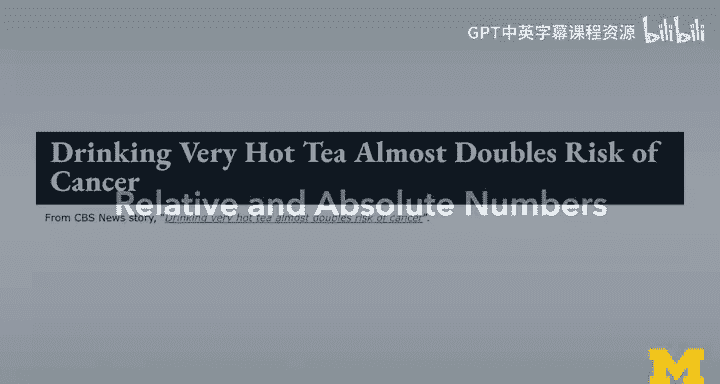
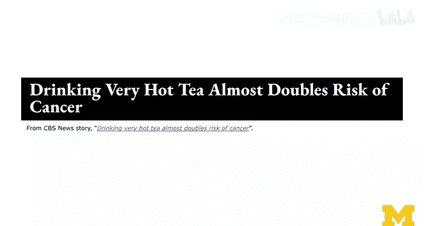
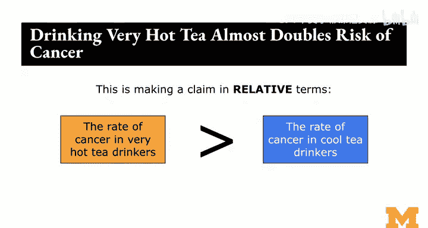
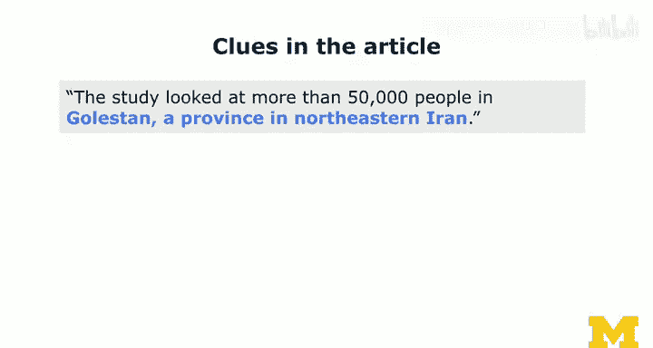
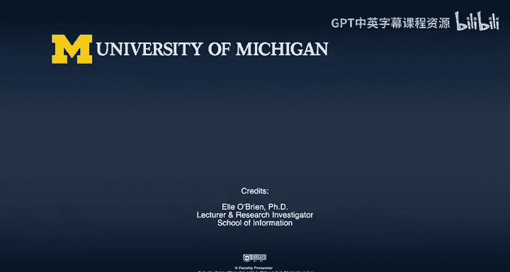

# 密歇根大学《理解数据：导航统计、科学和AI-Understanding Data Navigating Statistics, Science, and AI》 - P18：17_相对数与绝对数.zh_en - GPT中英字幕课程资源 - BV1pU4NzuEvt

Here's a pretty scary looking news headline， drinking very hot tea almost doubles risk of cancer。

Now， if we get past how scary this sounds and we just start to look at it。

 we might see that this is making a claim in relative terms。

We're looking at the rate of cancer among very hot tea drinkers compared to in cool tea drinkers。

 and there's a claim that the rate is higher in the very hot tea drinkers group。

But something to watch out for with relative statements like this is that they have a way of sounding scarier than absolute numbers。

 so if we look at the absolute numbers that are presented in the study。

 it turns out that for very hot tea drinkers out of every 10。

000 or so people will get 80 cancer cases and among cool tea drinkers， there were 57 for every 10。

000 people。So it's definitely still a higher number among the very hot tea drinkers。

 but this isn't quite as horrifying to look at， partially because these numbers， you know， 80 and 10。

000 is still not terribly high， right that could turn out to be a lot in the long run。

 but odds are most people still are not getting cancer。In fact。

 the rarer in event is in absolute terms， the more drastic any relative comparison is going to sound。

 so here's a hypothetical， what if there were only one case of cancer among 10。

000 cool tea drinkers and two among very hot tea drinkers which could just be chance right I mean sometimes you'll just get slightly more cancer cases and other times even if in fact the rates were truly the same。

 well now we would have double the rate of cancer。If there were three cases among the very hot tea drinkers。

 then we've tripled the risk of cancer， and if there were four， we have quadrupled。

 even though it is still in absolute terms， fairly uncommon for anybody in that group to be getting cancer。

Here's another way that this can be said， this is an example from the Cancer Research UK。

 a helpful blog。The imaginary headline cushions double the risk of cancer sounds scary。

 This is what's called a relative risk。 If you were told cushions double the chance of developing cancer from one in a million to two in a million。

 that's still a very small， absolute risk。 The absolute risk here is two in a million right。

 that is the risk for people who use cushions， but it's not very big still。

 most people out of those million do not get cancer。And for many people。

 living without cushions wouldn't be worth this tiny increase okay。

 so would you give up a cushion over a number like this， probably not。

 even though it is technically true that the cushion group had doubled the rate of cancer。

So should we be avoiding reporting numbers in relative terms entirely？

I don't think we should necessarily go that far， I think what happens here is that different styles of reporting are appropriate for different contexts and sometimes things get mistranslated。

 so I think when the tea drinking study was published it was in a public health journal so it was for other scientists who practice public health。

And so those scientists think about populations in the world。

 they think about whole countries and continents， so they're thinking about thousands to millions to even billions of people。

 so if the cancer rate were absolutely small but doubled for a fairly large population。

 that could still come out to a lot of cases in the whole world and it's still possibly worth interest to people who work on public health。

But for an individual， just me reading my paper， trying to decide if I should drink tea。

 it doesn't help me know how likely I am to get cancer or you know。

 maybe maybe I should take that risk because there's other benefits of tea drinking。

 I'm not really sure from that sort of number。So would I stop drinking tea over this。

 no for a couple reasons one of them is that I still don't have enough information even if it were established that the risks were higher for drinking tea。

 maybe there were other benefits and I don't have information on that generally I think it's very hard for me to personally parse out risks because I take risks every day and I often don't really think about how big or small they are you know in absolute terms so I don't really know what would be the cutoff personally for you know choosing if a risk is high enough to change know change my behavior over I actually kind of need more help on that and related to that is that you know for me I usually ask my doctor about things like this so I would ask them about you know does it are other doctor seeing this sort of study and saying I should change my behavior and I would kind of trust an expert to help me wade through that because it's pretty challenging to do on my own Of course it's not always feasible。

I know that not everybody has access to a doctor。And so you know， sometimes it's worth finding。

 you know， is there somebody in your community， is there a public health agency that you trust looking for somebody who's an expert that you trust that you know would give you reliable information about when something has risen to the level of being you know risky enough that they're advising people broadly change their behavior。

 but without without some kind of broader statement like that。

 I usually don't follow individual news stories like this， they can just be too noisy。

But finally there's a hint in the article itself that I actually think kind of ingates the first who。

 even if I didn't feel like 0。1 and2 applied， I think the article actually gives a pretty good reason for me not to listen to it and so later in the article far down after talking about how high the cancer risk is increased it says the study looked at more than 50000 people in Golisttan a province in Northeastern Iran and I don't live there I don't live anywhere close to there I live in Michigan in the United States and here's maybe the really key part in the United States and Europe tea is rarely consumed at temperatures above 65 degrees Celsius but in places like Russia。

 Iran， Turkey and South America it is common to drink tea that hot or even hotter so in fact the behavior that was being studied drinking tea above 65 degrees Celsius it actually pretty rare where I live so it's actually probably not likely that I am regularly drinking tea like in the study and so for that reason I would say。

The study is not actually examining behavior that's very similar to mine。

 it's got a context and it applies to people of a particular culture in a particular place and that headline about cancer risk being doubled really does not take into account that I might not be you similar enough to the study population for the result to generalize to my own circumstances。

 so for me I would say this should stay a public health interest story for people who are working on health policy in this part of the world。

 but I'm not convinced that this is enough for me to stop drinking any tea at the very lukewarm temperature that I tend to drink it at。

