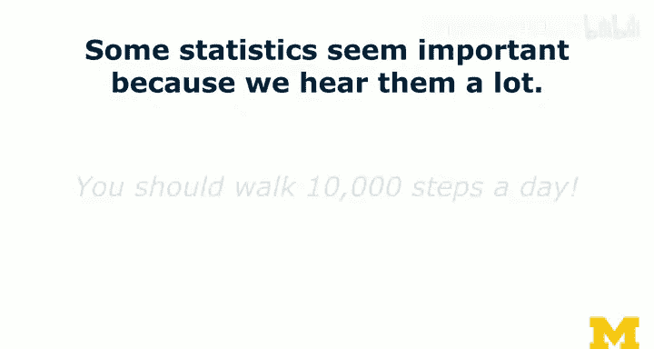
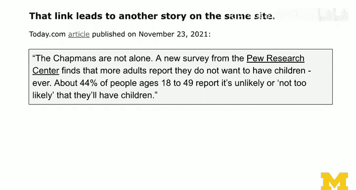
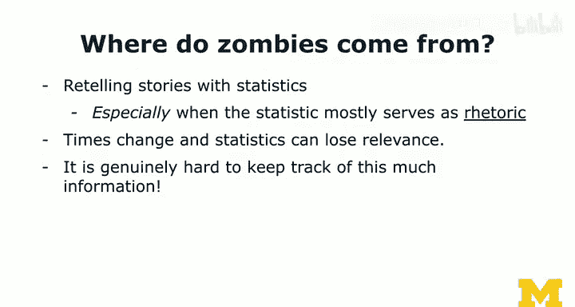

# 密歇根大学《理解数据：导航统计、科学和AI-Understanding Data Navigating Statistics, Science, and AI》 - P19：18_僵尸统计数据解析.zh_en - GPT中英字幕课程资源 - BV1pU4NzuEvt

A lot of statistics seem to just live in the ether out in the world and we're not really sure where they came from。

 but because we hear them a lot， they sound so important。 One example is that you should walk 10。

000 steps a day。 Where does this actually come from Was it a large study I it the guidance of a public health agency。

Not exactly， it turns out that it comes from an advertisement for a pedometer from Japan in the 1960s called the Manpo meter。

 it turns out that Japanese walking clubs embraced a pedometer manufacturer's nickname for their product。

 Manpoquet， which literally means the 10，000 steps meter。Scientific no。

 seems like it came up because that was a catchy name for this device and it has stuck with us ever since。

That's one example of how over many retellings we can lose critical context about a number here's an example that I encountered I was reading an article on today。

com about motherhood and it said that now a survey by the Pew Research Center has found that 44% of Americans say it's unlikely or not too likely that they'll have kids ever and that line had a link so I followed it。

And I said， okay， where is it going go and I looked for the citation and it went to another news story on the same site that read the Chapmans are not alone。

 a new survey from the Pew Research Center finds that more adults report they do not want to have children ever about 44% of people ages 18 to 49 report it's unlikely or not too likely that they'll ever have children okay that's a lot 44% of people in that age bracket I really wanted to check that number because it was really differing from my own observations about the world in my own life and so I went and I clicked on the Pew Research Center study。

It turns out that this is what was actually said by Pew research。

 some 44% of nonparents ages 18 to 49 say it is not to or not at all likely that they will have children someday。

 so we're talking actually about nonparents so 44% of people who don't already have kids is what the original study said。

And somehow over these retellings， it turned into 44% of Americans and those are very different right。

 for people who don't already have kids in the age bracket of 18 to 49 is definitely not the same as Americans so you could really get very different interpretations of this number and indeed this is being used to very different to a very dramatic effect over the course of of these blogs that just link to one another。

Another thing that can happen other than outright forgetting a critical piece of a statistics context is that sometimes people make subtle writing choices and that just alters the statistics meaning so here was an article I saw that was about how to be happy the science shows that our circumstances。

 how rich we are， what job we have， what material possessions we own these things matter less for happiness than we think Santos says and then research does show that wealthier people are happier than poorer people but not by a ton okay so I went and clicked on that study what does it actually say and it turns out that the study was not really about wealth but it was about income while numerous studies have documented the modest though reliable link between household income and well-being now I would argue I think it's actually the this is subtle but income is not really the same as wealth right because of income is about you know how much money you're making。

On a monthly or yearly basis， but wealth is about all your assets and at least in the United States。

 you know I know lots of people who have a low income but they have high wealth and that could be because of their wealth is what lets them work in a low income environment and so there really is not always in my experience very strong link between those two and I don't think that that necessarily challenges the validity of this study or its usefulness or even its relevance necessarily。

 but I think it's important to remember that having a lot of assets like having maybe a house in your family or having parents that are wealthy or getting an inheritance。

 those are all different from income and so income might not be the best way to measure somebody's wealth。

Finally， a statistic could also be out of date， so let's go back to our example about divorce。

 so we already talked about why this number is a little bit challenging because the unit here is not really what people think it is but if even if this was you know even if this was like a good great way of measuring the odds that I'm going to experience divorce there's still a problem and that's that the divorce rate has been changing and the divorce rate was highest around 1980 and has been declining almost ever since in the United States。

So for example， here we've got a chart about divorces per 1，000 people。

 which is a different way of measuring how common divorce is and we've put in a line around 1980。

And we can see that in the United States that that number has been declining so when people are talking about how high the divorce rate is it's often because they used to be more true than it is now and they're not accounting for the fact that this has actually changed quite a bit and so I know for a fact that you know my mom heard this statistic when she was getting married before I was born and so it's kind of wild that the same statistic gets used even though the circumstances have actually drifted quite a bit so where do these zombie statistics come from right statistics that just keep living on and take on a life of their own that is really past their usefulness。

One way is that when we're retelling stories with statistics。

 we often use the statistics in a kind of casual way I think this happens a lot when the statistic is meant to serve as rhetoric not as something that we collectively trying to understand so for example in that today article about people choosing not to have kids the article wasn't really about the statistics of you know what are the trends in who was choosing to have kids or not anymore it was really a personal story about one mother reflecting on motherhood and so what I suspect happened is she was writing and maybe an editor said you know a way that you could make this story sound even better as if you add some statistics and because that was the advice I got when I was a kid when I was writing an essay or a piece of nonfiction。

 it was almost always advised that I add statistics to it but the issue with that is that when the statistics is not really front and center it's really just employed as like a bit of window dressing to kind of help set the stage for the story。

Then we were're sometimes prone to just copying and pasting or going oh well somebody else used it here so I'm going to use it here。

 you know I think this happens even in science writing that in science technical writing when we write manuscripts reporting things scientists often have to cite a lot of things to show what they've already you show what the other work is that's related but it can be hard to read all of it closely so we have limited time and when under pressure。

 we just want to add statistics to bolster an argument。

 sometimes it's easy to forget to trace them back to where they came from Another thing is that times change and statistics can lose relevance as in this marriage statistics。

 but oftentimes once something is out there in the world and it's kind of become like a cultural icon and we're all talking about it it can be very hard to correct that and going around and correcting everybody is often very frustrating and not a kind of thing to do all the time。

I don't have an easy fix for this， but times change and statistics drift。And also。

 it really is genuinely hard to keep track of as much information is out there。

You know there's just a lot of studies， there's a lot of numbers and you know we want to talk about them and every time we do we move them a little bit farther from their original context and it can be tricky to keep track of where does every number come from so I think we should expect these errors to happen some of the time even if we you know are really diligent about them to some extent it's going to be a little bit unavoidable but you know it's still worth knowing about because of you know these zombies can they can really get in the way of us seeing what's really happening they can be stand ins for knowledge that really they take us away from having a moment to look at something freshly and when we look at you know when we look at where statistics come from with fresh eyes sometimes we'll see something something that's much more interesting or compelling or usually closer to the truth than we could get by just using the zombies。

