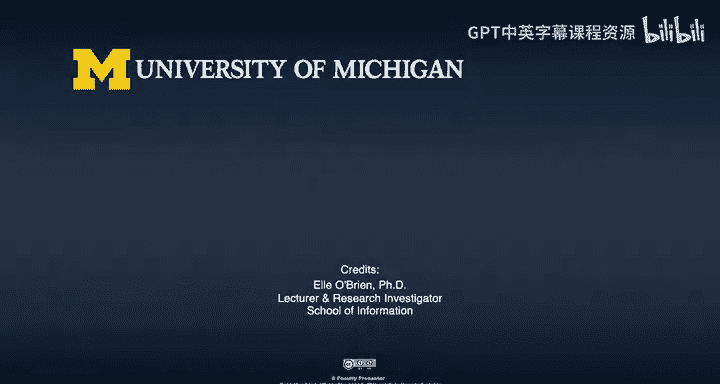
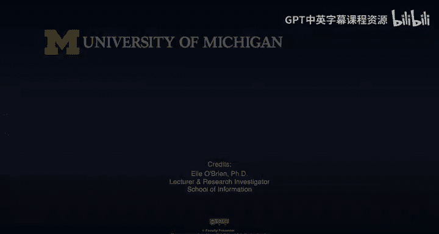

# 密歇根大学《理解数据：导航统计、科学和AI-Understanding Data Navigating Statistics, Science, and AI》 - P1：0_欢迎来到《理解数据：导航统计、科学与人工智能》.zh_en - GPT中英字幕课程资源 - BV1pU4NzuEvt

Hi， I'm El O'brien， lecturer and researcher at the University of Michigan。

 Welcome to Understanding data， Navigating Statistic Science and AI。

In this specialization we're going to explore some big ideas about how we make sense of。

 learn from and make predictions with data I'm so excited that you've joined us。First。

 let me tell you a little about myself。My background is in science research specifically I specialized in auditory neuroscience。

 which means I studied how our brains make sense of sound my training involved a lot of mathematical modeling using math and computers to explain and predict things that are hard to measure directly in people I'll share more about this through examples you'll see in class。

Today I work at the School of Information at the University of Michigan as part of the teaching faculty。

 I teach data science and statistics classes for students from a wide variety of backgrounds。

 that's something I love about working here。I also conduct research about how scientists in many areas of research work with complicated data and software。

There are so many different ways that somebody could teach about data because as we will see shortly。

 data is everywhere we look and there are many reasons to create and use it。

Think of this specialization as a brief guided tour through some big ideas in modern thinking about making meaning and value from data。

Remember that this tour is far from exhaustive and my choices for what concepts to emphasize are of course influenced by my particular science background that means you might notice that teaching examples skewew towards research about human health。

Additionally， this specialization will include no algebra or programming problems our goal is to build intuition and familiarity with big ideas perhaps you'll become interested as you follow along in taking some further classes where you will get into some equations or some coding so you can analyze data or build a predictive model yourself。

 or if you're already quite experienced with working with data。

 this class might help you zoom out to see your work in a bigger context。In the first course。

 we'll learn about what data is and how we use statistics to make sense of patterns。

 we'll also spend time developing our intuition for thinking and talking about numbers。

 with an emphasis on spotting and avoiding misleading statements involving statistics。

In the second course the look at how science connects data with our understanding of the world to help us create new knowledge。

 I've tried to make the science class that I would have wanted to take when I was first learning how research works。

 we'll also explore how science reaches the public， what can get left out。

 and how to reason about scientific sounding claims you might encounter in your life。Finally。

 we'll talk about artificial intelligence and machine learning。

 we'll try to clear up some big confusions about what these terms mean。

 give some insight into how these systems often work and how they can go wrong。

 and give you important strategies to ask questions when someone is telling you about AI。

Although you can take these courses separately， I think you'll get the most out of the specialization if you take them in order。

 if you do， I suspect you'll see some recurring themes， keep an eye out for these through lines。

No matter where you are coming from or where you hope to go。

 I hope this specialization offers something of value to you， Most of all。

 I hope it helps you see that when we talk about data， we are never just talking about numbers。

 we are talking about things that matter to us and just by being you。

 you also get to decide what matters。

