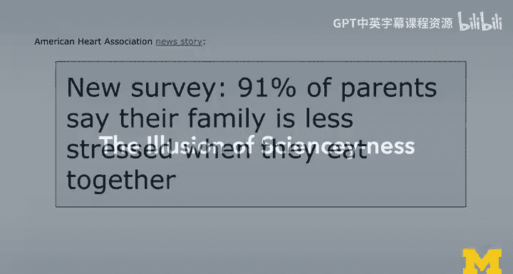
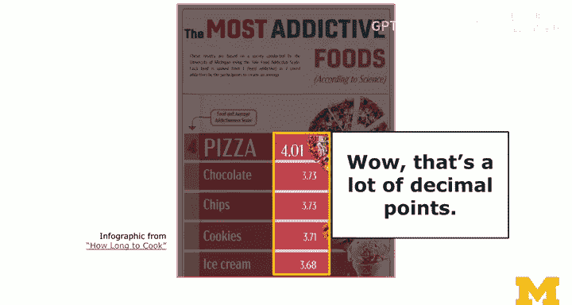
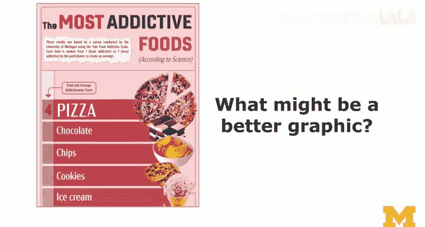
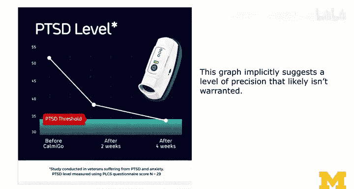
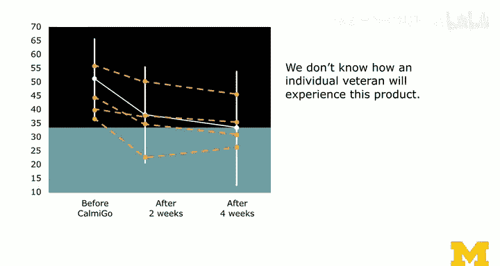
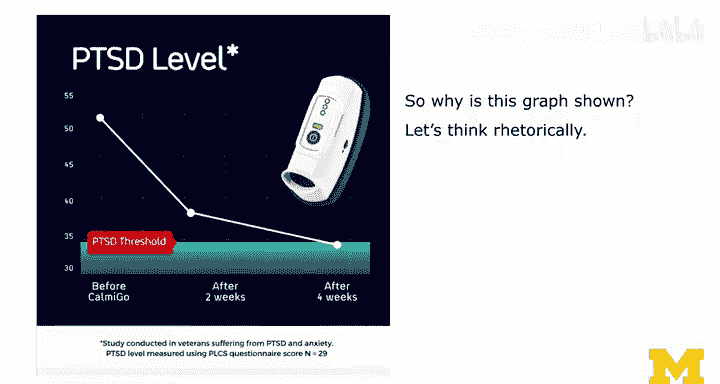

# 密歇根大学《理解数据：导航统计、科学和AI-Understanding Data Navigating Statistics, Science, and AI》 - P20：19_伪科学性的表象.zh_en - GPT中英字幕课程资源 - BV1pU4NzuEvt

Recently， I saw a headline that read new survey， 91% of parents say their family is less stressed when they eat together。

Now I think that sounds pretty sciencey and what I mean by that is that we've got this number 91%。

 oh that is so precise， it sounds so exact。But when I actually read the news article and looked at the study。

 it turned out that the margin of error for the study was about three points that means that assuming the survey was well designed then that actually means that the true value of parents that reported being less stressed when they ate with their family was between 88 and 94% so is it 91% I don't know I mean if this were me writing this I wouldn't be sure enough to say 91% I would probably say 90% or maybe 9 in 10 and I start to feel a little bit suspicious that like why did they keep the 91% and I think that that might be。

You know， sometimes I think that's because of 91% just sounds so good and it kind of acts like a bit of a credential。

 like how could we have gotten a number this precise if we weren't doing really。

 really good and powerful science？And so I tend to feel a little bit uncomfortable with numbers like this when the numbers sounds precise。

 but the actual margin of error is maybe much larger， Here's another example that I found online。

 this is an infographic of the most addictive foods according to science and what this is doing is showing numbers from a study that happened at the University of Michigan coincidentally where participants were asked to rate various foods on a 1 to 7 point scale of how addictive they found it and so the average together all of their ratings and so for pizza the average rating was 4。

01 for chocolate it was 3。73 for cookies it was 3。71 so some people came together and decided to turn that study into an infographic。

Now。I don't love something about this。 I feel taken aback by how many decimal points there are here。

 There are two decimal points of precision so pizza is not you know a four on the addictiveness scale it's 4。

01 and chips are 3。73 and that is a 0。02 point difference from cookies so wow that's really suggesting with you know a lot of precision it feels very certain that chips are more addictive than cookies but I have trouble believing that personally so and I did go back and look at the studies and you know it was hard to put together exactly what the margin of error is but there is no way that it is small enough for us to be able to detect a difference between chips and cookies at this level remember that there's that margin of error around every number they're kind of fuzzy these numbers are these are way fuzzier than is being suggested by。

Two decimal points。So if we were to improve this， we could you know we could cut out one decimal point maybe maybe we want to say that pizza was an average of four and all of these other foods got around a 3。

7 right so this this starts to you know give a more coarse representation of the number and even though that looks a little less you know perfect in scienceency and precise it's maybe more honest to how you know what level of differences are we able to resolve right we couldn't really resolve that chips are more addictive than cookies based on the fuzziness built into the study and the fact that we're just taking a rough average we actually think they're pretty similar。

And we could go even further and we could just remove the numbers and we could just say all of these are foods that were around。

 you know， the upper end of the addictive food scale personally。

 this is what I think is correct or you know ideal for a general audience because it doesn't imply more precision than we really have。

Another example is we could look back at this graph， remember this。

 this was from our the advertisement that I was served about this inhaler that could treat posttraumatic stress disorder at home and they were showing this graph of how PTSD level which was a unit I was having some trouble parsing changes over time and it turns out that that level is from a questionnaire and they implemented the questionnaire in 29 people。

 I still don't know what a typical score on that questionnaire is or how much of a difference you would need on your questionnaire to feel like you'd really gotten a meaningful change from the device。

 but let's ignore that and just keep going with this example。

Now the graph is actually suggesting a level of precision that I think is not quite warranted and by this。

 I mean look at where those points are right so what we're seeing is that we have a point before before the tool was used we have about 50 on the score after two weeks it's close it's between 35 and 40 and later it's around 35。

But those， you know， the fact that we're using dots here is a choice that I think suggests a kind of sureness about what the levels are that we don't really have。

Remember that every measurement has a range of plausible values that's based on the margin of error of the measurement device and remember that each of these points is the average score of 29 participants so a margin of error sometimes looks like this it's like we would draw some little lines around our point to say what's the neighborhood that's plausible and based on the data on that has been published by the company we tried to reconstruct it as well as we could and these are what the margins of error actually look like so in the group before commami go before the device it looks like where scores ranging from about 35 to 65 after two weeks know we still got a pretty big range and after four weeks it looks like the range is maybe even a little bit larger so in fact the plausible values that you the score average score could take are there is a lot of variability in there and here。

It' even more nuanced， but I think even more important point。

Is that this represents the average of users， but when you actually use the device what you get is not the average result。

 you get your result and many individual could have different results with this device so I've plotted an orange dashed line here what an individual user's results could look like so maybe this person gets a fairly slight benefit or you know it could be a similar pattern but lower somebody could get very。

 very little benefit， somebody could maybe you know get all big benefit on the first measurement but then go back up we don't really know the truth is is that when we look at only averages it obscures that we don't know how an individual veteran is going to experience this product。

So why is this graph shown at all， I think that it mostly serves a rhetorical function of indicating that look。

Things get better when using this and it does communicate， things got better。

 but I think it doesn't do a good job of explaining if you were to use this device。

 what would you expect， what are the possible outcomes that you personally could see and in that there's quite a lot of variability and I think that if this chart were serious about showing you what kind of benefits are you going to see then we would have had the scale translated into something that was you par to a typical a typical user of the device it's possible that people who use the device are super familiar with the questionnaire because of maybe they have since they have PTSD they're getting it measured on this questionnaire a lot。

 maybe it's very familiar but I doubt that I doubt that it's really common knowledge and so what I really would want to see here to know you should I be using this is what kind of benefits are people reporting。

 what does it feel like， what does it really feel like to go from 50 to 45 on that scale。

That would be the information that I would really need to see so I think this serves a mostly rhetorical point to say look the device works。

 but I don't think it really explains what somebody should expect from it because you know there is going to be a lot of variability people are very different。

 especially when it comes to treating things like post-traumatic stress disorder。

 so you know there's just a lot more variability and outcomes than is being shown here。

