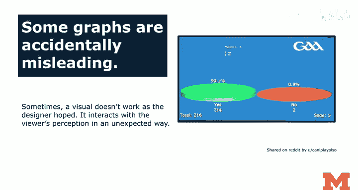
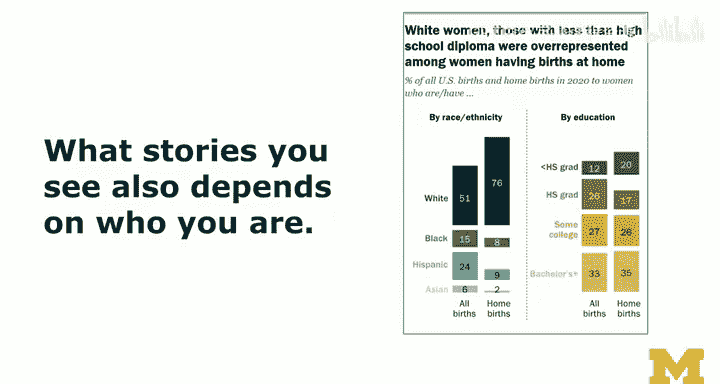

# 密歇根大学《理解数据：导航统计、科学和AI-Understanding Data Navigating Statistics, Science, and AI》 - P21：20_数据可视化的优势与局限.zh_en - GPT中英字幕课程资源 - BV1pU4NzuEvt

Let's talk about strengths and weaknesses of data visualization。

You might have seen a misleading graph before so take a look at this one what seems misleading Well we have a difference in what the numbers are suggesting versus the picture looking at the difference in the numbers。

 it's 29% of people in this survey said yes they're in favor of increased pandemic related restrictions one percentage point more 30% said no we so small difference it seems like but then with this picture it looks like that's quite a sizable difference so we kind of get a different impression from the numbers as from the picture。

And you know what you might be feeling here is manipulated by the maker of the visualization it's possible this was an accident。

 but at least for me， it makes me wonder， are they trying to get a certain emotion out of me with this picture？

Now some graphs are misleading mostly by accident this is what I'm pretty sure is an accident first to set the stage we have two KPop bands weekly and red velvet and a fan on the internet decided to make a graph of the average height of different members of various KPop band so weekly it looks like has an average height they're the tallest on average I guess they took the heights of all the individual members they averaged them and that came out to about five foot6 and red velvet is an average of about five foot3 so that's a fairly fairly small difference but looking at this picture it seems that the members of weekly would simply tower over the members of red velvet it looks like they're just completely different scales。

And I think what's happening here is that the visual just isn't working as the designer had hoped。

 so the perception of you know these different icons creates an impression of just a much larger difference than there really is so here we can see that if we draw these dashed lines to say okay。

 so what's the heights of you know weekly and red velvet wow that looks like a huge difference？😊。

Now in fact， the real difference in the heights if we had you know tried to graph it more realistically is actually very subtle。

 the average difference in their heights is quite you know it's only a matter of about three inches that the average height of a weekly member is about five6 and the average height of a red velvet member is53 and choosing different iconography we could maybe make a you know a more accurate depiction of the magnitude of that difference here's another example so this is some data from a vote I believe in Ireland I just found this on the internet and thought it was interesting and it looks like the designer of the graph thought it would be cool to introduce a threedimenional element so that the height of these cylinders would tell us how you know how much of the vote had gone in favor of yes or no but unfortunately it's very hard to discern the differences in the height of these cylinders the way this is visually presented and so it looks like there's barely any difference at least。

To me that's how it looks when in fact there's 99。1% of people voted yes and less than 1% voted no so a quite dramatic difference but that difference is really hard to detect now some graphs are just plain confusing this is when I found exploring UNICEF which has data about you know countries all over the world and it looks like the data is about various investments that they have and some kind of supply but to me this is simply overwhelming I'm not sure what to look atm not sure how to read it so very confusing to me。

So why does this happen？It might help to remember why we visualize data in the first place。

So a quick question which would you rather have if you wanted to understand something about flight delays at New York City Air。

 something that you might remember from earlier videos。

 would you rather have this chart depicting you know the frequency of various flight delays。

 or would you rather have a table of the raw data， just over 300，000 rows of flight delays？

Probably you'd rather have the picture。And that's because data visualization helps us efficiently communicate a pattern in a data。

Now every visualization has a couple of ingredients which are more or less in our control。

 those are the data。So what actually is there that we have to visualize the choices of the creator。

 so if you're the creator， you have some control over this。

 and there's also the viewer's perception which can be a bit more unpredictable。Now。

 data visualization creators might have some competing values。

So they might have a couple of you know values in mind that are not necessarily possible to achieve at the same time。

 so on the one hand， if we think of this as like a tug of war。

 on the one hand they might want to expose the data so viewers can explore it for themselves。

On the other hand， they want to tell a story efficiently。

 they know that their viewers only have limited time and attention。

 and so it's important to get across you the big ideas from the data。

So on the side of exposing data so viewers can explore it for themselves。

 here's a chart that I think at least to me this took this to an extreme。

 so this is a chart that I found in a McKinsey report and this is about industries that are affected by COVID-19 and whether or not those industries are disproportionately women or disproportionate men。

 so this chart know because it's an area of data and research that I'm not really familiar with and this exposes a lot of aspects of the data。

 I personally found this one a bit overwhelming and hard to understand。

 but perhaps if you're somebody who's more comfortable with this you type of data then this is easier for you to read but for me I felt a bit you overwhelmed by how much there was to explore here。

On the other hand， you can go to the other extreme of telling a story efficiently。

 but where you really hide everything about the data behind it。

 so this is an image from a YouTube video about why is modern art so bad so obviously it has a very strong opinion to share and so it's trying to argue that something called standards have declined over time。

 but it's not clear what standards are or how they were measured。

 it's not clear where this blue line comes from， I don't know if it's an actual measurement from a person or if somebody just made this up。

 so I have no idea where any of this data is from， so they are telling a story efficiently。

 but I cannot explore any of what's behind this for myself。

So data visualization choices have consequences for what a viewer is able to discern。

 and that means they could either expose or hide relevant patterns。Here's one more example。

 this is from a Pew Research Center report about home births in the US so this is data about in the United States some people choose to have you know if if they're pregnant and they're going to give birth they can do it in a hospital or they might do it at home so in this bar graph we can see that it looks like in 2020。

 there were more home birthrs indicated by a higher green bar and we have a kind of companion chart。

 this gold line chart and in this one we can see that it looks like there is an uptick in the percentage and real quick just think for a minute why both of these charts important to be shown together。

Well， one reason I think this is important is because of if we only see the raw number of births。

 which is this green bar chart， it's possible that what if in 2020 we just learned that there had been more births overall than there would have been more home births but not necessarily a higher percentage of births would have been home births if there was a corresponding increase in the overall number of births。

 so to discern if something is getting more popular as a percent of births。

 we need to have it represented as this percentage which is in the line charts。

 so these two charts are complementary and I think they're both important to understand the magnitude of the trend。

Now from those charts you get a very high levelvel picture。

 but we need a different chart to appreciate that not all families are equally likely to choose a home birthrth。

 so in a chart later in the report we can see a breakdown of that data by race and ethnicity of the women who participated in the survey as well as their education levels and from these charts we can see that the decision to have a home birth is not equally occurring across all races and ethnicities。

 it's more likely in white women and also not by know across all levels of education。

 it seems to be more common among women with less than high school diploma。

So in these different charts， the creator is emphasizing different aspects of the data。

On the one hand， we can see that home birthths are getting more popular in the US。

 but we need this other chart to appreciate that this choice isn't equally popular across all racial and ethnic groups。

 it's not happening the same everywhere。And what stories you see also depends on who you are you're going to approach this chart differently and potentially take a different message away if you are somebody who is deciding do I want to have a home birthrth if you are a health educator in your community if you are a nurse or a doctor or if you're somebody who works in public health and policy you might come away you might think of different things as you see this chart depending on what lens you bring in the first place Now data visualization is a huge topic and we've just begun to scratch the surface what I would like you to take away from this from this very。

 very crash course in you know one big theme in data visualization is that visualizations are the product of many choices by their author and every choice has tradeoffs some aspects of the data are going to be hidden and others are going to be emphasized there is simply know avoiding that so remember this when you're looking at a chart and you can think what choices did the author make and because of those choices。

What did they emphasize and what might they have obscured？

