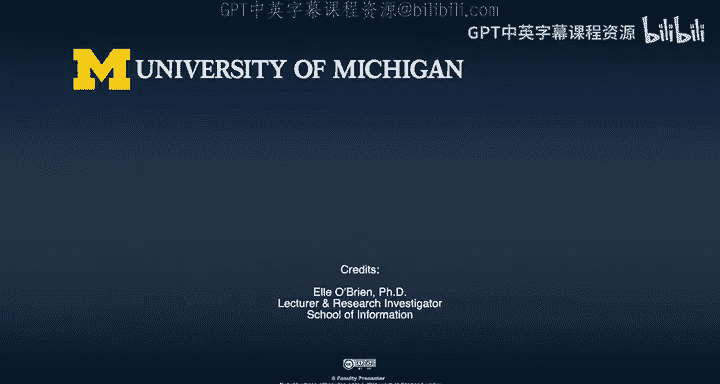

# 密歇根大学《理解数据：导航统计、科学和AI-Understanding Data Navigating Statistics, Science, and AI》 - P22：21_模块4导论：是否应该相信统计数据.zh_en - GPT中英字幕课程资源 - BV1pU4NzuEvt

Now that we've seen some of the most common confusions around discussing statistics。

 we're going to zoom out and consider why do people discuss statistics at all。

 As we've learned statistics are tools for making sense of patterns in the world。

 and sense making is a human behavior， we bring to that task all our beliefs， experiences and values。

In the last week of this course， we'll explore some nuanced questions about what numbers can and can't tell us。

 we'll also talk about how to decide which statistics to trust。

 so let's get started with the question to keep in mind through this entire module why。

