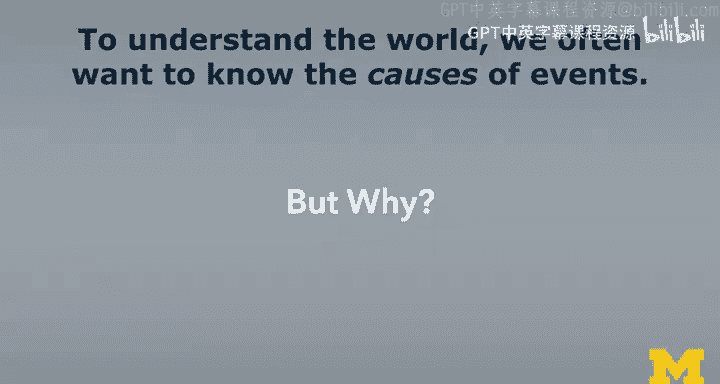
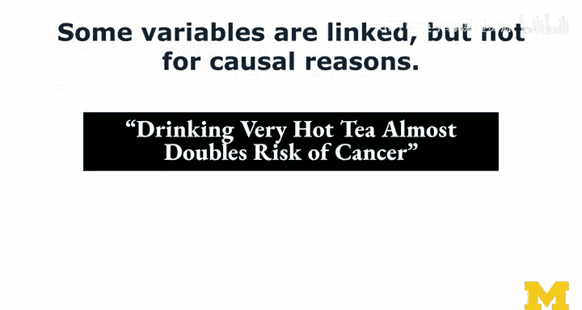
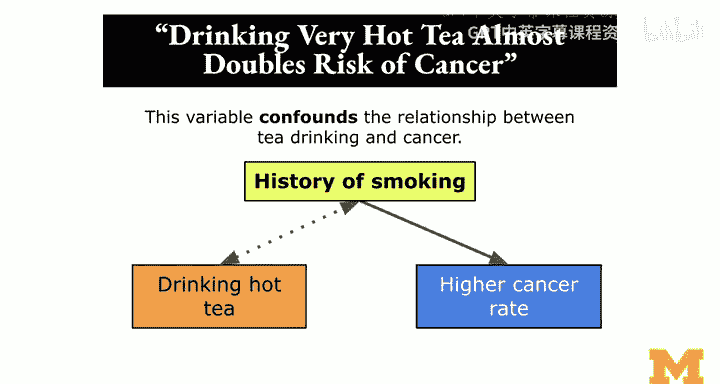
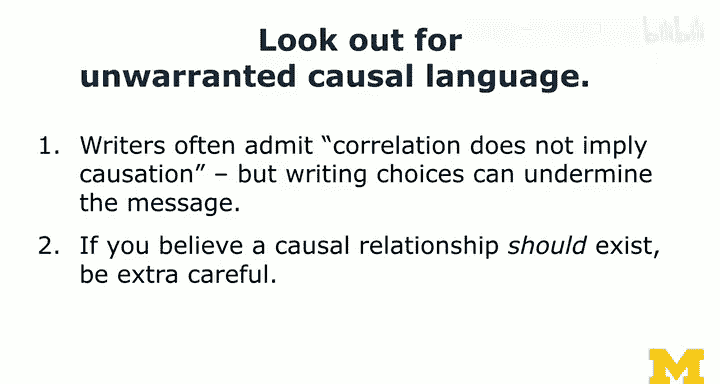

# 密歇根大学《理解数据：导航统计、科学和AI-Understanding Data Navigating Statistics, Science, and AI》 - P23：22_质疑背后的逻辑.zh_en - GPT中英字幕课程资源 - BV1pU4NzuEvt

To understand the world， we often want to know the causes of events， we want to know。

 does drinking hot tea cause cancer？

Does using a medical device cause an improvement in PTSD symptoms？

Did a recent speech cause a politician to become less popular。

 and did a new policy cause a change in the international supply chain？

But proving causality is actually quite hard。And that's because lots of things in the world cooc without having a causal relationship。

Here's an example from a website that specializes in sharing some spurious correlations is what it's called spurious correlations。

 we can see that the divorce rate in Maine correlates with the per capita consumption of margarin right so those two lines are going very much together at share looks like the margarine consumption is closely related to the divorce rate in Maine。

Here's another， it's also cheese based， per capita consumption of mozzarella cheese correlates with civil engineering doctorates awarded。

And some relationships like these are just spurious right that's in the name of this website。

 spurious correlations and that's you know probably because there are a lot of things happening in the world so just by chance some of them are going to happen at the same time and I just want to take this word correlation correlation is a word that has a very specific technical meaning。

 some people will say only use it when you're positive you have the right technical meaning in mind。

 I kind of think the cat is out of the bag and people use this word so much in a casual sense that I think most of the time it's safe to treat this word as meaning if you encounter it every day。

In a casual setting， I think this usually means two things appear to be associated or related。

 they are trending together in the same direction。Now some variables are linked。

 but not for the causal reason that we think， sos let's return to this example about the hot tea drinking in this study that was you know reported as saying drinking very hot tea almost doubles risk of cancer。

 so the study reports in association。

There were more deaths observed in one group， the hot Tea drinker group， than the other。

 the cool Tea drinker group。Now a scientist commented on this paper though so they sent in a rebuttal to the journal and said wait。

 did you consider this and this scientist commented that the groups might differ in important ways besides what temperature they like to drink their tea。

 the groups also differed in terms of their gender。Their smoking history。

And their alcohol consumption habits so why could this matter according to the news story。

 if we have drinking hot tea and higher cancer rate。

 the news story seemed to imply that there was this direct causality that drinking the hot tea is what causes the higher cancer rate。

But the commenter suggested that something else could be happening。

So hot tea drinkers tended to also have a history of smoking。

And history of smoking is what is causing the higher cancer rate。

 so the hot tea drinking is not directly causally related to the higher cancer rate， it's associated。

 it's linked here， it coaccurs with the history of smoking and that's the causal factor。

And so we would say that this variable， you know， their smoking history is confounding the relationship between tea drinking and cancer。

 it kind of adds a little bit of a detour。

Now， unfortunately， both of these causal pathways could lead to the apparent relationship in the study between drinking hot tea and cancer。

 so simply from knowing that you know there was there were more deaths in the hot tea group by cancer。

 we can't actually tease apart which of these two pathways it is directly。Now。

 because of this sort of issue， as well as the spurious correlation issue with the mozzarella cheese and doctor it's awarded。

 the bar to establish causality is very high， so we often have some doubt is this a causal relationship Now。

 causality is a very deep topic and we're not going to get to it， it's in its entirety right now。

 to summarize it very， very bluntly， most scientists will accept specific types of experiments as evidence for causality occasionally when certain conditions are met。

 they're also going to accept correlations as evidence。😊，And sometimes neither option is feasible。

 we can't quite achieve either of these conditions that we would like。

But the bar is quite high and we're going to talk more about this in part two。

 which is all about science。Now it's also easy to imply a causal relationship even when you don't have any of the grounds to you know。

 make that conclusion scientifically， so heres here's an article from the New York Times。By 2019。

 the annual death rate from crashes talking about car crashes was near its lowest level since cars became a mass item in the 1920s。

 but then came the COVId-19 pandemic。 crashashes and deaths began surging in the summer of 2020 surprising traffic experts who had hoped that relatively empty roads would cause accidents to decline。

 Instead， an increase in aggressive driving more than made up for the decline in driving。

 and crashes continued to increase when people returned to the roads later in the pandemic。

So this story to me makes an implication。Of a certain causal pathway that the COVID-19 pandemic led to perhaps higher stress which caused more aggressive driving and that aggressive driving caused the increase in traffic fatalities。

But what do scientists who study traffic fatalities think。

 so going through that that story I was able to find a link to you know a research report that presented this data about the increased fatalities。

 and so this is from the US Department of Transportation and it's written by a team of scientists who for a living。

 they study traffic fatalities and this data set。Now， in that report。

 the researchers proposed several causal pathways， it was possible that the COVID-19 pandemic caused more people to be working from home。

 which meant that there were less cars on the road。

 with less cars on the road people decided that they were comfortable driving faster and that led to more traffic fatalities。

Another pathway they suggested is that medical personnel were occupied by the pandemic and that led to longer response times to accidents。

 longer response times to accidents mean that people would die of injuries that they previously would not have died from and that led to more traffic fatalities Another pathway is that the COVD-19 pandemic led to higher drug and alcohol use。

 possibly is a coping mechanism to stress and isolation。

 which that then led to more impaired driving， which then led to more traffic fatalities。

It's also possible they suggested that this increase is not directly attributable to the pandemic but there could be other factors afoot which were leading to lower seatbelt use。

 there was just a trend that was hard to explain of lower seat beltt use and that might have led to more traffic fatalities。

As well as they also noticed evidence for more distracted driving which has unclear origins that could be you know the cause of the traffic fatalities now interestingly。

 the report mentions nothing about aggression， it actually does not raise this aggression hypothesis at all。

So it's possible that the causal pathway pandemic increases us of driving。

 increases traffic fatalities is real， but so could many others。

 and in fact this was not one that the highway researchers noticed anyway or considered。

So even though I think that the author of this story would probably say that you can't make。

 you know， a very， very strong causal claim from the data。

It does seem in the storytelling to overstate the certainty about the you know causality and I'm specifically looking at sentences like but then came the COVID-19 pandemic and I think in a storytelling setting this really sets up that that specifically is you know what changes changes the game here。

And then we can see that you know， crashes and deaths began surging around that time and specifically this sentence。

 an increase in aggressive driving more than made up for the decline in driving。

 so that sounds like a pretty strong mechanistic claim about what's going on here。

So why did this happen， how is it that the writer could have presented this with a you know strong causal claim implied whereas the actual scientist did not make such a strong claim。

 it's possible that the author like many of us wanted things that they considered bad to have a bad effect on the world so maybe they were personally very affected by isolation and maybe they felt like it was making them aggressive and perhaps because of that was such a strong personal experience and that seemed so negative。

 they they kind of put that lens on you know this data which may or may not be related to that。

Likewise， we also want good things to have good effects。

 so I think sometimes when we want to believe that something is a moral good。

 we want to be really you know sure that it is doing something measurably good in the world and sometimes because of we bring in these desires that we want bad things。

 things we don't like to have bad effects and things that we think are good to have good effects。

 we might be a little bit primed to want to interpret strong causal statements about the effects things are having on the world。

But we really have to be careful with causal statements。

 things can look related for completely silly reasons and things can be related。

 but not for the reasons that we first assume。And there's also a danger zone which makes this extra hard and we've got to be really careful here。

 but another way that people do mess up is by downplaying causality that is well established like cigarette smoking and lung cancer。

 it's now known that you know a really effective disinformation tactic。

 a tactic by cigarette companies is to you know increase the appearance of doubt about this relationship between cigarette smoking and lung cancer。

 which actually is rather well studied and established at this point。

So what you can be on the lookout for is unwarranted causal language。

Writers will often admit that correlation does not imply causation， but at the same time。

 they can use writing choices that undermine that message。

And if you believe that a causal relationship should exist。

 if you think something is so bad that it must be having a measurably bad effect on the world or so good that it must be good for the world。

 be extra careful about what data you'll accept as being evidence for that。

