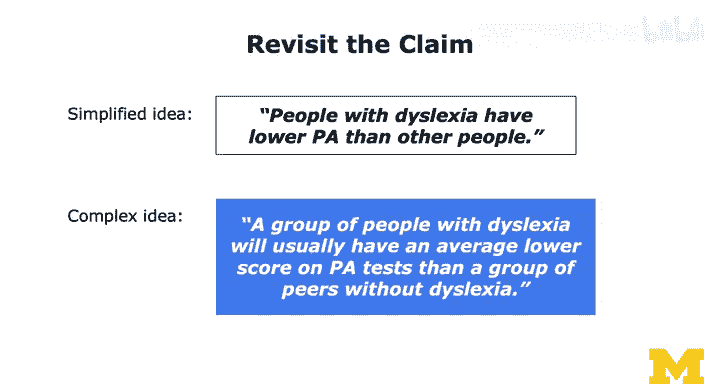
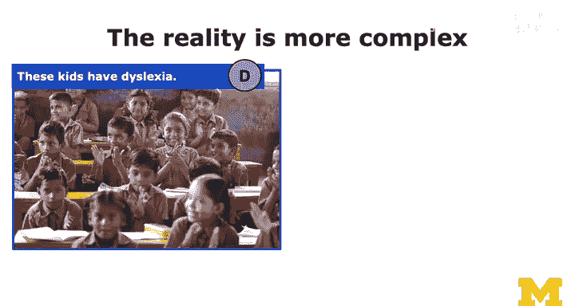
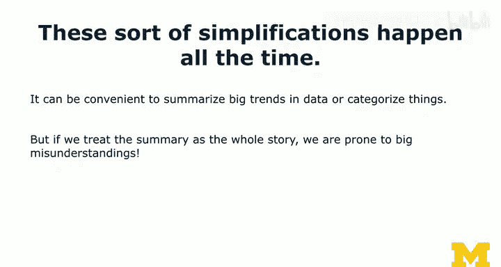

# 密歇根大学《理解数据：导航统计、科学和AI-Understanding Data Navigating Statistics, Science, and AI》 - P24：23_信息压缩的统计摘要.zh_en - GPT中英字幕课程资源 - BV1pU4NzuEvt

Another nuance is about summaries and how they can reduce information。

Remember that statistics are often used to summarize data。

 instead of talking about a distribution of data， we could talk about a mean or a median。

In other words， we're using statistics as a shorthand。

 we could tell somebody what the median flight delay is at an airport instead of showing them the whole distribution or giving them the whole data set。

But shorthand can get us into thinking problems。It's easy to forget that shorthand is just a convenient summary。

 it's not the truth。So here's an example from research I did during my PhD， which is about dyslexia。

Dyislexia is a condition where people struggle to learn how to read for reasons that are not easily explained。

 it's not about resources， it's not about how much they're trying。

 it's just it's often just difficult for you know challenging reasons for people to learn how to read。

There are， it turns out certain word games that many people with dyslexia find challenging。

 so for example， if I tell you the word cup and I say break that down into parts a and soak a。Now。

 this is called phonological awareness， it's noticing how a spoken word could be broken down into smaller units。

And it turns out that for whatever reason， people who have dyslexia tend to find that task a bit more challenging than people who don't。

So we see common statements about dyslexia。Like people with dyslexia have less phonological awareness than other people。

 and sometimes this could be abbreviated as PA。But what does the data actually look like。

 so this is some data that is visualized from the Healthy Brain network data。

 which is a large study of children in New York City。

 I think it's about 100 kids in each group and these are of similar age and so we have about 100 kids who have dyslexia and 100 who don't in scientific terms the group that does not have any diagnosis is usually called the control。

 so we have these two groups and if we make a plot of the different distributions。

 we can see that on the phonological awareness task， the control group tends to have higher scores。

And so what is being said here and is this is a pretty robust and reliable finding is that the average test score which I've indicated with these lines。

 so a summary of kind of where's the peak of that distribution。

 the average test score is different between the groups。

 so the blue line is the average for the group of kids who have dyslexia。

 the dashed red line is the average score for kids who do not have dyslexia。

 and so this standardized measurement of phonological awareness。

 kids in the control group tend to have a higher score。

But notice that the distributions have a huge overlap and I'm pointing here to this purple center。

 right and where it's purple， it's not red or it's blue， that's overlap。

So what this means is that there are some kids with dyslexia， so indicated here。

 this D with a circle around it， this probably represents a there is some kid with dyslexia who you know got a score of about an eight on this phonological awareness measure。

And there is somebody with you know， without dyslexia indicated by this C。

 who has a lower score on the phonological awareness test。

 even though they don't have dyslexia and they probably won't go on to develop it。

So when people make this claim that， you know， people with dyslexia have lower phonological awareness than other people。

 this is actually just a shorthand for a more complicated idea。

A group of people with dyslexia will usually have an average lower score on phonological awareness tests than a group of peers without dyslexia right。

 that's that's kind of a mouthful， I mean it makes sense that that's a lot to say and we want to shorten it。

But the shortening does something to a lot of our thinking。

 When we hear people with dyslexia have lower phonological awareness than other people。

It sounds like if I have， you know a couple children here。

 so this is a picture of some kids who are reading and we may say that this girl who we've circled in blue has dyslexia and the girl sitting beside her who we've circled in red does not have dyslexia。

 it sounds like we're saying。The girl who has dyslexia has less phonological awareness than the girl who doesn't。

But the reality is more complicated， right， the reality isn't that we know that that girl who has dyslexia has lower phonological awareness than the girl beside her。

 it's that if we have a classroom full of kids that all have dyslexia and a classroom full of kids that don't and we take the average score in those two classrooms and compare them。

 we probably will see a difference in the averages， but there's going to be a lot of overlap。

And that's you know this is an example of how making a category is reducing information。

 so when we say these kids all have dyslexia， we're kind of reducing， you know。

 this is a statement that sometimes turns into an oversimplification of what phonological awareness is like for these kids。

Now you know part of this comes down to how do we define dyslexia in the first place and it turns out there is no test that perfectly tells us who has dyslexia and that's because if we often have to rule out that there could be other reasons why a kid is having trouble learning to read like if we found out that a kid was not getting a good breakfast before they come to school being hungry is a very good reason why somebody might struggle to learn when they get to class or they could have a very stressful situation at home and it's very hard to identify that sometimes so because if we have to rule a lot out。

 it can be hard to precisely determine who has dyslexia in the first place。

Now reading ability it turns out varies continuously in the population so this is from a paper that is a review of developmental dyslexia and across cultures we tend to see that when we measure reading ability in the population according to some standardized measure of you know how quickly and effectively people are able to read dyslexic readers tend to just be kind of at the lower end of that you know of that continuum it's not like it's a separate like bump at the bottom you know where suddenly there's a lot of dyslexic readers there's just kind of this normal distribution and as with any normal distribution some people are on the top for reasons we don't know and some people are on the other end for reasons that we don't entirely know。

But we draw a threshold， so somewhat arbitrarily we just drop a line and say everybody who's on。

 you know one side of this line is going to get treatment so we're making a binary decision about who will be you know categorized a certain way so that we could provide services and support for them。

But that means that if these two girls fall just on the other side of that line。

 there's very little difference between them， right， they might be extremely similar。

 but just because we impose a cutoff， they might get talked about as if they're very different when it's actually a very negligible difference between them。

So when we talk about people with dyslexia， we have to be careful to remember that they're not in a wholly different category from other learners。

 they're actually on the same continuum。And talking about dyslexia as a category in the first place is in fact。

 a simplify choice， simplifying choice made by people。

And these sort of simplifications happen all the time。

 it can be convenient to summarize an overarching trend in data or to categorize things。

 but if we treat the summary as the whole story， we're often prone to big misunderstandings。

