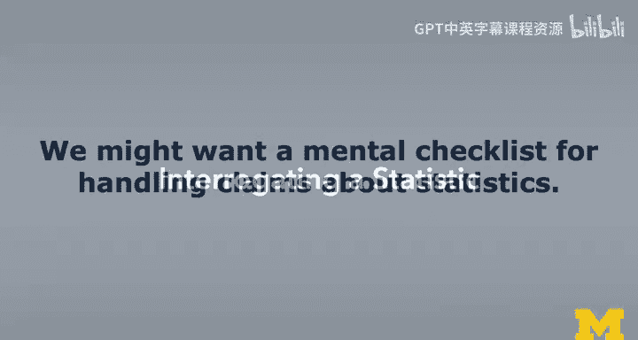
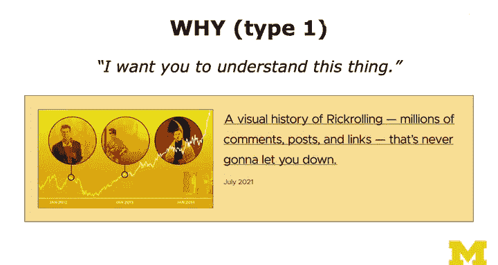
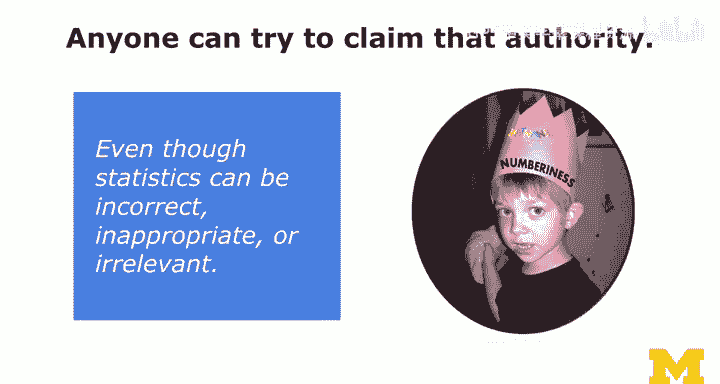
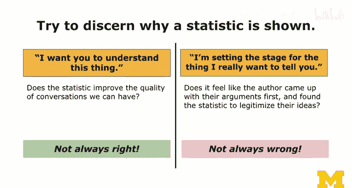

# 密歇根大学《理解数据：导航统计、科学和AI-Understanding Data Navigating Statistics, Science, and AI》 - P25：24_统计数据的审辨方法.zh_en - GPT中英字幕课程资源 - BV1pU4NzuEvt

嗯。

We might want to have a mental checklist that we can take with us for handling claims about statistics now one popular method is the5 ws。

 who， what， how the Ws at the end of how， when and why， so lets let's try this together。

Here's an example from New York Times oped that I saw recently。

 it's called I'm a New York City paramedic， I've never witnessed a mental health crisis like this one。

And theres there's this paragraph in nearly 20 years as a medical responder。

 I've never witnessed a mental health crisis like the one New York is currently experiencing during the last week of November。

 911 dispatchers received on average 425 calls a day for emotionally disturbed persons or EDPs。

 even in the decade before the pandemic， those calls had almost doubled。

 and I've highlighted the part that looks like a specific statistical claim。So first， who。

 who is it about and who is saying it？So for who is saying it。

 it looks like we can tell that the author is somebody who worked as a medical responder in New York City for nearly 20 years。

 so he seems to have reasonable credentials to be talking about this。And who is it about。

 it looks like the statistic is about 911 dispatchers， presumably also in New York City。The what。

 so some what questions， what are the units， what is the benchmark。

 and what is this statistic capturing？So we can see that these calls that are being measured are in a unit of calls per day for emotionally disturbed persons or EDPs。

Now I can tell the unit is calls a day， but I don't know what a good benchmark is like I don't know before this time period when he's claiming that the calls have gone up in volume I don't know what was typical what if was it was it 400 was it 200 I don't really have a benchmark in mind for that and what is the statistic really capturing so what does it mean for somebody to be labeled as an emotionally disturbed person I don't know that I could guess but I don't know that。

Another question is how how is the data collected so presumably there is you know call centers around the city have some kind of record keepinging system and I'm assuming there's some kind of standardized way that they're combined across different call centers for these tallies。

 how is it analyzed， I'm assuming they just counted them up and made an average of how many calls there were per day。

 but that's a bit of an assumption。And when， when is the statistic from that looks pretty clear during the last week of November？

And why why would the writer include this statistic and this one's kind of a it's a little bit harder I think so just going back to the topic sentence。

 I think it gives us some clues in nearly 20 years as a medical responder I've never witnessed a mental health crisis like the one New York is currently experiencing Okay。

 so this this feels like the topic sentence， this is really， you know the main point。

Now for a critical reader of statistics， the why is often the most interesting question I think there's really at least two types of whys why type1 is I want you to understand this thing so here's an example that I have pulled out this is from visual magazine online called the Pudding and they feature all sorts of data visualization。

 storytelling and journalism and they have this post called visual history of Rick Ro Rick Roing is when you tell somebody you're going to send them a link to something and instead you send them a link to a music video of Rick Asley singing and dancing so it's called Rick Ro and so I think what's going on here is that they're trying to help you understand Rick Rollling in a way that maybe you never have before by showing you different charts and visualizations and you know data for you know something you might not have thought of in you know。

With this lens before， so they're going to expand your understanding of the phenomenon of Rick Rolling。

Why type2 is more like I'm setting the stage for the thing I really want to tell you now for this example。

 I want to go back to this statistic about how many people in America say it's likely they want to have kids or not so this was from an article on today co and the quote was now a survey by the Pew Research Center has found that 44% of Americans say it's unlikely or not too likely that they'll ever have kids and so if you remember this is from an article called anoded to women Without children from a mom now when I think about this piece as a whole right and so you'd have to go link to this as a whole so you're kind of taking my word here but the essay itself is not really like a review of statistics it's a personal essay it's a person who is a mom who is talking about her feelings you know towards women who don't have children and so this。

Statistic that's here about you know the 44% of Americans。

 although we show it it's not really accurate， but it's here， I think kind of。

 it's one of the only statistics in the piece， it's not really a numbery piece。

And I think what's happening is that this is here kind of to set the stage for the rest of the essay。

 this is not really the main point， it's it's just like a thing that tells us， hey， there's。

 you know， there's something going on here and then it ushers us into the personal essay。

So why is that used at all Well， one reason is that numbers can signal authority we often treat numbers in at least in the culture that I'm from。

 we often treat numbers as the most authoritative form of evidence and there's this sort of you know royal crown of numberiness。

 it's really authoritative if you've got a number， you've got the truth。

But anyone can try to claim that authority， this is a child wearing a paper crown。

 so he's also trying to put on the number in his hat。

 but clearly he is is a kid and he's just playing and he doesn't really have that gravitas and authority and this you know we know this can happen because even those statistics are you know powerful。

 they can also be incorrect or inappropriate or irrelevant。

 there's a lot of ways that a statistic could not be useful at all for the claim that is being made。

So I think in this piece here what is this really doing。

 I think it's on one hand it could be saying here's a big number right 44% that's a lot so you know that this topic is important。

 it's not just important to me the writer this is important I kind of wonder if that's maybe the intention here or this number is precise right 44% that sounds so precise and scientific so you know that this is super scienceency。

 we know science so you should trust us about everything else we're going to say。

I don't know if this is exactly what you the editors were thinking when they， you know put this in。

 it's kind of an assumption I'm making， but I think these are two reasons why people often do include numbers even when understanding the statistic is not really the point of the piece。

So I think it's crucial to try to discern why a statistic is shown in the first place。

 is it I want you to understand this thing and often if it's about understanding。

 the statistic is in some way going to improve the quality of the conversations that we can have。Or。

Are you setting the stage for something that you really want to say？

And often you can tell that this is the case because it might feel like the author came up with their arguments first and then found a statistic that would legitimize their ideas and later put that in。

So how do we know， you know， it's a little bit of a feeling thing。

 we're often not able to tell for sure， so it's some ambiguity。

 but often you can kind of feel it out。Now， one nuance here， a complicating factor is that。

This does not mean that a statistic is right or wrong。

 so somebody could be trying to you know coming into the statistic sharing with you know trying to get some mutual understanding or inviting you to explore a topic with them that doesn't mean that their numbers are right they could have done a calculation and correctly they could still have an inappropriate statistic it could still happen and likewise somebody could be using a statistic as a prop for something else that they're trying to argue but that doesn't mean that the number is wrong or inappropriate。

This is really just something to keep an eye on because of it can tend to be that when the statistic is not really the point。

 sometimes that invites a bit more sloppiness in the presentation， but that's just a tendency。

 it's not an absolute。So which is it here right so remember this is you know the context we've got our medical responder。

Is he trying to get us to understand what it's like， you know。

 working in a call center or is he setting the stage for the thing he really wants to tell you？

So you know answers might differ on this， I don't think there's an absolute answer。

 but to me I actually think it's this one， so again。

 this piece is not terribly numberery and you know he's somebody who is on the ground right so this is a medical responder and he's talking about his experience and I feel like this number about you know receiving on average 425 calls a day it's really to give gravitas。

 you know to say it's not just him， there's really something going on here you know to his personal experience。

And part of why I feel that is because of I'm not able to answer all of these questions as well as I would like in this quote in his quote。

 I think we know the who we know the when and the why。

 but the what exactly gets a call categorized as an EDP or how are these you calls measured and what's a baseline for that in the first place like how many you know how many calls do we get on average before the mental health crisis so you know because if I'm still missing that information I feel a bit like you the point here might not have been to help me understand what's behind that number。

 I think I think this is kind of a part of his argument about why it is why this mental health crisis is so urgent and again that doesn't make it wrong but it does mean that I want to acknowledge that there's still parts of this that I don't fully understand。

