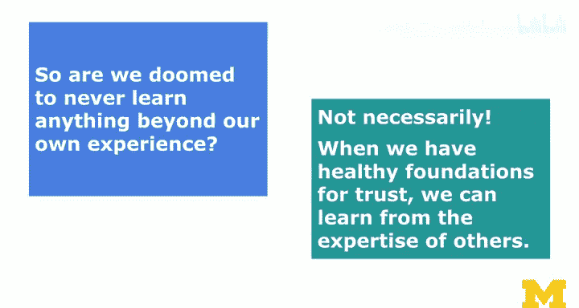
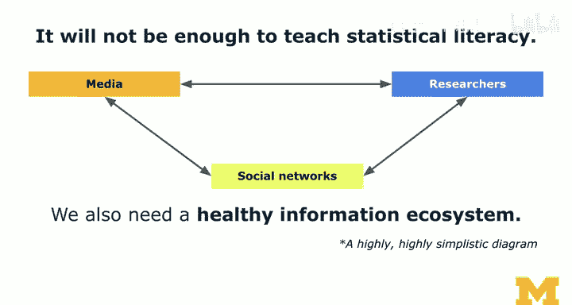

# 密歇根大学《理解数据：导航统计、科学和AI-Understanding Data Navigating Statistics, Science, and AI》 - P26：25_风格、权威与可信度.zh_en - GPT中英字幕课程资源 - BV1pU4NzuEvt

We just saw an example of a statistic that we were missing some context about。

So here was our quote during the last week of November。

 911 dispatchers received on average 425 calls a day for emotionally disturbed persons or EDPs。

So some questions I had， how are the calls categorized and counted。

 right what if we found out that the category of you know EDPs is maybe not as closely related to you know what I would think of as a mental health crisis。

 you know， as I might think？What benchmark should I be comparing this count against what was that average call a day volume like you know before the current crisis and would an expert agree that this is a valid measure in the first place。

 you know what if somebody who really is an expert in you know the 911 call centers in New York said that's not really the measure that you'd want to use。

 maybe there's you know another reason for why this number would have increased like a new campaign a new advertising campaign about you know inviting people to use 911 dispats and to call that number for mental health crises when maybe people simply didn't know before that that was an option I don't know。

 I'm making that up but my point is is that I could imagine a world where an expert might say that number is more complicated than I think。

And of course， there is what other factors could contribute to the count。

 like what if there had recently been an advertising campaign inviting people to call this number。

 so maybe it was simply reflecting awareness of this again， don't know making that up。But。

Just trying to show that I have like limited understanding of this。

Now I could try to verify this statistic， but it's going to be difficult for a couple of reasons。

 one is data access restrictions， so it's probably a good thing that it's not trivial for me to just go on the internet and find all of the 911 call logs from New York City that's good。

 but it is going to be difficult for me to access those you know that data。

Another thing is the technical complexity of the call recording system。

 so part of what goes into making this number is you know。

 well hower calls aggregated from different operators and what if that's a technically complex system I don't know for sure。

 but most of the time I've seen systems for collecting data that have distributed sources right so there's multiple people collecting the data there is some not negligible complexity about combining those。

I also don't have the medical expertise to validate， you know。

 is the you know the criteria they're using for labeling a caller as having an EDP。

 I don't know if that's a valid， you know category or not。And finally， all of this would take time。

 I do not have time for all of this， I have a full time job， I have a lot of stuff to do。

 I don't have time for this。Now we encounter a lot of statistics every day and time and rain power are limited resources so for better or worse because we don't have that time and that brain bandwidth to you know deeply check all of these we often lean on style to determine which sources we trust now I really say for better or worse because this has some vulnerabilities but let's start with an example of you know how we might on style alone how we might try to weigh the merits of this Instagram post I'm taking off my statistician kind of hat and I'm going to put on you know trying to remember what it felt like before I had ever learned anything about statistics and how I might go through go through the world so we've got two categories we've got the crown of numbereriness which we're going to use to signal you know maybe it has real authority and on the other hand we have the paper crown which is somebody dressing up as if they have authority。

So this Instagram post， it says it's a fact， that sounds pretty real。

It does have a cool Greek letter right， so we've got that it looks like a sigh beside the psychology。

 so cool Greek letters that that seems like something I associate with universities and scientists。

It has a number thats 70% numbers numbers are real it sounds kind of right。

 I definitely believe that marrying your best friend is probably a good thing on the other hand there is no source right there they're not claiming like where where is this from there's no citation for where the 70% comes from。

The author clearly wants shares， we can see in the description of this posts very tiny。

 tiny letters here， but they're saying tag and share。

 so this person has a clear incentive to say something kind of splashy。

The design looks a little bit amateurish， you know I would assume if this was a major research organization that they might have a budget for better you design and I don't know who is running this account。

 I don't know who is behind psychology fact by no clue who that is。So to me， you know。

 just on these kind of surface level markers， I think this one would say。

 yeaht I don't put a lot of stock into this， I think this seems like I don't know if I could trust this。

Here's another， this is also from Instagram and it's from an account called Mental Health Fact Daily Fact 297 depressionion and Ex。

 a recent study suggested that nearly 12% of depression cases in adults could have been prevented if those individuals were marginally more active during the week。

Okay， our two categories， let's see how is this way out？On the one hand。

 the number 12% sounds really precise and we've got science language look at this we're talking about depression。

 that is a medical term， marginally more active， marginally more active sounds really specific。

Big words right so individuals instead of people that sounds like yeah this is probably a smart person it sounds correct I mean I' have had a lot of people tell me that exercise played a role in their you know mental health improving their mental health so maybe that's true。

And again， we have facts， this is on mental health facts daily。

 and also there's a cool big blue brain logo。On the other hand。

 there is again no source we do not know who conducted the study。

 there's no link to any journal there's there's nothing I could follow to find out where this is from The author also wants shares。

 they're saying sharere this with whoever needs to see it I mean that's sort of couched as if that's a public service because there might be people who need to see it but they still want shares。

Again， we have no idea who is behind mental health facts daily。So this one's kind of a toss up。

 I feel like this one's a bit harder， so I don't know， maybe could go either way。Okay。

 what about this piece， what about our our piece from The New York Times。

 so which one is it is it you know real crown or is it paper crown？Okay， so we've got credentials。

 the author has credentials and this looks very legitimate， so that's good。

Here we have you know our statistic is couched in lots of specific and technical sounding language right so we have a specific time。

 it's the last week of November， we have an acronym EDP and we have a specific number about at the average of 425 calls a day。

 so that all sounds specific and technical which sounds good。

Here there seems to be a reference for this claim here。

 so even though I can't directly check this 425 calls a day。

 I can follow this link here to see something about the call volume doubling in the decade before the pandemic。

 I haven't checked that reference， but I'm assuming that if I clicked it。

 it would go to a useful and relevant place。Again， now here we have the New York Times it is in the New York Times and I know that this newspaper has a fact checking team。

 you have seen them in the past publish corrections when people have pointed out issues in the reporting。

 so to me that's a good thing I kind of put that under the real authority but depending on your opinion of this news outlet。

 you know maybe you also feel that this is a biased and unreliable news outlet。

 so if you dislike this news outlet， then automatically maybe this is going in via you know the paper crown category。

Now this here about， you know having witnessed a mental health crisis， you know， well I am somebody。

 I teach a lot of students and you know， I have to agree with with the writer。

 I mean I feel like I have observed more mental health crises now than ever before and so you know what he's saying is validating my observations and that counts for a lot。

Now， because it is hard to validate the statistic for all the reasons I described earlier that I do not have the time or the bandwidth to really get into the New York City you know。

 911 dispatcher data。I am probably going to make a judgment to trust the reporting or not。

And this may be influenced， perhaps mostly influenced by surface level signals。

And those could be things like the writing style， the scienceiness， does this appear to be science？

The publisher and the author's credentials， and if it agrees with my own worldview。Now。

 this approach has a vulnerability and it's that anyone can present findings with language that reads as authoritative。

So even though， you know， I definitely think to some extent。

 everyone can cultivate a bad stats detector and I think most of us， you know， we do over time。

we can learn just to use some kind of common sense think through of you know does this really check out what context might I be missing right so using those5 ws we could get really familiar with common reporting errors and those are things that we talked about in week three so you could really learn to kind of spot what are the typical you know errors that people make in reporting statistics incorrectly。

But I still think we're going to have a problem because many statistical claims that we encounter will be incomplete or ambiguous What do I mean by this？

Andcomplete means we are missing details that we would need to fully understand what the statistic means and where it comes from。

 sort of like I was still missing some information about you know， that dispatchcher call number。

And others could beammbiguous， which means that they are consistent with many explanations。

 not just the one implied by the writer。So does this mean that we are completely doomed to never learn anything reliably beyond our own experience。

 well it it doesn't have to be。When we have healthy foundations for trust。

 we can learn from the expertise of others so we can trust with good foundations。

 people's statistics， or because if we trust the process by which those statistics are made and presented to us。

 so if that's there， then we don't have to verify everything personally。

 we can rely on others' expertise。Now， of course is that reality。

 not always because we live in a really complicated world。

 we also need a very healthy information ecosystem because there's a lot of players in creating you know the circumstances that we need to have healthy trust we need you know media that always acts competently and with integrity and issues corrections quickly when things are you know when things are reported incorrectly or inappropriately。

 we need research here so people who are producing statistical summaries and collecting data and analyzing it。

 they have to be acting also with competence and integrity and social networks we need that you know the people that we interact with。

 including our leaders， public experts and our friends and family that are all going to act in ways that are you know show concern for one another and are you know going to help us cultivate a good information environment so all of these parts have to be working to have the healthy information ecosystem。

So we could go beyond just using markers of style right and so I think because of this is sort of the world in which we live in it's really not enough just to have statistical literacy because if we simply are overwhelmed by the volume of statistics that we're going to encounter so we were going to have to use trust and in a perfect world that trust would not be based on style。

 it would be based on an understanding of a strong process that produces knowledge now this is a highly highly simplistic diagram information science I work in the School of Information。

 it is a huge and extremely complex topic but this is this is my very tiny summary of just how nuanced this topic can be。

