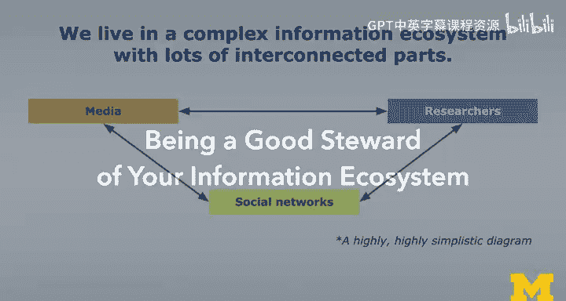
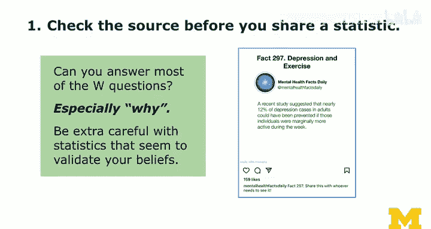
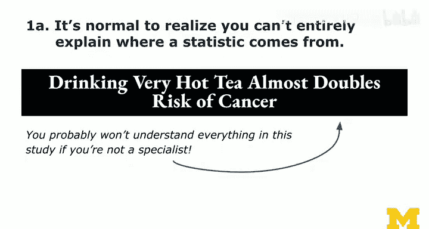
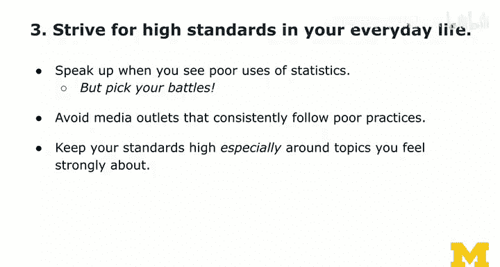
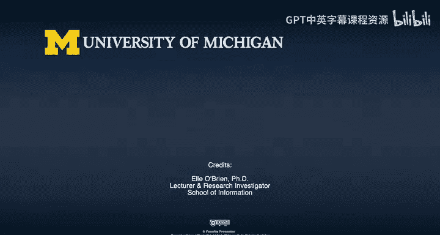

# 密歇根大学《理解数据：导航统计、科学和AI-Understanding Data Navigating Statistics, Science, and AI》 - P27：26_成为信息生态的合格管理者.zh_en - GPT中英字幕课程资源 - BV1pU4NzuEvt

So as we just saw， we live in a complicated information ecosystem。

 and there are lots of interconnected parts。

Now， you may occupy， you might be part of the media。

 you might be a researcher or somebody who produces statistics。

But I ambedding that all of us who are watching are part of somebody's social network。

 so I want to focus on this part， the social network and what can you do if you're there。So first。

 check the source before you share a statistic。And you know， there's those W questions。

See if you can answer most of those， so go to the thing that you're thinking of sharing。

 try to answer most of those questions you know and look at look at if the source generally you know provides you with most of the information you'd need to answer those。

 the why question is often the most important。And be extra careful when you're working with a statistic that seems to validate your belief。

 so I think if you are prone to believing that you know exercise and depression are really important。

 this thing here， there might not have been such a study as this。

 but I mean you might feel like well of course that's true I know that's true so you share it but be really really careful in those situations we're often you know prone to looking the other way more when we when we think something ought to be true。

Now it is normal to realize that you can't entirely explain where statistic comes from so like I said so with this example here about drinking very hot tea。

 you probably won't understand everything in this paper like you could go you could follow this news article you could go to the original paper you could try to read the paper but the paper isnt deeply technical language right so it's for people who are professional public health scientists and they have jargon it's like reading a carman you will basically if if you're not a mechanic。

 so you probably won't understand everything in the study if you're not a specialist in that area so I don't want to say you can never you know ever share a statistic that you don't perfectly understand but if you're missing most of the W questions that might not be shareable。

Second， resist using statistics as a prop for authority， right。

 so try to find another place that the authority comes from。So a bad number is worse than no number。

 and this is because of people take statistics so seriously and we are so prone to seeing them as authoritative。

 even though we know there can be a lot wrong with them。

So a bad number is in many cases worse than having no number。And if you can't measure something well。

 consider not putting a number on it at all， it's okay to say there is not a good way to measure this。

And don't just count other ways of knowing so you know in this essay included a statistic that I think might have been there just to you know kind of give an aura of seriousness。

 I think that maybe happens because of the editor's felt that a personal story wouldn't be taken as seriously but I think it is very okay to tell a personal story and one way that I think we can fight the proliferation of you know maybe poorly source statistics is to make it comfortable to not share a statistics sometimes so you can just say this is my personal experience and we don't have to prove that it's happening to you know millions of other people。

 it's okay to have a personal story and when we properly value that then I think some of the pressure to jam statistics into context where they don't necessarily fit will go away likewise sometimes we want numbers you about places that we work but sometimes just asking somebody hey。

 what's been your experience here。Sometimes those narratives can get you a lot of the same information or even better information than trying to conduct something that gives you a number。

 so sometimes a number is not necessarily the best way to get the information you need。

 so consider some other ways of knowing。Finally， you can strive for high standards in your everyday life so if you see a poor use of statistics。

 you can speak up but I do recommend picking your battles。

 it cant be very exhausting to correct every statistic that you encounter so I recommend personally what I try to do is I try to determine what are the stakes and what is somebody really trying to communicate if I'm at a dinner party and I hear somebody repeat a statistic from a news story and I think I don't know if I quite believe that but it's about something incredibly niche and it's just a personal interest if theres usually what they're trying to communicate is I'm interested in this thing and I want to talk about it so I think that's you I don't always want to correct that or challenge it if you are in a meeting at your workplace and you're using statistics to change your policies but you think there's something questionable about the use that's a context where you want to speak up so try to determine what is the why about why this is being discussed。

If it's going to impact people's lives， if it's going to be cited as the reason for a change that you're not really sure about。

 those are cases when you to want to use your voice。

Avoid media outlets that consistently follow poor practices so everybody's going to make mistakes and as we said we it's not possible to find any outlet that is completely without bias。

 it is you know not possible to find any outlet that is you know completely error- freeee。

 but what you're looking for is people to respond to you know suggestions and corrections that they're you know going to do some due diligence so if you see that you know you read an outlet regularly but they're making some of these mistakes that we've talked about in this course again and again and again。

You can you can avoid it， maybe take that one out of your daily your daily diet and keep your standards high。

 especially around topics that you feel strongly about and this is not just about you know making sure that you know you are always the most informed person you can be I think I think also if you are very high standards for what kind of you know statistical claims you accept and you will use as arguments it will help you create better arguments for the causes you believe in in the first place so keep your standards high and you know really be willing to engage with where data is from when it's something that you know that you personally feel strongly about。

