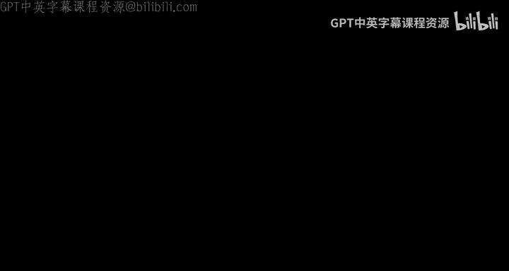
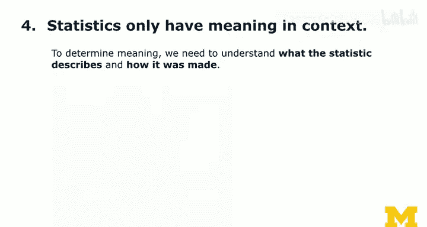
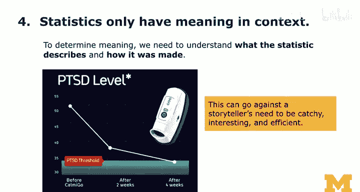
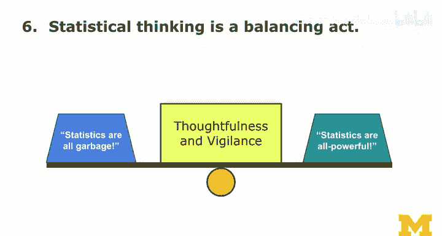
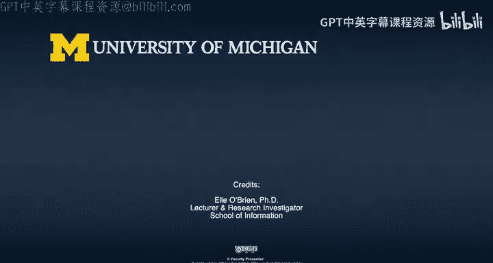
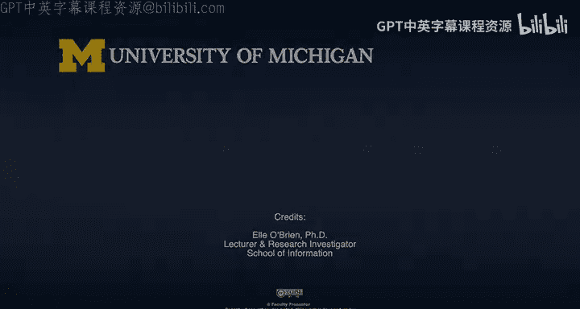

# 密歇根大学《理解数据：导航统计、科学和AI-Understanding Data Navigating Statistics, Science, and AI》 - P28：27_课程1回顾：如何描述数据.zh_en - GPT中英字幕课程资源 - BV1pU4NzuEvt

It is that time we are going to do a recap now， a big bird's eye view of what we've learned so far in this first part of the statistical literacy sequence。

So let's review the big ideas that we've covered。First statistics are made and shared by people。

 we've got this tree graphic to you know maybe remind you of the question。

 well how would we measure how big a tree is and it turns out there are lots of possible definitions。

Statistics are a tool for understanding our world， but we have to make choices what will we measure or count like that tree？

How do we get the data in the first place， How will we summarize it， How do we interpret the result。

Some statistics are more useful than others。And to be useful。

 a statistic needs to be an appropriate summary of the things you care about。That can be， you know。

 there's several ways that a statistic needs to be appropriate it needs to be the right method of summarizing we talked about means and medians and when do you really mean the median right so choosing which statistic is the summary is not trivial。

😊，And is the thing that you're measuring actually does it closely correspond to what it is that you actually want to understand right like this mood ring was not an appropriate summary of somebody's mood right it actually corresponds to body temperature those are different there's low validity there so we need our methods and you know our measurements to generally correspond to what it is that we hope to understand every statistic has uncertainty we never get away from this right so different scales and not all uncertainty is equal right some scales are better than others so saying that there's always uncertainty is not the same as saying everything's random we can't know anything we can work to reduce uncertainty just not all the way it never goes completely away。

Statistics only have meaning in context， so to determine the meaning of a statistic。

 we need to understand what the statistic describes and how it was made。

And an example here we have our you know this inhaler device that has a PTSD level and you know we can see there are indeed numbers but to understand what this actually means you would really have to understand something about you know how this was measured and what that access is over there what is it that's decreasing exactly what is PTSD level how much does that really affect somebody who is using the device so this really has to be understood in context we can't divorce the numbers from the context in statistics and importantly you know our need to understand where statistics come from in order to properly interpret them can actually be at odds with the storytellers need to be catchy or interesting and efficient so you know here I actually might have some competing incentives to the person who made this graphic who wants to tell a catchy and quick story。

😊。

Statistics help us make efficient summaries， but those summaries can hide nuance and here we have this example about you know how do we talk about people who are in these two different groups right so there's this diagnostic category that some kids have dyslexia。

 some kids don't。But there's a lot of overlap in how those those two groups of kids are going to develop right they're not completely different groups and the language that we use when we talk about group differences can greatly exaggerate our perception just culturally how we talk about those differences so we might you know when we talk about them as groups and we talk about big summaries about you know average differences。

 we often lose sight of there being you know much less differences between those individuals in those groups than we often think finally statistical thinking is a balancing act is one that I think many of us struggle with every day。

 I don't think this struggle ever completely goes away I know I struggle with it constantly is that there's kind of two extremes that we can be in on the one hand we can think statistics are all garbage it's all just people manipulating data to get the number they want it's useless on the other hand we can believe statistics。

Are all powerful， everything is knowable if we just have statistics。And you know。

 we might oscillate between these two and it's really。

 really hard to you know avoid the extremes but but you know we can really practice and it might take years and years and sometimes you'll lose it but we can practice that you know there is this middle way where we can balance them and if we are thoughtful about what we're measuring and reading and you know we're vigilant we don't kind of give up on and just get you know let anything slide with us right we're vigilant and we're thoughtful and we're concerned that maybe we can we can kind of coexist in the middle of these two extremes and we can use statistics so that we can have better conversations and you know better understanding of some of the things that matter to us。

So what's next， Okay， now that you know so much about describing statistics。

 we're going to talk about knowledge。 So knowledge is， you know。

It's how we know things about the world it's a hugely interesting topic and we know that statistics are a part of how we create knowledge but so is science right so science is you know our processes for creating new knowledge and learning for testing hypotheses and science is just a wonderfully complex topic and so in you the next part of this class I want to provide some insight into how statistics are used in science to test hypotheses create new knowledge and some of the biggest complexities and tensions and arguments that are being had today in science about you what is the role of numbers in creating new knowledge and I also hope that it's going to give you some interesting insight into how science works that you might not be getting you know just from consuming news about science so I want to help you have some more context for when you see news stories about experiments or scientific breakthroughs。

Also very close to my heart because I've been a scientist now for like a decade and I love it。

 so I to hope to see you there and we'll be having some conversations about science。

