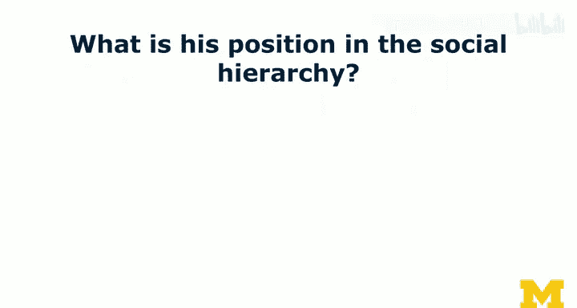
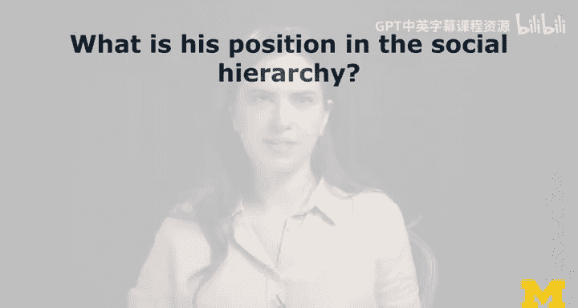
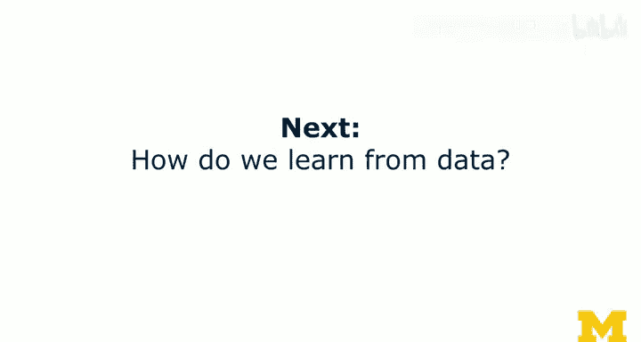
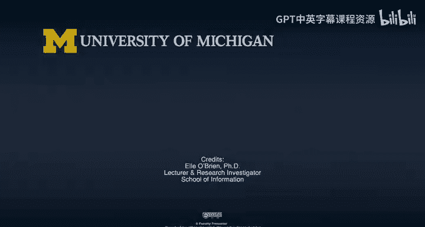

# 密歇根大学《理解数据：导航统计、科学和AI-Understanding Data Navigating Statistics, Science, and AI》 - P2：1_现象如何转化为统计数据.zh_en - GPT中英字幕课程资源 - BV1pU4NzuEvt

Let's start with discussing how things become statistics。First。

 we should ask what even is a statistic and one elementary definition is that a statistic is a calculation made from data。

 it could be any number， it could be how many of something。

 it could be something like mean or an average you might be familiar with and we'll cover what that is later。

 but what is a statistic simply a calculation made from data？

That this definition opens up another can of worms， what is data？

One definition of data is that it's a way of representing things in the world。

 and I say one definition because if there is actually not one universal and simple definition of data。

But the definition that I'd like to work with here is that it's how we represent things in the world so some examples in these pictures。

 it could be a book， a diary that somebody wrote by hand about the world that represents their experience as text。

 it could be a measurement something like in this picture we're trying to find out how thick is this sandwich we could measure it with a ruler。

This work of art here， this is some Nordic folk art。

 this represents snowflakes in the world in a new way。And here we have a spreadsheet full of numbers。

 and in this we're representing presumably something about the world。

 these aren't just numbers that somebody made up by hope。

 they're numbers that represent something like profits or inventory。

 and we've organized them in a spreadsheet so each of these is a way of representing something in the world in a new way。

Now in this definition， there's something really interesting I want you to note things become data when we choose to study them what does that mean exactly。

 let's go through an example， I'd like to introduce my chicken Melvin， this is Melvin。

 he does look a little different in his picture but that's just the power of Photoshop。

 this is Melvin and Melvin is not data， he's a chicken but。Maybe we could change that。

We might want to ask some questions about Melvin， I want to study Melvin。

 I want to learn more about him like I want to know how much does he weigh how many feathers does he have What does he spend most of his time doing what's his position in the chicken social hierarchy How satisfied is he with his life Now these are all questions that when we begin to study them we're going to start creating data and we're going to see Melvin in new ways。

So first to the question of how much does Melvin weigh。

 we could put him on a scale and that scale could give us a number。

 we might find out that Melvin weigh is something like 1。76 kilograms。

To the question of how many feathers does Melvin have， well。

 it is a lot and I'm pretty daunted by that question but in theory we could count them so I could sit by hand and count all of his feathers and you know maybe I am not that confident in my answer because if there's a lot of them so maybe I enlist another scientist to double check my count and together we might agree that he has 11。

490 feathers perhaps。To the question of what does Melvin spend most of his time doing， you know。

 we could also answer this by observing him， so maybe I will post out in the yard and I will follow Melvin around all day and write down everything he does。

Is one day enough？I don't know， I mean maybe one day it's not representative of all of his other days。

 so perhaps I should follow him around for several days， maybe a week。And sometimes of course。

 I'm not exactly sure what he's doing， you know， he could be helping a friend peck a stray feather or he could be picking on his friend。

 I don't know。I could try to take my best guess。 And， and at the end。

 I would come away with something like a log like this about what Melvin was doing at various points in time for a week。

To the question of what's his position in the social hierarchy。

 this is getting trickier because of I'm not sure how to directly measure that。

But I don't want to give up， so maybe we start somewhere， we could say。

 I'll just create a way to measure this based on my understanding of what I know about chicken behavior。

 so maybe I'll watch how many fights Melvin gets into in the week and count how many of those he won。

To the question of how satisfied is Melvin with his life now this is getting really hard because I do not know how to directly measure this。

 but I still want to get some data on it， maybe I could create a checklist of happy chicken behavior so I could consult with a veterinarian and we could talk together and they might tell me these are some behaviors that I've observed over my career that happy chickens do。

 and then I could follow Melvin around and see how many of those behaviors he exhibits。

Maybe another way that we could address this question is we could just ask Melvin and we could say Melvin。

 how satisfied are you with your life， and we could translate that from chicken to English。

 I'm assuming I can hire a chicken English translator and then we could analyze his answer。

But how do we analyze his answer？That's also a very tricky question， I mean。

 there's presumably so many ways that we could we could interpret it， you know。

 maybe something we could do is we could count keywords。

 we could look for very positive or you know happy keywords inside of his answer。

Or maybe I could have a psychologist rate his answer and say， how happy。

 how satisfied does this animal this Mellvin sound？And at the end of all of these explorations。

 we have all these ways of representing Melvin， so suddenly Melvin can be represented by you know his weight。

 this number， number of feathers he has， how many chicken fights he won。

 his activity log and his answer to how satisfied he feels with his life。

 we have all of these different ways of viewing Melvin。

 and that's sort of the essence of data collection。Now I want to put in a nuance here。

 which of these things is data， is it the number 11，490？E is it this， 11。

490 feathers counted on Melbourne and verified by two University of Michigan Chi scientists on July 7。

 2022。It's actually this one data is not just numbers， it's a value plus context。

 and I've highlighted in blue is the value that's the number， but there's also this context。

 it's that the number refers to as feathers， it's the chicken that they were counted on。

 and it's who verified it how did we counted。So to summarize every time we want to learn about nature。

 we have to do an active translation to take things in the world and find new representations that we can then learn from but every time we do this that translation。

 data collection is forcing us to make choices， remember all of those choices that we had to make when we decided well how will we really be sure about the number of feathers that Melvin has。

 how will we count how you know something about his position in the social hierarchy。

 how will we collect data that represents something about his happiness， those were all choices。

Even when we go to answer questions that are seemingly simple and objective。

 like which tree is biggest we're confronted with these choices， For example。

 if we were to answer this question， we could measure how tall trees are from the grass up to their highest point。

Or we could measure the width of the tree trunk， we could also measure the width of the tree's branches at its widest point。

 or maybe we want to collect something about the roots of the tree because of that is certainly part of the tree too。

 and any way that we pick to define what is biggest could potentially lead us to a different answer。

So next， after I've now introduced to you some of the trickiness of defining data and generating data。

 we'll ask， how do we start to learn from data？

