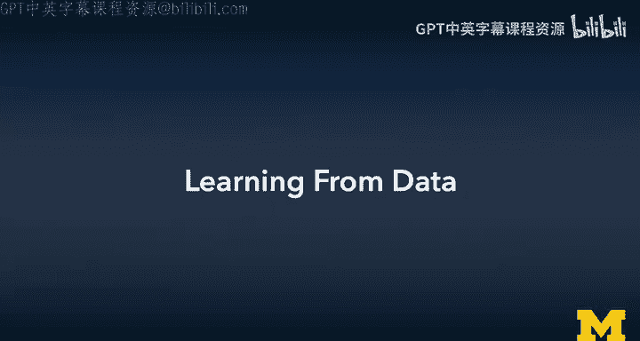
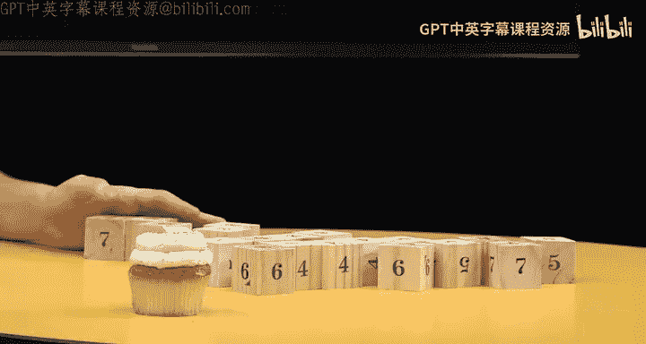
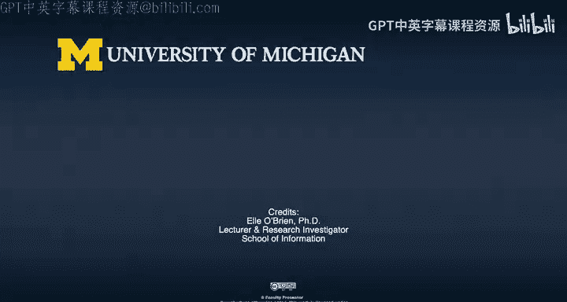

# 密歇根大学《理解数据：导航统计、科学和AI-Understanding Data Navigating Statistics, Science, and AI》 - P3：2_从数据中学习.zh_en - GPT中英字幕课程资源 - BV1pU4NzuEvt

Statistical thinking involves reframing our experiences into new representations that help us identify meaningful patterns in the world。

 so let's see an example Imagine that a new cupcake shop has opened up in town and I'm considering if I should spend my hard earned money on a cupcake are they even any good。

 so let's say I opened up a booth outside the bakery and I ask everyone who comes out to rate their cupcake on a scale of one to10 and now every time I ask someone this question I write their score down one of these cubes。

So after I intercept a whole bunch of people coming out of the cupcake shop and I collect their ratings。

 I have。A whole bunch of cubes so what's happened so far。

 the cupcake shoppers converted their real experiences of eating the cupcake into a rating at the one to1 scale。

 and then I converted that rating which existed in their heads into one of these numbered cubes that I can hold and I could store them and I could stack them。

Why are we doing all this Well， what we have right now is just a pile of cubes and this is pretty hard to make sense of so we're going to make something called a histogram now it's a way of organizing our data into a tidy visual so that I could better spot some patterns。

The way it works is that I'm going to stack all of the cubes that are very low on them together。

 so Im looking for any ones， there are no cubes， nobody rated at a one。

 but we have cubes where somebody rated it a two and then I can stack all of the threes together。

That's it， and then I can sta all the fours。And the fives。And the sixes。The seventh。And an8。Okay。

 so now let's look at this instead of a messy pile of cubes， we're looking at something else。

 we call this a distribution， we can see how the ratings are distributed from low over here to high。

And we can see that there is a lump in the middle around five。

 but there is some variability Let's take a minute with that word variability If everyone gave the cupcake the exact same score of a five。

 there would be no variability， we would just have a stack of cubes let's say five。

 but instead we have this shape。Because not everyone gave the cupcake the exact same rating。

 and the variability makes our data a little more complicated， but also a little more interesting。

And even though there is some variability， not everyone gave the cupcakes the same score。

 there is a pattern and that's that there is a bump here around five and that's because more people rated the cupcake of five than any other number and most people rated the cupcake between four and six。

 only a few people rated the cupcake three or lower and only a few people rated at seven or higher。

So if I think I'm anything like the people that Ive surveyed in front of the cutcake shop。

 I could probably learn something from this distribution。

I expect that I will probably give this cupcake somewhere around a five， maybe a four or a six。

 not incredible and not terrible either。And this is the essence of a very fundamental process in statistics。

 we find a way to represent something in the world as data。

 in this case that was people's experience of a new cupcake shop。

 and we put that data into a form that we can count and visualize that's the blocks。

Then we organize the data in this case we stack up the blocks with the same rating so we get a histogram and we do this all so we can understand how the data is distributed and begin to see patterns most of the time researchers used computers not wooden blocks to represent and store and manipulate data。

 but what I've shown you is an analog version of a process that statisticians do with software with only a handful of data points。

 the cubes representing people's ratings of the cupcake shop。

 you might be able to make sense of some of the big patterns even without making a histogram。

 maybe I could have just looked in the bag and noticed that there were a lot of fives but you can imagine that if we had hundreds or thousands of data points。

 it would become even more important to make the visual and of course to use a computer。

The bottom line is that we can use this histogram as a handy way to see the distribution of data。

 and from this distribution we can begin to notice some features like the peak the peak is really important because it's telling us a lot of people rated the cupcake around five out of 10。

So that probably means I'm also likely to rate it that way。

 seeing as I think I'm pretty like the people that were coming out of the cupcake shop。So see。

 I'm learning something from the data。Next up we'll formalize some words that people use to describe the peak of a distribution。

 the mean and the median we'll talk about what those statistics can tell us and also ways they can mislead us and I will eat this cupcake because I know it's not likely to be the best cupcake I've ever had or the worst。

And that's okay with me。

