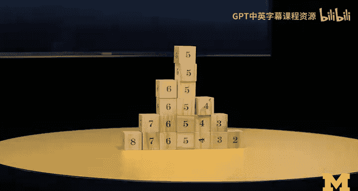
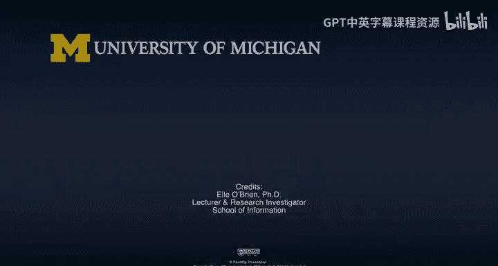

# 密歇根大学《理解数据：导航统计、科学和AI-Understanding Data Navigating Statistics, Science, and AI》 - P4：3_均值与中位数的测量意义.zh_en - GPT中英字幕课程资源 - BV1pU4NzuEvt

Okay， I've got my blocks here and let's refresh what they mean Each block represents how a person rated a cupcake from the new cupcake shop in town at the low end down here。

 a one represents the worst cupcake they've ever had and a10 would be the best Now we noticed that there is a shape kind of like a mountain or a hill and it's around this value five more people said the cupcake is a five than any other score。

Now I'm going to introduce some terms that capture something about where this peak is and why do we care about knowing where the peak is one way to think of it is that the peak and the range right around it tells us how a lot of people rated the cupcake so knowing how most people rated it is useful to me to form an expectation about how I like it。

The terms that I'm going to introduce are also essential for reading stories about statistics。

 they're used so often to summarize and simplify data and I want to help you develop an intuition for what they mean。

First up， the median， the median is calculated this way。

 we're going to line up all of the blocks in order so we take apart this distribution and I'm going to put them in a line from biggest to smallest。

Like so。Okay， so we have this line and now we're going to find the block that is exactly in the middle。

Okay， it turns out it is this one， it's this one right here， which is a five。

 and that means by finding the one in the middle， the median。

 there are just as many blocks on this side as there are on this side。Okay。

 so now we're going to put our distribution back together so we re stack the blocks。Okay。

 and we can see again， right， so we had the mediaian was a five and look that corresponds to the peak。

Now let's talk about the mean it also goes by a different name， the average。

 and one way to think about the mean or the average is that it's the result of a calculation。

 we're going to add up all of the numbers on these blocks and then we divide it by the number of blocks that we have so that's going to be。

Two plus three plus three plus four plus four plus four plus5 plus5 plus5 plus5 plus5 plus5 plus6 plus6 plus6 plus6 plus seven plus seven plus eight。

 we're going to add all those up。And then we're going to divide that sum by the total number of blocks。

 which happens to be 19 blocks， and that's going to give us about 5。05。

 which is also you know going to be pretty close to you know this peak of the distribution and now just just so you know I didn't calculate 5。

05 in my head， I had that written down。Okay。Another way to think about the mean。

 which might be a little bit more intuitive is that if we were trying to balance this whole shape of the distribution on a finger。

 where would I have to put my finger to perfectly hold it up Now if I put my finger all the way down here？

And I try to balance somewhere around like the eight or so。

 this shape is going to go tumbling the other way， right it's too heavy on this side and if I do it over here。

Down by maybe the two or the three， it's going to go tumbling the other way， right， it won't balance。

 but if I put my finger right here underneath it by like the fives。

 then that that is likely to balance。And that balancing point is the mean so our mean was 5。

05 and the median is5 they're very close but not exactly the same， but practically speaking。

 they're really quite close Now why do we have two statistics anyway if they're so close。

 why can't we just have one Well here's another example。

 what if the distribution of cupcake ratings instead looked like this？

Now it's not so symmetrical most people rated it very highly。

 but a few people gave it quite low scores， maybe they were very。

 very picky cupcake judges Now I'm going to calculate the mean and the median again。

Now the median here turns out to be nine right and that's because of half of the blocks are going to be you know if we lined all these up。

 we would have the same number of blocks on this side of a nine and on this side right。

 this is kind of the one in the middle so the medians nine。And the mean is actually 7。7， right。

 so it's going to be somewhere down here。And that you can kind of imagine is because if we had to put our balance point here。

 if we balance at nine， right， it's going to be too heavy。If we balance here。

 that's going to be closer to， you know， this we'd be able to balance the shape if we put a finger right around here。

So here's an example of a distribution with what we call a long tail， right。

 there's a lot of the action is concentrated over here。

 but there's this tail over here and it's not symmetrical。In this case。

 what's happening is that the median is still a good way to capture where the peak of the distribution is where most of。

 you know， most of the votes are， most of the cupcake ratings。

 but the mean gets pulled by the extreme values from a few people who disliked the cupcake。

 even though most people were quite positive about the cupcake。The median is much more stable。

 it's not as affected by a few people who are all the way down here。

So if I'm trying to decide if I want to go to the cupcake shop。

 which one is more helpful for me to know the mean of the ratings or the median？Think for a moment。

In this case， with this data distribution。I'd say the median is more useful to me。

 the mean is lower than most people actually rated the cupcakes this is an example of how we need to consider the research question and the distribution of our data to determine which statistic is the most useful summary to help me make a decision。

