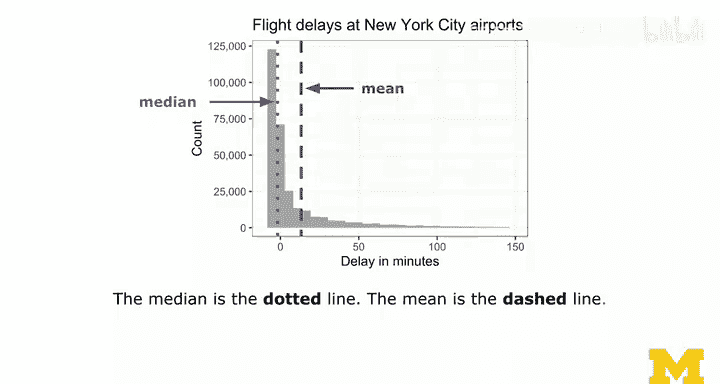

# 密歇根大学《理解数据：导航统计、科学和AI-Understanding Data Navigating Statistics, Science, and AI》 - P5：4_直方图解读方法.zh_en - GPT中英字幕课程资源 - BV1pU4NzuEvt

Let's look at another example from a real data set， but first。

 I want to introduce how we display data on a graph。

Weve visualized our data with a histogram made of blocks。

 but most data analysts don't take a pile of blocks with them to work。

 they'll use a computer to make a graph。So here is a picture of our blocks displayed on a pair of axes。

 we have the rating on the bottom which is called the X axis。

 and we have the number of people who gave each rating on the Y axis。

 and our blocks are stacked up one on top of another。

 except now they're depicted with little squares instead of cubes。

Now we could remove the block labels。And just leave the bars the height of each bar represents how many blocks are piled up。

 so this is more visually efficient， a bit simpler and it conveys the same message and this is how we'll usually see histograms represented Now let's see a real example here we have a histogram of flight delays at New York City Airport in 2013。

The height of each bar represents how many flights had a delay around that many minutes。

And here we see on the Y axis again is the count。So we can see that the highest bar is around zero minutes or even less。

 meaning that the flight was ahead of schedule， but there are a couple of flights with extremely long delays。

 it's rare for a flight to be delayed more than two hours which is about 120 minutes。

 but it does happen。So I've plotted the mean and the median here first， the median。And here。

 the mean。The median is close to the peak around zero minutes。

 50% of flights had a delay that was less than or equal to zero minutes。

 and 50% had a delay that was more than or equal to zero minutes。

 and the mean is all the way out here around 40 minutes because these data points out here。

The ones that are close to two hours of waiting， they have the effect of really pulling on the mean and dragging it out towards the tail。

 so if I were taking a flight leaving out of New York City。

 which statistic is more helpful for me to know as I planned my trip。

 would it be the mean or the median？And here we can see them both together to really see how there's a difference between them again。

 the median is more representative of what a typical flight delay is The mean represents a bigger delay than most flights ever see。

