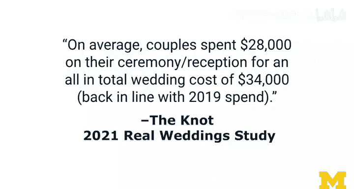
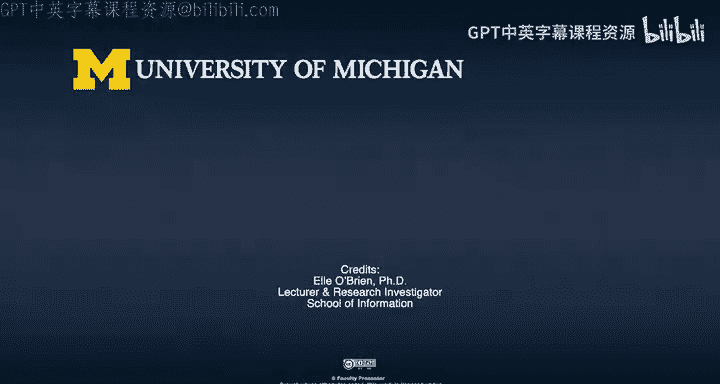

# 密歇根大学《理解数据：导航统计、科学和AI-Understanding Data Navigating Statistics, Science, and AI》 - P6：5_均值还是中位数：如何选择.zh_en - GPT中英字幕课程资源 - BV1pU4NzuEvt

In our last example， we were able to visualize the whole data distribution about flight delays so I could identify both the mean and the median and decide which is useful。

 but a lot of times we don't get access to the distribution where just presented with either the mean or the median and told to us accept that it's a reasonable summary of the data let's see why this can be tricky here is a quote from the not an online wedding blog about a study of how much readers spend on their weddings they say on average couple spend $28。

000 on their ceremony or reception for an allin total wedding cost of $34。

000 back in line with 2019 spend and this was from 2021 so all we get is the mean。

Right， we got on average。 we're only getting the mean but is this a useful statistic Well。

 let's think and I'm going to use some blocks again for this。

 We can imagine what the data that gave us the mean might look like。

 so I'm going to make a distribution of imaginary data now and instead of talking about the exact number of US dollars spent。

 I'm going to convert it to the number of months of salary。

 which is maybe a bit easier to think about if you live outside of the US。

 So over here I'm going to put brides who spent。Maybe only two or three months of salary on a wedding。

So maybe maybe this was something you know， with their immediate family and at the other end of the table with the nines are。

 somebody who spent， I'll do make that from into a nine。

 so we'll have some people who spent you know， like almost close to a year of their salary and let's see。

 I'm going to make the rest of the distribution in the middle， most people are in the middle here。

And you know what， just for this， let's say only one person。

Spent nine months of salary on their wedding。So this distribution here。

 kind of like our cupcake distribution， looks neat and symmetrical and it does have a peak in the middle。

So。😊，If this is what our data looks like， let's think which statistic might be helpful for someone planning a wedding who wants to know what a typical reader of the no is spending on their party。

 you try and answer this question and then we'll discuss。If you said either the mean or the median。

 you're right， in this case， the mean and the median will both correspond to roughly the peak of the distribution。

 so they're fair representations of what a typical reader is spending。

But what if the data looked quite different now the data looks quite different right so now most people are spending no more than two to four months of salary on their weddings。

 but there are a few very expensive events still that are really going to skew this distribution Skew is another word for saying we have a long tail Now the median is still going to be around here。

 but the mean or the average will be pulled out by these so the meann is going to be higher than our median in this case。

 which statistic do you think would be more relevant to a reader who's trying to plan their own wedding。

In this case， the mean is just not all that close to the peak。

 most people don't spend as much as the mean on their wedding。

 so a reader planning their wedding would probably find the median more useful Now we don't know which data distribution is more realistic this one or the more symmetrical one。

I think the distribution is likely to have a long tail。

 I personally think it looks more like this because some weddings can get extremely elaborate。

 but I don't know， it's actually impossible to tell from knowing only the average cost of a wedding like in the quote。

 if that statistic is actually representative of typical brides。

One more thing and let's switch up the question and consider our data from a different perspective What if I'm no longer planning a wedding but I'm an entrepreneur who's trying to decide if I want to get into the wedding industry maybe I sell flowers for events and I want to understand how much money I could stand to make by marketing myself to couples who are getting married now this is a little bit of a challenge but what statistic do you think I care about here。

Here， the mean might actually be useful because I don't care if I get money from a lot of small weddings or one really expensive one。

 I just want to make sure there's money to be made。

 I can't be positive I'll end up getting hired by the expensive wedding planners but I know there's a chance and because the mean takes into account that there are some very extravagant weddings it does reflect something about my theoretical opportunity。

To summarize the mean and the median are two fundamental statistics that you must know。

 you'll hear about them a lot as you read the news because they are a quick way to summarize complicated data。

 but depending on the question that you're asking and the way that the data is distributed。

 they might not tell you the same thing， knowing which statistic is helpful depends on the context。

