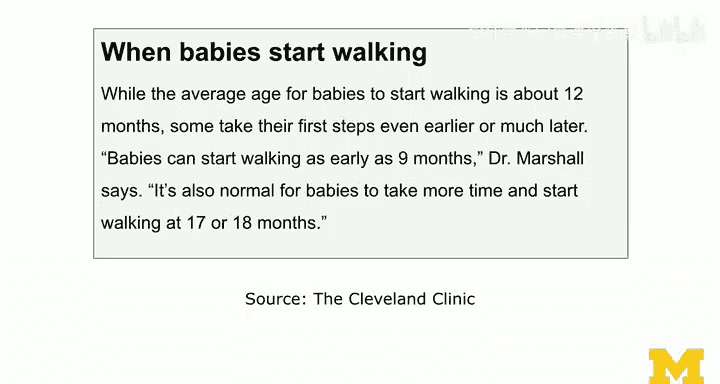
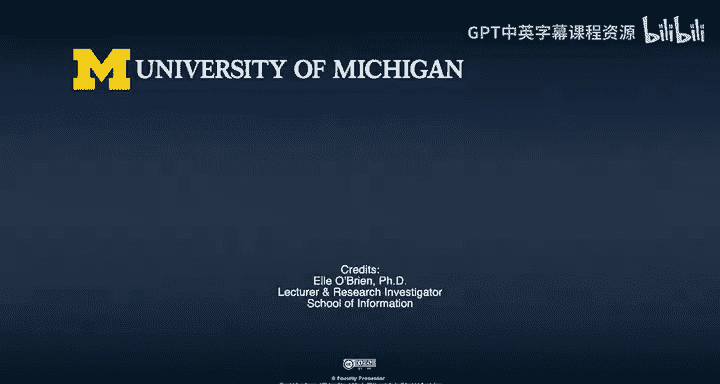

# 密歇根大学《理解数据：导航统计、科学和AI-Understanding Data Navigating Statistics, Science, and AI》 - P7：6_健康的数据变异性.zh_en - GPT中英字幕课程资源 - BV1pU4NzuEvt

We've been talking so far about summarizing data with statistics like the mean and the median Often we use the mean or the median to communicate a representative or typical outcome seed in data。

 a typical cupcake rating or spending on a wedding， but like any simplifying summary。

 we can sometimes lose important information when we only consider a mean or a median let's consider an example。

 so to return to our distribution of cupcakes， what we see is that there is a clear peak around five but there is some variability。

 some people rated it a4 or a six and some other people rated it even outside of that range。

 we could also imagine a completely different scenario where the peak of the distribution is still at five but there's much less variability。

Now， maybe everybody rated it a four or a six， so even though five is the median， it's it's you know。

 very， it's a bit of a different situation than when we had this here。

There's almost no evidence of anybody rating the cupcake extremely high or extremely low。

 whereas here there are， even though these are somewhat rarer outcomes。

 there's still a chance they can happen so if this is the data that I have I should feel more sure that I'm going to rate my cupcake between a4 and a6 than if this is my data where I still think I'm likely to rate the cupcake between four and a6。

 but I have to acknowledge that there are there are events。

 observations people who try the cupcake and think that it's either worse or better than that range Now what I've been manipulating here as I spread the blocks out further and farther from the center of the distribution or I take them away and I make the distribution very narrow。

 you could call that the range of the distribution how much space on the one to1 scale my data occupies another technical term that describe something about the spread of data is called a standard deviation。

And without going into the specifics of the mathematical phrase。

 you can note that deviation refers to something differing from the norm， and we can think of。

 you know， the center of the distribution as kind of a norm。

 it captures something representative or typical。Even though the term deviation implies something almost negative in the English language。

 it's just much more neutral in statistics variabilityability is a part of life。

 it's not a problem to get rid of， in fact it's often what we care about understanding the most so here let's look at an example from child development here's a question when should parents expect their baby to walk。

One way to answer this question came about through research by the World Health Organization。

 they collected data about healthy children in Ghana， India， Norway， Oman and the United States。

 and they were hoping that they could create a standard for doctors so that doctors would be able to understand。

 you know perhaps when is a child at risk if not walking on time and when our communities may be at risk and in need of public health interventions。

So let's look at our distribution of ages when children walked from their data now this is actually something called simulated data。

 what that means is that they didn't provide all of the data to the public。

 but I looked at the statistics in their final report and I constructed what the data might have looked like to yield those final statistics。

So here we have Age in months is on the X axis， so some children start walking around seven months。

 others are walking around 18 months， but most people are in the middle。

 and on the Y axis again we have the count， so how many。

Now the mean of this distribution is about 12。17 months， that's a very exact number， that's the peak。

Could you imagine if we told parents that they should expect their baby to walk at 12。17 months。

 Almost no babies would actually walk at that precise time。

 most would walk a little before or a little after we'd have parents calling the doctor because their baby walked early at 12 months or late at 14 months。

It just doesn't make sense to be attached to that average of 12。17 months because in fact。

 a lot of babies start walking at 11 months or 14 months。

Look at how much of the meat of the distribution is actually between a pretty big range of months。

Theres it's quite common for children to walk before or after 12 months so something that we could do instead is create a range of walking times that are common for healthy kids。

 we might say let's start our range near the bottom maybe start around month9 because even though there are a couple of kids who started walking earlier than that it's fairly rare and maybe we go up to maybe like 16 or 17 months at the latest because after that we want to encourage parents to be checking in with their doctors so instead of telling parents to expect their baby to walk in 12。

17 months we can tell them to expect walking between nine and 16 months because we know there is a lot of variability and when kids start walking on their own and most of that variability is normal and healthy kids that start walking at nine months can grow up to be healthy and happy so can kids that start walking around 12 or 16 months and kids。

fallall outside that range， they do exist， they can also be healthy and happy。

 but maybe we'll want to schedule a checkup just to make sure they have everything that they need to thrive。

To recap， looking at children's development， we see a lot of natural variability。

 and that means we should keep our expectations for individual babies flexible in this case。

 it's even more useful to know a range of likely outcomes than it is to know aine or a median。

