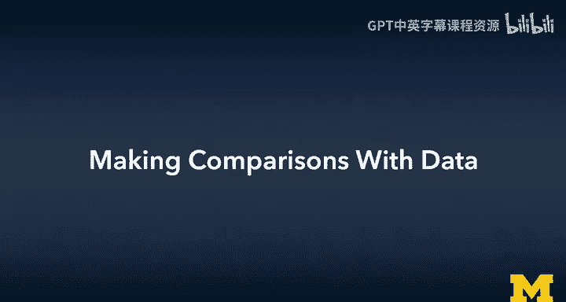
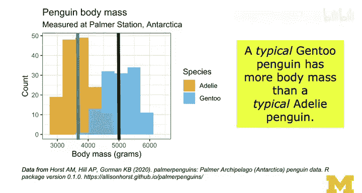
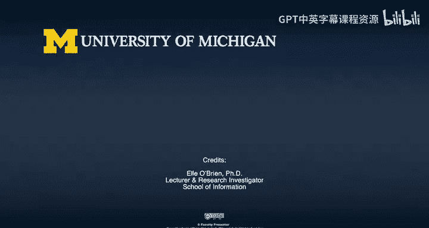

# 密歇根大学《理解数据：导航统计、科学和AI-Understanding Data Navigating Statistics, Science, and AI》 - P8：7_基于数据的比较分析.zh_en - GPT中英字幕课程资源 - BV1pU4NzuEvt

So far we've been talking about data that comes from one source。

 people walking out of a cupcake shop for flight delays in New York or wedding spending by readers of a popular online magazine。

 but sometimes we want to make comparisons between two data sources。

 we want to know if one cupcake shop has different ratings than another or if flight delay is differ by airport。

 let's look at how we might do this using the intuitions about data distributions that we've been building。

So I'm going to introduce to you two types of penguins。

 these are the Aelli and the Gentu penguins and these are two species that live in Antarctica。

And perhaps we are interested in understanding something about how big they are。

 so here's a distribution again， and a distribution remember is you know we've perhaps weighed a whole bunch of penguins and these are all aelli penguins and so we took all of their weights and we've put them on this plot here and so we can see a couple of things about it。

First we're looking at their body mass， so body mass is on the X axis here。

 so this axis here is body mass going from smallest to largest。

 we have the count so that's how many penguins there were of a given body mass。

 we have some plausible range looking at how far the body mass span we can see that the penguins are between about 2500 and5。

000 grams。And we could try to guess what's a plausible mean， so looking at this distribution。

 it's pretty symmetric， so I'm going to say we can just use the mean to estimate something about the peak and it looks like it's around 3。

700 grams so we could draw a line right about here。

Now let's take a look at data from the other species， the Gen2 penguin。So look again。

 we have the width of this range so the penguins seem like they span from about 4000 to 6，000 grams。

 there's a peak that is about at 5000 grams and finally we can look at them together so if we were to plot these two distributions on the same graph we can see in one color we've got the aelli in the blue color we've got the Gen2 and this region where it's darker that's where they overlap。

So let's ask a question， which penguin species is larger？Think about this question。

 because each penguin species can have a range of body masses， maybe we should ask。

 does a typical a dullli penguin have a bigger or smaller mass than a typical Gen2 penguin？

And one way to quickly summarize what's typical in this case would be the mean body mass for each species。

 and we know the mean is a pretty useful summary in this case because these are nice and roughly symmetrical distributions they don't have very long tails so our plan then is actually to answer this question we can estimate the mean of each of the two penguin species and then compare which mean is bigger。

So let's go back to our histograms and start labeling。

 let's first label the average body mass of the Aelli penguinss right here。

And let's do the same for the Gentu penguins right here。So looking at these two。

 we could say that the Gen2 penguins body mass is on average， larger than the Adelli penguins。

But what does it really mean for one species to be larger on average。

 I want to add some nuance here to what it means to compare averages。True or false Think about this。

 Does this mean that every Gen2 penguin is bigger than every ali penguin？

Look at the graph for a moment and see if you can get any intuition。

 any hints that are calling out to you is every Gen2 penguin bigger than every ali penguin now the biggest ali penguin is close to 5。

000 grams we can see that because of the distribution of ali penguins。

 we've got some data that's over there right around 5，000 grams。

And let's look at the smallest Gen2 penguin， so if we look at their data distribution。

 where's the tiniest penguin right about there， this one's a little less than 4，000 grams。

So when we see them on the same picture， we can be sure that there are indeed some Adelli penguins that are bigger than some Gentu penguins。

 even though Gentu penguins are on average larger。Another way of seeing this is that there is an overlap between the distributions penguins of both species have been observed in this range here that I've darkened in this range of body masses。

So what does it really mean to be bigger on average Well we've decided that this is， in fact false。

 it is simply not true that every Genu penguin is bigger than every Adelli penguin。

So does it even really matter that we found out that Gen2 penguins have a bigger average body mass？

Well， I'd say yes， and here's two ways of thinking about why。

One way we could say it is that a typical Gen2 penguin has more body mass than a typical aelli penguin。

So we're saying something about typical， we're saying that you know there's something about you know where those penguin body masses cluster and it's in a slightly different place for each species so another way of saying that is if I were to randomly pick an ali penguin and a genhu penguin。

Usually， more often than not， the Gentu penguin would have a higher body mass。

Comparing the means of two data distributions is a useful way to identify some bigger patterns。

 like that Gen2 penguins tend to have more mass than ali penguins。

 and using averages helps us create expectations or general ways of simplifying data so that we can think about it。

Sometimes those will be wrong， like when we find an especially small genu penguin or an especially large ali。

But we have still learned something that works in more cases than it fails。

Here's a central tension in statistical thinking we can learn to identify patterns that hold in some cases。

 maybe even a lot of cases。But we will rarely talk in absolutes。

 being right about statistics means expecting to be wrong some of the time。

