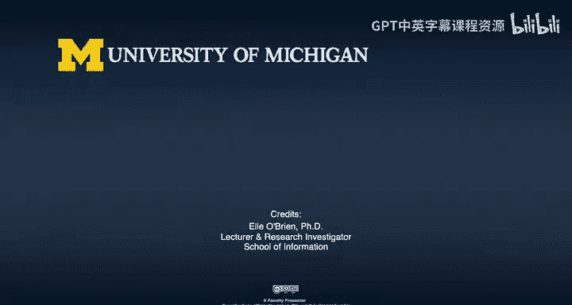

# 密歇根大学《理解数据：导航统计、科学和AI-Understanding Data Navigating Statistics, Science, and AI》 - P9：8_模块2导论：培养不确定性直觉.zh_en - GPT中英字幕课程资源 - BV1pU4NzuEvt

In the first week of class， we've explored fundamental ideas about data， how to collect data。

 how to think about it， and how to summarize it。Every day we encounter summaries of data。

 how much an average wedding costs， the median home price， the average rating of a restaurant。

We often use these shorthand summaries to reason and make decisions because they simplify thinking about potentially complicated measurements。

We've also discovered that not all statistics are equally helpful。

A statistic could capture the wrong aspect of data。

 like when someone reports a mean when a median is more relevant to their audience。

A statistic could also be so simplistic that it obscures the most meaningful information。

 like when we report a single mean where a range of likely outcomes is more appropriate。

In the next few lectures， we'll keep developing our intuition about what could strengthen or weaken our trust in the value of a statistic。

We're going to consider how uncertainty can enter into our measurements of the world and how we continue to learn things even under imperfect conditions。

Getting comfortable with uncertainty might be the single most important statistical thinking skill It will really challenge you to consider numbers in a new way。

Let's begin with some demonstrations， and then we'll put the concepts together。

