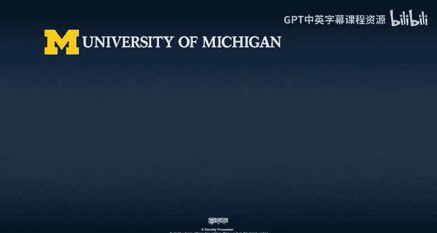

# 密歇根大学《生成式 AI 基础知识：概述和影响｜Generative AI Essentials： Overview and Impact》中英字幕 - P11：10_生成式AI训练数据偏见分析.zh_en - GPT中英字幕课程资源 - BV1Dw4m1S7HU

h that one worries about with respect to any AI system and certainly for generative AI systems。

Is bias。For the most part。This bias arises because there is bias in the training data。On which。

The system has been trained。So。The first thing to think about is where did this training data come from。

The training data is。Usually collected。Often at great cost。And may come from a variety of sources。

Yes。At the end of the day。We may end up training a system on the data that we've been able to get our hands on。

Even though we know that it's not a perfect reflection。Of the world that we would like to model。

And there's a lot of satisfying satisfying and saying， oh。

 this is about as close as we can get to with respect to the data that we have。Everybody understands。

That it is important to have training data that is representative of the world that we're trying to model and that if we don't。

 then we are likely to end up。Training a system to behave in ways that would be perceived as incorrect。

Or at least biased。And so。People building these systems。Do make an effort。

Within the constraints of what data they're able to collect。To do the best job they can。Nevertheless。

There are any number of。Stories that people can tell about how many AI systems have failed in this regard。

It is generally believed that if。The teams that were building AI systems were more diverse。That。

There will be fewer errors。And I think that's a reasonable statement。Just because。

With a diverse team， people who think differently。There's less likelihood of。Some types of mistakes。

Going unnoticed。It is also generally believed。That in addition to engineers who would be building these systems。

 that it is a good thing。To have processes for consultation with communities that are impacted。

Just in terms of making sure that we're covering blind spots and making sure that。

The kinds of concerns about certain data sets or known biases and ways in which certain data sets were collected。

Can be recognized and addressed ahead of time。None of this。Is a magic pill that's going to make。

Training data， unbiased。Even with the most diverse team and even with great community consultation。

It is quite possible。😡，Let we end up with training data。

That isn't really representative of what it is that we want to do。There are many reasons for this。😊。

Representation is tricky。Okay。To be able to say， I've got a data set that is representative。

I need to be able to first。Say what it means to be representative。

If you and I don't even agree on what population it is that we're trying to represent。Well。

Our notions of representative couldn't be the same。So for example。😊。

AHo trying to run some kind of clinical trial might want to have good representation with respect to。

It's cashment area and the kinds of。Patients that might live in that area。

But then they might wish to publish a paper about the results of their clinical trial。That。

Would impact the whole world？And even if they've done a perfect job of representing their patient population in their study。

 that doesn't mean that they did a good job of representing the whole world， in fact。

 they almost certainly didn't。And so here we have this thing of what is this model going to be used for and what does it mean to be representative？

So。Answering these kinds of fundamental questions is hard。Now in the case of generative AI。

 these problems。Might actually be slightly easier because we have to assume that generative AI systems are universal and are meant to be universal at least that's how they seem to be today and so we want to represent。

Everybody on earth。

