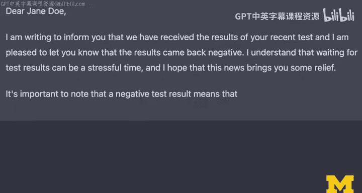

# 密歇根大学《生成式 AI 基础知识：概述和影响｜Generative AI Essentials： Overview and Impact》中英字幕 - P14：13_数据隐私保护挑战.zh_en - GPT中英字幕课程资源 - BV1Dw4m1S7HU

I think there are a variety of issues related to privacy with these kinds of AI technologies because people I think will be tempted to do some work savingaving by introducing information in their queries say to something like chatt EBT and in that information they might include information that ordinarily they would think of as private。

 not realizing that when you put that into the software。

 you may be exposing information you aren't supposed to expose， so for instance。

 instead of saying the name and medical information of a patient in order to get chat EBT to write a letter or to make a note describing what your experiences were with that patient a doctor might want to not use the name of the patient when when making that description but as we habituate using these technologies。

 people may not be thinking they may not be put in mind of the ordinary。

cautions that we take in the context of sharing information just because it feels so private when you're at home alone engaging with a machine。

 It doesn't feel like that information will necessarily spread So I think people should be cautious about the information they provide even if they want assistance from entities like chat GT or any of the other AI bots that are out there。

 it's fantastically helpful， I think to use those technologies。

 but you just may not want to include information that would ordinarily be private Yeah I think it's safe to ask sensitive questions。

 I just think it's important to leave out information that will be absorbed into the database of the technologies that you're using if you were able to give a lot of information about an identifiable person。

You you could have that information infused into the background data from which the AI draws information。

 and that might include a photograph or it might include music that someone else had written or it might include descriptions of an individual and so I think you want to be careful about sharing that kind of information because you don't know how it will be used and whether or not that information can be exposed。

 So I do think it's important to use those technologies with the idea that you may be exposing information you ordinarily wouldn't want to expose at the same time。

 I think you can talk about very sensitive issues without exposing that information you can create pseudonyms for individuals if you need to talk about in individual name you can put it in the context of fiction if you want to you could interact in a way that's cautious and still talk about subjects that are。

Controversial， difficult。 I actually can see AI technology making some kinds of conversations a lot easier for people。

 particularly sensitive conversations， because some people might be more comfortable and more honest if they're engaging with a piece of technology rather than another human being。

 I think there are a lot of introverts in the world out there who might find that more comfortable。

 maybe not just introverts。 really， it could be anybody who's just more comfortable engaging with a piece of technology in the same way that they might talk to their dog。

 their baby or their plant。 I'm not sure what what the companies like Open AI can do to protect private information from being exposed through the AI。

 I'm not sure that there's going to be an easy way to recognize， recognize fact from fiction。

 That is， I'm not sure that they will be able to determine whether the name that someone inputs when they're trying to have another chapter of a book written。

Whether that that person will be seen as identifiable， it's possible if someone says， okay， Cha GP。

 I'd like you to write a piece of fiction， and then that fiction will forever be that notion of fiction will forever be tied to the characters that follow。

 It's not clear to me whether that's possible or not。 maybe it is。

 And I'm not sure how they will do that。 what they've done already is amazing。 I mean。

 the idea that the experience that one has when interacting with these technologies is to produce something that a person could produce or to produce something that seems like a conversation。

 These are amazing things。 So I don't want to say that it's impossible to be able to winnow out to the fact from the fiction。

 But I think it will be difficult。 So I'm not sure what they'll be able to do。

