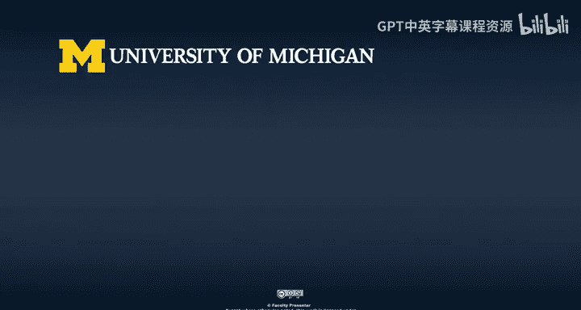

# 密歇根大学《生成式 AI 基础知识：概述和影响｜Generative AI Essentials： Overview and Impact》中英字幕 - P1：0_人工智能与ChatGPT的定义.zh_en - GPT中英字幕课程资源 - BV1Dw4m1S7HU

My name is Kenarro Toyama。 I'm a faculty member at the School of Information at the University of Michigan。

 and I do research about digital technology and its impact on society。 Overall。

 artificial intelligence is really any kind of system that is human created that does things that we as human beings perceive to be intelligent in this broadest sense。

 you know it could be everything from the intelligent eye in your garage door opener that you know makes sure that the door doesn't accidentally shut on something and of course。

 these days we are all carrying very intelligent things in our pockets。

 our smartphones can understand our speech to a great extent and respond in intelligent manner。

 All of that is artificial intelligence but recently there's been a lot of excitement around a particular class of artificial intelligence that is really about。

😊，About effectively a certain kind of very sophisticated kind of statistical pattern recognition and learning about patterns and generating new patterns and so forth。

 and that class which is sometimes called neural networks or machine learning or deep learning is really what's generating the recent excitement around AI chat EptT is one of the most recent technologies that have come out of this wave of AI and what it is is it's informally called a chatbot。

 meaning that you can have a conversation with it through a text interface just like you were texting a friend。

 and what's amazing about chatt EPT， is the degree to which its responses are so human in nature。

 In fact， you know unless you're really looking for flaws in chat EPT。

 you can have a text-based conversation with it that just seems like you're talking to another adult human being。

