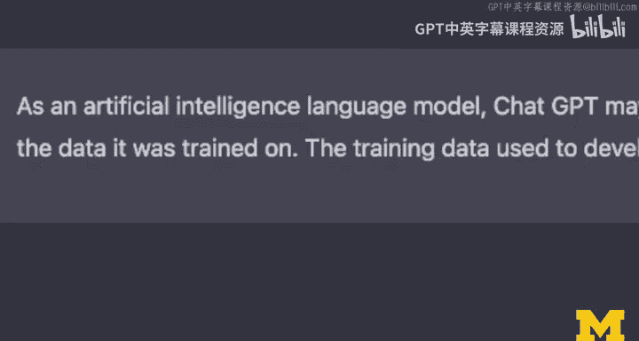

# 密歇根大学《生成式 AI 示教｜Generative AI Teach-Out》中英字幕 - P11：10_ChatGPT类人化应答的利弊分析.zh_en - GPT中英字幕课程资源 - BV1Hs421N7LX

Hi， my name is Julie Hoi and I'm an assistant professor in the University of Michigan School of Information so a big value of chat GBT is its human like response and I think that's why people are really drawn to it you can type in any query like how do I。

😊。

Bake waffles on a Sunday and it would kind of tell you not just in like the instructional form that you might read on the internet。

 but it's like a person is kind of walking you through that process or like with essays that the fact that you can ask it to write an essay and it sounds just like a student has written it is why people really like using it for writing writing prompts but I guess that's also where a lot of the problems come in so like in educational settings because it sounds like exactly like a person has written it。

 it's really easy to plagiarize teachers are having a really hard time determining if something is written by AI or by a student and so openAI has actually released a additional tool to identify if something has been written by chat GptT so at least that's something that teachers can implement into their classroom to kind of prevent that from happening another reason that the humanlike response might be problematic is if people are writing message。

that are supposed to be personal and they find out that it's actually written by NAI。

 so I think I saw like someone post on Twitter that he had Chat EBT write a letter from Santa for his children。

 which made me think like， well now that you're not writing that personal message to your kids so you can imagine people writing like I don't know。

 like a birthday message to their mom or I'm sure they would be not particularly happy to find out that these like supposedly personally written messages are coming from NAI bought rather than something that they thought the。

The writer was writing so I think those are some areas where it can become a little problematic in the future I can imagine that people will become more used to getting AI written messages but they might have to be a little bit more upfront about when they are using those tools。

 another area that it might be an issue with its humanlike responses that people might start to believe that whatever chatt EptT says is real and always correct and if you go onto the website they kind of give a warning saying that our algorithm isn't 100% perfect we might be giving incorrect information sometimes。

 but you know like a lot of people they skip over that initial information they just type in what they want to hear and if chattET is giving incorrect information like potentially high stake situation。

 people might yeah take in the wrong information not really know whether。

it's true or why it's true with a lot of AI algorithms there builds off of what like the dominant population thinks what most people are typing in and that leads to the responses that chat GT giving are they could be biased in many ways and so kind of figuring out。

To。Identify when it is biased， when it might be less biased is a big skill that not many of us might like have I definitely can't always determine like whether or not an answer is like the best answer or not。

 but because it only gives one response kind of。

Collected from many responses that they've collected through their database。Yeah。

 people might be inclined to think that that one response is like the best response or the most truthful response when it may not be。

