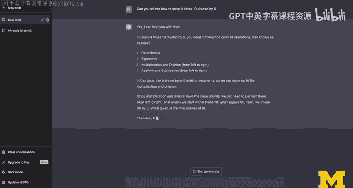

# 密歇根大学《生成式 AI 示教｜Generative AI Teach-Out》中英字幕 - P15：14_可选ChatGPT示例：简单数学问题.zh_en - GPT中英字幕课程资源 - BV1Hs421N7LX

Hi， my name is Sam and my name is Moisa and today we're going to show you how to use chat GPT by providing four different examples。

First， we're going to use chat GPT to solve a math equation for us。

I'm going to ask chat GP if they can tell me how to solve 8 times 10 divided by five。

And it's thinking。Okay， so chat GPT is giving us the answer and also breaking it down into the PEmDIS equation。

 so parentheses， exponents， multiplication and division， addition and subtraction。

And then it gives us our answer， which is。

16。