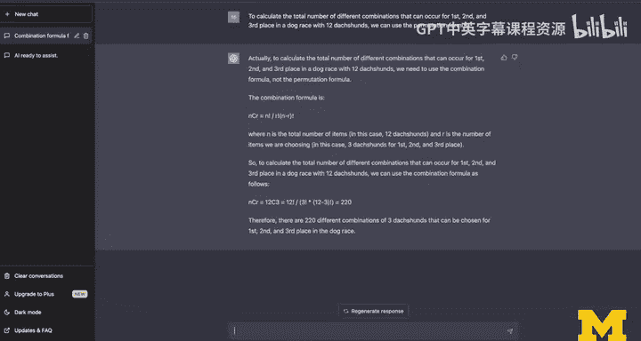

# 密歇根大学《生成式 AI 示教｜Generative AI Teach-Out》中英字幕 - P16：15_可选ChatGPT示例：复杂数学问题.zh_en - GPT中英字幕课程资源 - BV1Hs421N7LX

Now for chat GPT， we're going to try a permutation。Example。

To calculate the total number of different combinations that can occur for first， second。

 and third place in a dog race with 12 doxins， we can use the permutation formula。

Chat GT is thinking。And chat G says。Actually， to calculate the total number of different combinations that can occur for first。

 second， and third place in a dog race with 12 doxins， we need to use the combination formula。

 not the permutation formula。Combination formula is NC equals N Explamation point。

 slash R Expation point， parentheses n minus R parentheses Explamation point。

Where n is the total number of items。Pentheses。In this case， 12 dashhounds parentheses。

And R is the number of items we are choosing。Prenheses in this case， three doxins for first， second。

 and third place parentheses。So to calculate the total number of different combinations that can occur for first。

 second， and third place in a dog race with 12 daxons。We can use the combination formula as follows。

N CR equals 12 C3 equals 12 explanation point。Divided by parentheses3 exclamation point。

Atric parentheses 12 minus3。Pheses explanationation point parentheses equals 220。 Therefore。

 there are 220 different combinations of three dashhounds that can be chosen for first。

 second and third place in the dog race。

