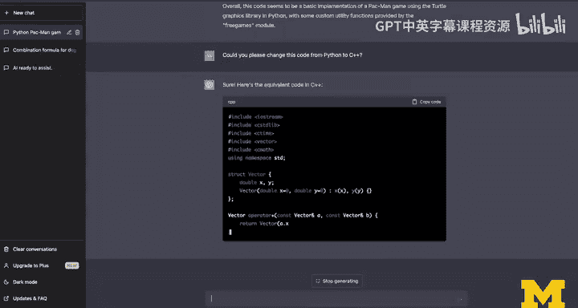

# 密歇根大学《生成式 AI 示教｜Generative AI Teach-Out》中英字幕 - P18：17_可选ChatGPT示例：编程问题（第二部分）.zh_en - GPT中英字幕课程资源 - BV1Hs421N7LX

So for our next prompt。We will ask Cha G B T。Could you please change this code。

From Python to C plus plus。Sure， here's the equivalent code and C+ plus。

And then Chat EPT creates a code block for us， converting our Python code to C++。

Now sometimes with these coding examples， it can take quite a while for chatt GPT to generate code。

 that's because it's doing it in real time。And so we get to see it going line by line。

Generating the code。

