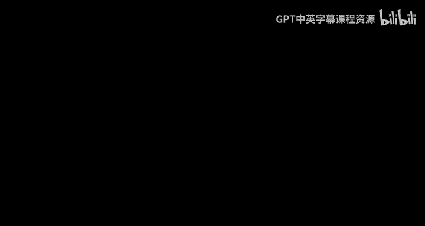

# 密歇根大学《生成式 AI 示教｜Generative AI Teach-Out》中英字幕 - P22：21_版权归属：生成内容的剽窃与溯源.zh_en - GPT中英字幕课程资源 - BV1Hs421N7LX

I'm Jack Bernard， and I'm an attorney in the General Co's office here at the University of Michigan。

 I also teach in our schools of law， education， public policy and information。

 and I have been thinking about chat GptT since I first heard about it， which is， I guess， about。

8ight months ago， and I've responded to lots of questions from people in our community about how it works and what kinds of implications it creates。

 Well， I mean， I think you don't have to plagiarize when you're using chat GptT or any other kind of AI that's out there we I think the opportunity opportunities with these kinds of technologies are amazing for us。

 I mean， there are tremendous number of things that people might be able to do with these kinds of AI technologies that don't involve any kind of academic misconduct or misrepresentation of any kind。

That's to say we we use technology all the time when we're doing our work。

 the challenge with these kinds of AI technologies is that they're able to do a lot of the work for us。

 and because they do a lot of the work for us， it might be tempting to want to use them in ways without giving them credit or without acknowledging that we didn't do that work。

 and of course in the academy the coin of the realm is acknowledgement and credit。

 and we might struggle with this new technology because the lines are right now unclear。

 So for instance， we have students who might go to a friend and say， hey。

 could you just read this paragraph for me and give me a sense about whether it makes sense to you Well。

 we don't typically acknowledge that kind of support and now lots of students use technologies like the recommendations in the word software or grammarly and I think those kinds of things don't get acknowledged。

 Of course， those sorts of things aren't capable。Wri an entire paper or an entire response to a question and so I think people are apprehensive about the possibility of replacing a student or even a faculty member's own thinking with the product of something like chat GT so I do think there are lots of ways to use chat GT and other AI technologies without engaging in some kind of plagiarism but I don't think that it's hard to slip into the world where someone might have plagiarized it's easy when you've run out of time to lean on another source because we already know our students do that right they go to Wikipedia or they go to someone else's article and just cut bits of it and put it into their own work without acknowledging it。

It's worth also saying something about what is plagiarism。 Plagiarism is not a legal violation。

 It's a violation of academic norms。 So when someone plagiarizes。

 they they don't acknowledge the source of specific language or even of their thinking。

Or they attribute it to somebody else like adding someone else's name to your paper in order perhaps to attract more readers。

And I don't think it's necessary when using technologies like chat GptT to keep those things hidden。

 In fact， I expect that students will say I created this paper and I use chat GptT to help me that's a possibility how faculty will respond to that that's a whole new question I think just because chat GptT looks across a large corpus of information to produce an individualized independent response to a query that draws on this experience that it's had reading lots of other materials。

 that doesn't make it plagiarism in the same way that it doesn't make it plagiarism for me to have formulated all these words that I'm producing right now from all of my experiences over a lifetime and so I think chat GT is doing essentially what people do。

 maybe not exactly the same way， but in ways that are actually very similar which is it。

Mulates knowledge and assembles a perspective based on the AI Now it probably isn't conscious just yet。

 but it's a lot like going to somebody else who also does the same thing to get information。

 So I I don't think it's necessarily Well it's not plagiarism on the part of Cha GT to create new expression from being exposed to lots of things。

 it is possible， I suppose for chat G to quote a third party without someone knowing about it。

 And I guess in that case， it could be plagiarism。 But I think it's unlikely to be the case from what I can tell there's some safeguards there。

 therere probably safeguards that can be circumvented in some way or another。

 we have yet to see but for the most part， just assembling an amalgam of this information it's been exposed to and creating original expression。

 that in itself is not plagiarism。 That's just communication from a piece of technology。

 I think it's difficult to know what kinds of。Citation cultureture we're going to create around these smart technologies。

 these AI technologies。 right now， we don't know what to do。 I think students， faculty。

 publishers are going to be a little confused about how to acknowledge whether their materials were created in part with a collaboration with some kind of AI。

 I don't think we know the answer to that question yet。If it were me。

 I would err on the side of letting people know that this is what I used because I think it's about integrity。

 We want in the acade in particular to make sure that we're citing our sources。

 and so I think students and faculty should make their best efforts to create normative standards where their expectations about what people can and cannot use and of course。

 in some classrooms， faculty members will be using chat GT as part of the teaching model and so I think maybe that will be baked in and a student wouldn't have to mention it because it's part of the original assignment。

 but I think if a student or a faculty member say when making a publication， we're using chat GT。

 it's a good idea to acknowledge it， especially in these early stages。

 because I think it provokes conversations that will enable us to think about what our culture around citing AI will be。

