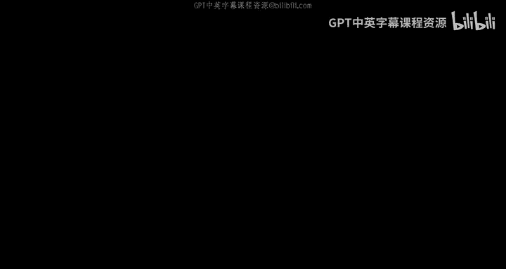

# 密歇根大学《生成式 AI 示教｜Generative AI Teach-Out》中英字幕 - P28：27_AI与艺术创作.zh_en - GPT中英字幕课程资源 - BV1Hs421N7LX

The next thing I want to talk about with regard to。Why this kind of labeling matters。Has to do with。

Geneerative AI outputs。And their relationship。To creative output。From the creators in our society。

 authors of books and painters and musicians and composers。There's a question of。Somebody。Like me。

As a reader。I might actually find。A book。Written by a generative AI system， a compelling read。

I might choose to read such a book。However。I would very much like to know when I'm doing that。

That I'm reading。A book written by a GAI system as opposed to a book written by my favorite human author。

嗯。And I think。My。Expectations about these things are also likely to impact what I'd be willing to pay for the efforts of the human author versus the GAI。

And having the right kind of labeling again， I think is going to help us。

Overcome many of the difficulties that we're already seeing in the marketplace where。We have。

Bookstores， at least bookstores on the web， ebookstores flooded with。Generative AI content。

That real life human authors are having to compete against。At least for certain types of。

Creative works。Similarly。A few months ago， we had。An artist。Submit a painting created。

By a generative AI system that won an art competition。

 and there was a lot of debate and angst about this。

What this says is that the quality of art that was being generated by the GAI system was at least comparable to the quality of art that human artists participate in the competition were doing。

However， the fact that there was a particular piece of art generated by an AI system mattered to the jury and to the public。

And to the other competing artists。And so。Having that be clearly disclosed is。

 I think in the interest of all。