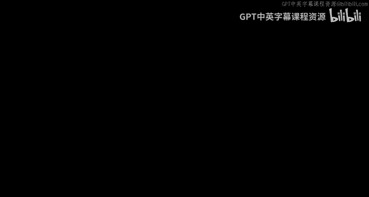

# 密歇根大学《生成式 AI 示教｜Generative AI Teach-Out》中英字幕 - P32：31_AI生成艺术品的所有权.zh_en - GPT中英字幕课程资源 - BV1Hs421N7LX

The question about who owns actually the generated images what the generated media created with generated AI models it's a very good one。

 I mean if you think about it from the perspective of how they get produced or let go it this way most of these companies that are creating generated AI tools provide a very specific language of whom these generated images belong most of those are stating that it's sort of a shared ownership the company that provides the software or their generated model has the right to use the image that this person generated but so does the person who generated it so it's basically split they can do with the image you generated what what they want。

 but so can you I think for the moment I think it's quite。😊。

For that sort of f of conversation， I think this is a possible solution。But I understand， of course。

 also artists were arguing wait a second， the image only could have been generated because my images are in the data that was actually used to create an image。

😊，This is a very slippery role because the problem here is that the results generated by the generative model is not a copy of the work of the artist present in the data。

 thus he has no chance to sue somebody for helping him。And by the way。

 it's also sort of like a very hypocrittic poem because every artist is influenced by other artist before him。

 right， so it's something similar what's happening in gene eyes。😊。

The recycling images from those generative models might remind you of a specific artist。

 but it's also sort of like an artist imitating another artist， right。

 And the only thing that happens when this happens in reality in real people is that you would try to say。

 well， it's just imitating another artist thus see what original and he might not be like such a good artist。

 But there would be no there would be no lesson going on between those artists。

 as long as they don't copy the signature。 and but that to really a fake。

 right So this is actually what's happening right now if they generative AI generated imagery。😊。

They' are not copies。They don't perics of those artists。That's also why they can be， you know。

 used by the person gene or the company that provides the model。

This could be a much longer conversation by the way here。

 because there's a lot of loopholes and a lot of things that could be discussed， like for example。

 all generative AI models for images the starting point for each process is a random noise image。😊。

This is another argument why it cannot be a copy because it's a randomized image that gets transformed then through。

If you through youicing processes into an image that is legible。

 So I don't think there is like a final word on this at the moment， who owns what。

There might be actually an interesting debate coming out of this。

 which is questioning actually the concept of authorship and ownership， generally speaking。😊。

What is agency， what is authorship and so I think these are all very pressing questions。

 but there might be extra at the point coming where understand that the idea of authorship might be outdated。

😊。