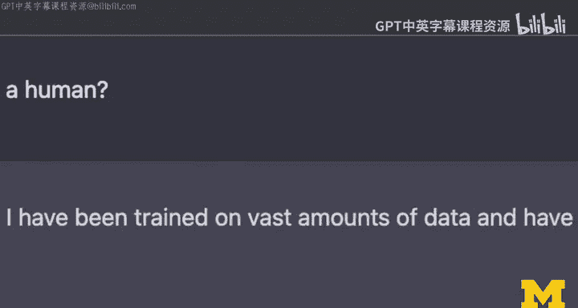

# 密歇根大学《生成式 AI 示教｜Generative AI Teach-Out》中英字幕 - P35：34_人工智能监管体系.zh_en - GPT中英字幕课程资源 - BV1Hs421N7LX

So I think one of the most challenging things that we are facing now as a society is how to regulate AI。

 And I don't think we can do it soon enough。 The technology is already out there。

 Some of the darker implications are already being foretold。

So the first thing is I think we do need to have very good regulation of AI。 I think of， you know。

 this generation of AI as being like nuclear power in its potential power and potential to do harm and just like with nuclear power。

 which is extremely tightly regulated， we also need to be thinking similarly about AI on， you know。

 I think there's a number of things that we could do that would immediately help even the current situation。

 So， for example， one thing is that there's a little bit of。Abiguity as to。

 you know how much an entity would be blamed if they put out an AI system that did something。

 you know that went rogue in the way I was talking about earlier。

 but where it wasn't the intention of that person or organization to cause that to happen。

 We need to close that loophole， basically， you know people or organizations that put out AI systems that go rogue need to be fully held responsible for that fact。

 And of course， that will immediately slow down the eagerness with which you know people or companies put out this technology。

 but in fact， already we've seen examples of this。 we don't we want to make sure that these systems are not having the kind of conversations that would cause somebody to feel particularly bad about themselves occasionally accidentally。

 you know， understand something about your emails that is very sensitive and accidentally make it public in a way that you want。

 know， and all of these things are things that in theory could happen even with today's technology。

 And so I think the consequences of。System doing something that was unintended and negative need to be significant。

 And they need to be tied specifically to the people organizations putting that technology out。

 So that's one thing。 I think with technologies like chatty PT。

 Another thing is that we might want to suggest that any such system keep a very good record of every conversation is had every text that has generated and for a variety of reasons。

 so that we can actually go back and inspect what might have gone wrong if something goes wrong。

 as a teacher， I can also say that would be super helpful in， for example。

 being able to detect whether my students are submitting assignments that were written by chat E PT right So this ability to be able to inspect what the systems have been。

Have been putting out is， I think super critical。 There's a range of other things。 But overall。

 I think the important thing is for regulation to be a little bit on the conservative side in the sense of。

 you know putting the onus on the creators of the technology to feel and experience the legal responsibility should something go wrong with that technology。

 So I think one of the harder things to kind of rein in or regulate about some of this oncoming AI technology is first of all。

 you know， are we prepared to let it take away jobs， And if so， what's the type of。

 you know kind of policy around that。 it's going to be inevitable that those things are going happen。

 we haven't tried to curb that from happening with， let's say， manufacturing robots。

 even though they've taken away jobs in certain contexts。 know， we haven't so far talked about。

 you know， maybe we don't want self-driving trucks because that could eliminate 3 million jobs just in the United States of all the people who drive trucks。

 But maybe those。meaningful conversations to have。 I think some of the harder things to kind of regulate and adjust because they'll sneak into our society are you know these effects of what happens once we start using these technologies and become so habituated to it that we don't even realize the impact on us。

 And I think you know again， we' are seeing versions of that already with technologies like social media where you we have some sense that it's eroding our democracy。

 and yet there's no attempt to regulate because we're not even sure what it is we would regulate。

 But I think the earlier we have those conversations the better with AI。

 those kinds of issues I suspect will just get worse and worse in the sense of we'll be challenged more and more and more with shifts in the way we interact with the technology。

 certainly， but also with each other and do we want those shifts to happen or not。

 I think we just need to have more discussion as a society and be clear eye about it。

 I think chat GptT represents a certain kind of threshold。Has been achieved。 You know。

 people talk about the singularity， which is the moment when artificial intelligence equals。

Human intelligence。 And then from that point on， it just gets smarter and smarter and smarter。

 And we are not quite there yet。 but I think we are amazingly close。 And if you think about it。

 that's something that humanity has never experienced， right。

 which is a situation where something other than a human being can be smarter than us。

 And so I think that， you know， suggests both again， it suggests great power。 technological power。

 And any time there's great technological power， it can help with the things that we want to have happen。

 but it can also cause great danger。 And so in this case。

 I do believe AI technologies are things that we have to be super careful about as a。😊。

Civilization so that we really stay away from some of the darkest potential impacts that it could have。

