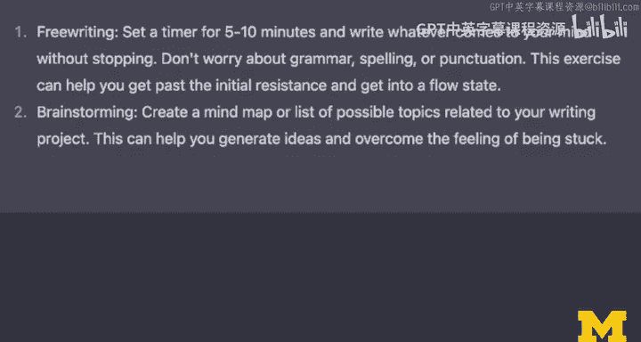

# 密歇根大学《生成式 AI 示教｜Generative AI Teach-Out》中英字幕 - P45：44_利用ChatGPT提升技能水平.zh_en - GPT中英字幕课程资源 - BV1Hs421N7LX

A lot of people have been comparing chatGBT to tools like calculators where when calculators first came out a lot of math teachers were concerned that students wouldn't be learning math anymore。

 they would just be learning how to type in an equation and the answer would be spit out by the calculator but what some people have been arguing is what calculators they kind of do the lower level calculations which frees up a lot of energy to do higher level math。

 and in some ways I believe that's true but I'm not really sure if the same thing is happening with chat GBT where if a student were to type in a query like write me a history of trees in Michigan that they would just turn in that answer and not really know what the rhetorical moves are behind it。

 like the structure of the writing， how they choose what emotions to include in the writing。

 how they chose what words and a lot of that really helps with writing skill development and with communication。

En。By kind of taking that away， it's not clear whether ChatyBT is like supporting writing at all。

 so I think there needs to be a lot more work to understand that。Yeah。

 so I think there's a lot of interesting opportunities for AI to support writing skills even before chat GBT you could see stuff like grammarly or even with Gmail they would show what your tone is if something is too long。

 how might you edit it to make it to seem more like easily digestible but now I guess like everyone's really interested in understanding what chatGBT's role is in the writing space I think one thing that I'm interested in is。

Tools that support the process of getting started with writing so a lot of these other tools like grammar Lee or like the stuff that evaluates your emails。

 you have to write the first draft and then another tool kind of evaluate whether or not it's like good or bad。

 but a lot of writers have trouble just getting started and I think that's where a lot of the value is what chatGBT is that it gets you over the hurdle of the white blank page that we're all kind of fear when you have to write your essay for the first time it just kind of starts writing for you and I think that's what's so exciting for people is that they can kind of see that being done for them and I think there could be a lot more research to understand how reading what Cha GBT writes might affect like how you write yourself but I know there's a lot of conversation about whether people are even like reading what it's writing if they understand what ChadGBT is writing so there's opportunity to see like whether that writing can serve as like maybe educational models or not。

