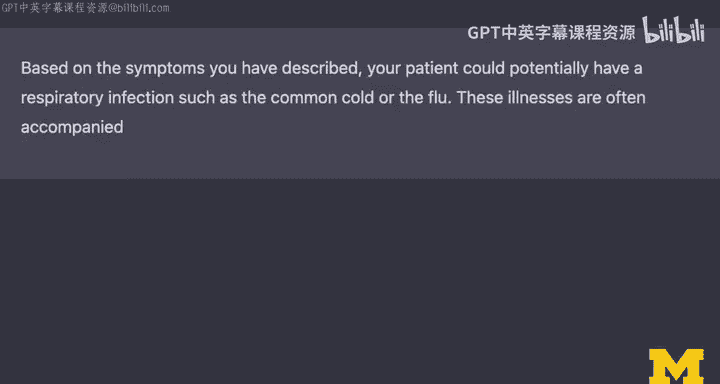

# 密歇根大学《生成式 AI 示教｜Generative AI Teach-Out》中英字幕 - P48：47_AI在医疗实践与教育中的应用.zh_en - GPT中英字幕课程资源 - BV1Hs421N7LX

When we think about the necessary involvement of clinicians in the development of artificial intelligence or programs that are designed to have an impact on clinical care。

 it's going to be essential and I would say it's not going to just be clinicians。

 I would even add patients to that group as well when it comes to having an understanding of what it's like to actually be in clinical practice or to be at a patient's home。

 if developers are the only individuals that are in the room when these technologies are being developed。

 you could imagine as well-mean as they can possibly be。

 not having that real life clinical experience and or those experiences of patients experiencing or having certain comorbidities or health conditions。

 you could imagine that there could potentially be somewhat of a disconnect when it comes to how these technologies are used or how individuals interact with them。

And or how they are implemented。 And one of the things that we are frequently concerned about is how is how will these technologies impact a clinician's workflow right。

 so it's going to take clinician input to determine or to。

Informed developers about what that workflow looks like and then help to make that decision about where AI or machine learning models would be most appropriately or effectively deployed in practice and the same is true for patients when it comes to the impact that artificial intelligence and machine learning will have on clinical care or clinical practice I would dare to say that it's going to impact every aspect of clinical practice in some way shape or form and the same is true for for medical education。

When we look at where we are now， it's mostly diagnostics。

 specifically image based diagnostics where we're seeing the most impact and that's understandable given the nature of these technologies。

 but eventually I see it having an impact on treatment， prognostication。

It'll have an impact on diagnosis， which is one of the which is what I'm working on currently。

 and then when it comes to medical education， when it comes to assessment and tutors or tutoring and a medical student being able to engage with or interact with or have that bidirectional exchange with an instructor that's not a human。

 but that is in some respects as knowledgeable as an instructor。

That they would interact with if they were actually sitting in the classroom。

 but to be at home and to be able to ask a a。Artificial intelligence agent about a specific question or topic or subject in medical education。

 I see that as being something that is definitely going to be coming in the near future。

