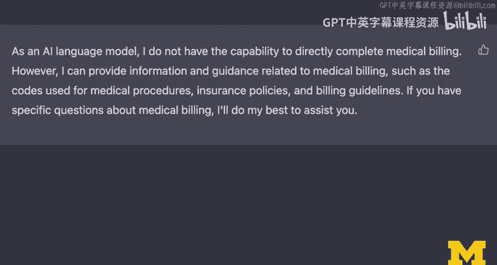

# 密歇根大学《生成式 AI 示教｜Generative AI Teach-Out》中英字幕 - P49：48_ChatGPT通过专业认证考试的影响.zh_en - GPT中英字幕课程资源 - BV1Hs421N7LX

So there's a lot of talk about chat GPT passing things like USME exams， bar exams。

 exams at business schools， very， very highly ranked or rigorous business schools。

 and we have to definitely take take note of that it's important。

 but it's going to also be important for us to to some extent kind of temper our expectations and to recognize when things。

Do require us to take a， take a look at them， or there is a tendency to。

Overhype technologies and media certainly plays a part in that and it's understandable。

And sometimes that can cause a little bit of concern or panic amongst individuals that are impacted by things like passing a USMLE exam。

 for example， a clinician may be wondering， well does that mean that these technologies are going to replace me or a patient could be wondering。

 does that mean that these technologies are going to completely replace my physician？And again。

 I think the way that things are framed， it could easily appear to be that way， however。

 I typically or I usually suggest taking a task specific approach or view of artificial intelligence and machine learning and that goes back to what I was saying earlier about this being a team we have to again acknowledge the fact。

 okay chat GPT past the USMLE exam so what does that mean for me it means that there are potentially some things in clinical care that I may not need to necessarily do anymore。

Yeah so you hear this term referred or used called dekilling right and that may not necessarily be a bad thing because it may open up opportunities for clinicians to perform tasks that they really should be paying a bit more attention to like the compassionate care that they would love to provide for their patients like being able to spend additional time with their patients because they're not doing things that tend to be a bit laborious or to be quite honest with you。

 things that they generally didn't go into medicine to do paperwork。

 billing and so on and so on if we have a。A AI agent that's able to do those things for us。

 then it could potentially allow us to focus on things like patientcented communication and shared decision making。

 being compassionate and having those meaningful conversations that we seek to have with our patients Now that doesn't mean that we're not going to have medical knowledge we are in a place now where we need to really start to think about what do we need to know from a conceptual perspective I see as moving away from medical students being found the source of information。

 I see medical professionals moving away from needing to be the absolute source of information and moving more toward being information managers being able to locate and to synthesize information and to communicate that information to patients in an effective way。

So we will have to think about from a conceptual perspective or at a conceptual level。

 what will medical students， what will residents， what will healthcare professionals need to know？

And what will in order to provide effective care？And then join that with what is it that artificial intelligence and machine learning as a teammate or in some cases as a tool can do that will allow us to do our jobs better or what is it that AI will do to augment what we do and then what is it that we're going to do to augment what AI does。

 and that's where I say again， when we think about things from a team perspective。

 it allows us to more easily see that it's not necessarily that AI is going to replace physicians。

 I don't believe that that's going to ever happen。what you may hear in some cases is it's not that AI is going to replace all physicians。

 but there's a very good chance that it could replace physicians that are unable to engage with or team with AI or use it as a tool effectively。

