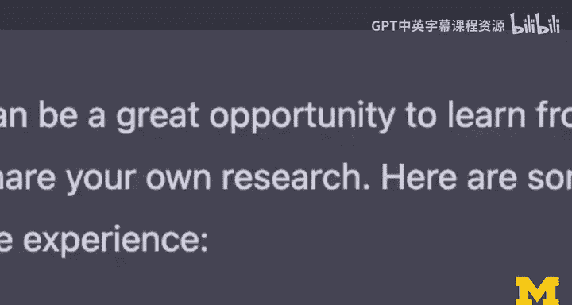

# 密歇根大学《生成式 AI 示教｜Generative AI Teach-Out》中英字幕 - P52：51_AI在日常咨询与自助指导中的应用.zh_en - GPT中英字幕课程资源 - BV1Hs421N7LX

Yes， I think with any technology， there' I think people are really worried。

 especially because they didn't anticipate with things like Facebook and Twitter that it would be as polarizing as it is and on those platforms because there' there's social platforms。

 people are seeking attention， seeking followers And so we tend to be like drawn toward people who take more extremet positions。

 So Phil Ttlock wrote this amazing book called expert political judgment and what he essentially found is the people who take extreme positions are actually worse than random in terms of making predictions and and essentially what you get is if you're listening to someone on the far left or the far right you might as you're better off throwing a dart at a board and just randomly picking it's going's going go downs going to stay the same。

 That's a better strategy than watching MSNBC or Foxs。

 The interesting thing about chat G3 is that you can ask it for a liberal opinion or a conservative opinion but it kind of gives you this know middle of the road's。

generallyally what we think there's humans in the loop in this。 So there's been humans sort of， know。

 checking。When training this algorithm to try and give reasonable responses。

The it's really good at kind of like very basic advice。 So， you know， I ask it like。

I'm a second year graduate student。 I'm going to my first academic conference or my first professional meeting。

 What should my strategy be， know how do I do this And the advice came back and said really simple。

 Okay， so first off， you know， if you're presenting。

 make sure that you know you've got your presentation ready， you know。

 make sure you know you're dressed appropriately， make sure you kind of like really you know doing doing a good job when you're kind of on the stage。

 Second thing you want to think about is are there new things you really want to learn and and look out。

 you know， look for those topics and you trying to go those sessions。

 Third thing is even though you might be meeting famous people in the field。

And you're excited about that。 You don't want to just go up to them and start talking about your research because you're a second year grad student。

 so chill。For thing is is however， this is an opportunity to meet other young people。

 So go to panels。Then interesting do it and introduce yourself to young people because they're going to be in the same boat as you。

And the last thing it said is don't overschedule， you know。

 maybe only schedule like 60% of your time because you want to be able to adapt because you might find。

 oh， I'm going to go to this panel and also you're just going to be mentally worn out。

And the last thing， the very last thing I said was。

Know whether in these situations you get energized or get worn out and adjust your schedule appropriately。

 It's a really good answer。 It's probably a better was a better answer than I probably would have given。

 I mean， if I'd have SAT down for an hour and thought about it。

 But what's happening is it's scraping from the Web advice that a lot of people have given a lot of time。

 So just getting general advice， it does， you know， as does Google。

 But the problem is like if you go on Google， you find like 40 different articles each one the take and often with extreme opinions。

 here it， it is， has more of a middle of a road， the road effect。And so， you know。

 I'm not going to place a bet on this thing， but my guess is it's gonna be moderating a bit。

 but I don't know the question is will people use it。 I mean。

 in the sense of like will people say I'm going to turn to this like weird AI and ask it for advice on buying a car。

 buying a house， talking to my children about like the construction of a will， those sorts of things。

 I don't know but it's really good at those things you know it's like's it's kind of frightening how good it is。

 but then it's not because what it's doing is it's it's averaging what we a bunch of people have done and again you know I'm in this field of collective intelligence And the idea is that you know think of ants you know ants aren't that smart。

 each one kind of like lays a little chemical trail that they follow or they have little things on their antenna and they sort of communicate by touching their antenna but a collection of ants can find a food source and then find a route to it really fast because it's aggregating this information。

 So if you think of this。Not as this kind of like super brain， you know。

 that's got mysterious evil you know， goals and instead think of it as just like。

An aggregate of what people have thought。And you approach it from that perspective。 And you think。

 you know， I'm trying to decide， should I retire， I'm trying to decide， you know。

 should I switch careers， I'm trying to decide， should I， you know， move closer to my adult children。

 I'm trying to decide， you know， should I intervene with my child who's taken a year off from college or how do I have that conversation that you could kind of interrogate those。

 Like， you know， tell me more about this first point or I disagree with and。

That I think that can be fun because， again， when we're exposed to ideas， it causes us or knowledge。

 it causes us to think。 And so this is a way to have a conversation with。😊，A very。

 very bright entity， a super knowledgeable entity。 And then from that。

 that having those conversations with that as opposed to just searching。

I think spurs us to think in ways we might not have before， right， And I think that's exciting。 I。

 but I really think。While it's easy to focus on the negative aspects of this。

I would like to think that， you know， when given the light bulb， when given the car or you know。

 given these new technologies that most people are going to use those。

To try and find ways to make their lives better and not just chat。

 but like so many people have so much fun with Dolly。

 my students serving a lot of fun with the music software， right， It's。

 it's incredible to see how much joy people are getting from this and how much productivity is coming from。

😊。