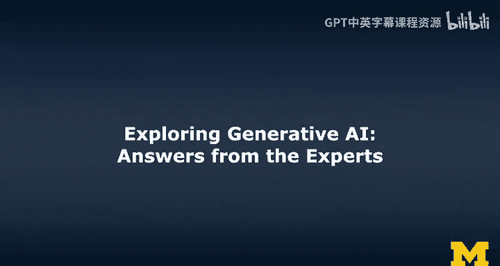

# 密歇根大学《生成式 AI 示教｜Generative AI Teach-Out》中英字幕 - P57：56_实时问答研讨：2023年8月23日.zh_en - GPT中英字幕课程资源 - BV1Hs421N7LX

Hello everyone， welcomelcome to the generative AI Teach Out Live Q& A。

My name is Melissa McCurry and I am a learning experience designer at the University of Michigan's Center for Academic Innovation。

I'll be your moderator for today's event。This live event brings together four unique voices to help us gain a better understanding of the current landscape of generative artificial intelligence and what an AI integrated future could look like for business。

 education， authorship and beyond。We can also learn more about how these powerful technologies can be used in our daily lives。

The generative AI Teach out is still live on Coursera。

 so please feel free to jump in and engage with our community of global learners。

 You can find the link in the chat now。I want to thank everyone who has already submitted questions in the teachout and in the event registration。

During this live session today， we invite you to submit additional questions for our panelists in the Zoom Q&A section。

 and we'll do our best to answer as many as we can。

Feel free to upvote questions from other participants given our limited time。

 we ask that you keep your questions related to the topic。

As we bring together this diverse community and discussion。

 we also ask that you be respectful of our speakers and other learners as you engage with this event and the teach out。

Please note that this event is being recorded and will be uploaded to the T out in Coursera afterwards。

I'd also like to point out that the closed captions have been enabled and you may need to press the CC button on the bottom of your Zoom window to view the transcript。

😡，Without further ado， I'm pleased to introduce our panelists for today。Dr。

 Kurt Sifsad is the Excut Director of the Center for Entrepreneurship at the University of Michigan。

Dr。 Mathiia Dl Camppo is an associate professor of architectureure at the University of Michigan's Toubman College of Architecture and Urban Planning。

Dr。 Yingzu is an assistant professor of Learn Sciences and technology at the Marshall Family School of Education at the University of Michigan。

And Dr。 An Hanguo is an assistant professor of electricalical engineering and computer science。

 as well as an assistant professor of information at the University of Michigan。

So thank you all for joining us today， let's jump into our Q&A。To begin。

 I'd like to ask each of you to give a brief introduction of your work and your research and how it involves generative AI。

Kurt， could you please start us off？Yeah thanks Melissa as Melissa said， my name is Kurt Gifad。

 I'm the Ex Director at the Center for Entpreneurship at the University。

 my interests are in the commercialization of generative AI and how it will change how we do business and how we work together。

 this kind of builds on 30 years of commercializing AI technology coming out of places like the University of Michigan and other laboratories。

Maiaus， would you like to go next。Sure， so the main focus related to AI in my work is with the laboratory for Architect Artific Inligence at Topic College called ARiel。

 that is an interdisciplinary laboratory between computer science， data science。

 robotics and architecture which brings together those disciplines to find novel solutions for architecture problems that can reach from very pragmatic problems like automated planmaking。

 optimization of structures to the discovery of cultural meanings within these tool sets。

And then Ying， would you like to go next？Sure so I'm in the School of Education。

 so I do research on using AI to facilitate teaching and learning。

 I am particularly interested in developing AI to serve as children's conversation partners to see whether and how children could learn through having back and forth conversations with AI。

I'm An Honggu， I'm a assistant professor in Com science and engineering and also School for information。

 so our work kind of related to generative VI there are two different directions。

 one that we mostly focusing on is on accessibility。

 so how can we use AI and generative AI techniques to make the world more accessible for people with visual impairment to increase the communication bandwidth per people with communication needs as well as there's a separate direction on how do we leverage these new tools for immersive authoring in virtual reality environments。

Yeah thank you so much everyone for those introductions。

 it sounds like you're all doing very interesting research and thank you again for being here today。

😊，For attendees who haven't yet taken the generative AI teach out。

 let's begin with a basic understanding of what generative AI is so this first question is for Kurt。

 how does generative artificial intelligence work？Melissa that's a big question just for some context AI has been around for quite some time and the uses we've seen in our lives have been more what we would call analytic applications of AI things like figuring out what the best therapies would be for a patient given their current comorbidities or understanding the optimal route through traffic in real time for your GPS system or financial systems stock trading and other things like this generative AI is new and exciting because it's about creating new content based on prompts from a user and really is opening the door to new types of creativity you know essentially this is is an information technology it's information in and information out and some people refer to generative AI as。

Very fancy autocomplete functionality， but it's much。

 much more than that you because of the sophistications of these systems。

 they have the ability to work at a very high degree of subtlety in fidelity with the information at a conceptual level some people say so you can say generate a prose in the style of Shakespeare or you could generate computer code in Python language or you could generate haiku based on a simple text prompt you can also prompt systems to generate music or other types of digital media we've all seen imagery coming from Dolly or midjourney based on text prompts and so it creates very sophisticated new content based on prompts from the user at a very very impressive level of detail and sophistication。

Thank you Kurt， that was a really helpful overview and then as a follow up question learners are interested in knowing more about training because there's a lot of talk about training in generative AI so what does this training look like and how are generative AI systems trained。

😡，Yeah， this is really kind of the excitement of looking back。

 you 30 years ago when I graduated from the AI lab here。

 we were dealing with big data sets that were know were trivial in size compared to what we have now and essentially a key part of the generative AI revolution is that we have massive massive amounts of data available on the internet in particular that is labeled and associated with different concepts。

 so these systems take this digitized content， you can think of blog posts and news articles and captions for images and tags on pictures on Pinterest and other things to correlate that information and create a very。

 very sophisticated model that allows you to predict what a text input would would be relevant。

So you it's all about the data with these systems and being able to use massive amounts of data to create very。

 very complex models which can be then used to generate new content you think of imagery of you know red green and blue pixels to creating color imagery。

 these systems， these generative systems are not looking at three dimensions they're looking at in some cases hundreds of thousands of dimensions in a you know almost incomprehensible space where they're making decisions to decide what is the next。

Piece of information， the next pixel on on the image being created or the next note of music that is being created or the next phrase in the haiku and it's it's really quite fascinating。

 but you know the day it comes back to very， very， very large。

Data repositories that are crawled over and over again by these systems to train them and create the models。

Thank you， Kurt， it's always so interesting to hear about how the models are trained and the large amounts of data that are put into the models。

Switching gears to our next question， this one is for Matiaus。

If everyone one begins to use AI to enhance their work。

 how do you maintain some level of individuality and authenticity in your work while using AI for enhancing。

That's a good question。😊，But actually it's not a new question that question always shows up when a new technology comes up。

 so I think that no matter if you're using a brush and oil paint or a photographic camera or AI you always have to find a way of how to express yourself that sort of tool because at the end of the day it's another tool right。

 artificial intelligence， the main difference is's one main difference between the tools you use to find any form of artistic production and AI is that artificial intelligence can learn which previous tools did not do。

But this can be also used as an advantage for an artist because repeat again。

 we are here with the work mentioned before and explained by Dr Sifgar， which is training。

 you can actually train your own data sets， you can you can train your own neural networks。

 for example， if your own data end on this is also a form of creativity like what do you use how do you use it。

 you can intentionally， for example， avoid really。Robust curve fittinging。

 creating really strange results which create a novel form of aesthetics that you as an artist can use as something that is unique to yours so there is a variety of ways and methodss and ideas and techniques where you can exploit even AI to expand your abilities as an artist。

One quick thing I saw in the news that OpenI just enabled like chat GBBT 3。

5 fine tuning capability for individual users， so that's really exciting。to follow on。

 I 100% agree with what Matias was saying I think it's not that creativity is going away。

 I think there'll be an explosion of creativity with these new and really powerful tools。

Yeah that's wonderful to see and I really appreciate hearing about AI and the advantages of AI because I think there in the beginning there was a lot of concern about AI and a lot of negativity surrounding it。

 so it' it's really good to hear like the positive impacts of AI。So moving on to our next question。

 it's on a related note about authenticity Ying we've gotten a lot of questions about the role and impact of generative AI tools in education。

What will or what should generative AI change about the skills we seek to teach in our classrooms？

Yeah thank you is this question is indeed kind of related to Mattia's question just now so there are a lot of discussions going on right now and the general consensus I would say is that it is essential to balance the acquisition of foundational skills with some sort of AI literacy so i'm going to expand on that a little bit so first certain foundational skills are still irreplaceable it is especially true in elementary and middle schools where we want students to learn how to do things on their own so that they could later become more effective users of AI tools that will become available to them so a good analogy would be the calculator so even with calculators available arithmetic remains a crucial skill because it lays the foundations for students to learn math in the future so similarly for generative AI like chat GT it could be a valuable brainstorming partner or editor。

😊，But it cannot evaluate its own output， so solid foundational skills like analytical thinking。

 organization， adaptability to different audiences are still very necessary so that the students can critique and refine on what chattGBT produces。

But beyond foundational subject matter， knowledge and skills。

 we also need to teach students on how they could leverage AI to enhance their applications of their skills。

 so when considering chat GT， the quality of its answers largely depends on how you prompt it。

 so this is a skill that we should equip students with。However。

 I do want to kind of differentiate between teaching specific prompting strategies versus providing a broader understanding of AI to enable students to adapt to the ongoing changes so both aspects are important but the latter is kind of gaining significance because of the rapid evolution of large language models so in fact I remember there is a study that compare GPT force behaviors over the course of a few months and found that even with the same prompt the quality of its output varied。

 so if we just have students to memorize fixed prompts without introducing them to the underlying logic it might not be as beneficial to help them keep up with kind of the really dynamic nature of AI。

Thank you Ying I think that's such an important part that we have to teach critical thinking and those strategies like you said and now moving on to our next question。

 this one is for and Hung how does generative AI impact people with disabilities so for instance we had a learner say that they were totally blind but they were interested in knowing how they can utilize AI。

Thanks for the question So in my lab we do a lot of work at the intersections of AI and generative AI and accessibility。

 so I would say there are both positives and negatives that we should think about on the positive side。

 these new machine learning and artificial intelligence capability have huge potential in making the world more accessible such as creating personal assistance to describe the visual content such as images。

 videos as well as know in the real world， I think that is still a very hard challenging problem that existing geneative AI where AI models do not do very well right so as an example there is a company called BIs which is a service that pairs sightted volunteers and blind users to answer questions through a video stream and they release a capability a collaboration with open AI so that blind users can upload the photo。

And then it's able to ask questions and talk， have a conversation with this photo， basically。

So I think that is very exciting and I think a lot of users are benefiting from that。

 but I think you we should really move towards being able to have a continuous camera stream that's able to observe what's happening in the real world and be able to have the user dynamically query and request the information in real time。

 so I think we're still pretty far from that。So so that's kind of the one of the example of a positive of how these new tools can make the world more accessible however there are also a lot of considerations that can things that can go wrong that we should pay attention to for example。

 related to what Ying said you know depending on how people prompt these models the models' output will be very different so we are not sure how chatGBT will say about a person with disability or how they would describe you know someone with disability maybe steotypical languages and invertently create you know other harm through this process。

 so you know although there has been a lot of techniques to add filters and you know like make sure things are not you know inappropriate things are being output but that in fact create other problems for example。

There has been a case where someone with ALS want to ask for a cigarette and you know the generative these large language model think you know cigarette is something that's not safe so it just prevented that person from saying that word so you know like so that's a kind of a very interesting case and another case is these data are for example there has been standard you know research on how should we describe human right so should we describe their gender or appearance or race so there are a lot of considerations there but actually heavily depends on where you are in the world in the Western culture or in a different part of the world actually people have very different preferences so how do we enable these kind of customization while still considering safety and also as a side note so we have been talking a lot about kind of large language models like chatTPT but the other like image generated。

Moels， for example， if you think about them， they are not currently accessible for people with visual impairment。

 right， so how there has been some ongoing research on how to how to make that happen。

Maybe just a quick follow up on things。 This is super exciting and interesting。 specifically。

 if you use large language models in order to describe， for example。

 the environment to a blind person， there is one particular problem that is still present。

 which is that this large language models very often hallucinate steel things。😊。

And thus are just giving false information， even if it sounds completely convincing。

 so this is like one of the danger that I see in these models is that they can create things that sound completely plausible and reasonable but are far away from the truth。

😊，thus actually creating a vision of an environment that does not exist for this blind person。

 so I don't know how this will impact them apart from things that are like dangerous if the model like says it's green but in fact the light is red to walk about the street。

 I know that this is just a matter of training and the larger data sets and so on and it will prove that's for sure but at the moment there's still a lot of hallucination going on。

Yeah that's a very important consideration so sort of at the intersection of AI and explainability and we had one work on like by providing touch exploration for blind users to explore image in detail they're able to make more informed decisions on whether the automatic generated caption is correct or not so in this case for example imagine there's a virtual assistant that's observing the real world that's telling the user was happening and there might be things that are hallucinated then we should you know for example one technique from the more algorithmic side is we can add a bunch of other like existing computer vision models that are more explainable to kind of check you know what are the objects that you see whether there are things that exist in this you know what this generative model is producing and then cross-che that and maybe like communicating that uncertainty better to the user although there' are also challenges in you know。

Understanding that uncertainty level and things like that。

Yeah just another quick follow up because we work with really young children sometimes just preschool a children so we think about this safety issue a lot so one approach we've been using is keeping the human in the loop approach so when children interact with generative AI so we keep the parents and the teachers in the loop so that they could kind of filter out the information they probably don't want the child to be exposed to yeah so but there are so many different kind of mechanisms how like what level of flexibility and automation that we want to include in the AI system that we need to research on。

Thank you An Hong Mathis and Ying， that that's such an interesting conversation and definitely one for all of us to consider as the technology continues to develop。

Being mindful of time， we're going to switch gears and move to our live questions from our audience today。

 and as we shift to these questions， I want to emphasize that a lot of these great questions are being discussed in our teachout and we hope that you'll take the time to join the T out live on Coursera。

So now with our remaining time together， let's move to these questions one learner asks as a professor。

 how do you introduce generative AI to your students， for example。

 generative AI can be quite daunting at first glance。

And how do you envision your students's use of GAI？Students are using GAI to help them write essays。

 do you think this is harmful or developing their critical thinking？so much in that we just had a。

Obviously we've had a lot of conversations within the college about the implications of generative AI in the classroom and and how the individual instructor determines whether it can or should be used and in what ways and how should the student be sharing that they're using that do you use it as as a cited source or do you use it as a coauthor。

 if you will and the reality is students are going to use this technology these technologies they have been using it certainly talking to students last semester right after the chat GT was made public they were using these technologies and it is a tool that all need to learn and understand how they fit in different contexts and there pros and cons but the reality is it's here and it's up to us to figure out how to make the best best use of it。

 I think it comes back to。You know， something that Ying said I think， is that you know we at the key。

 we need to teach our students to be critical thinkers and this is these tools are ways to add more content to the workflow if you will。

 but it doesn't absolve them or us of the you know the responsibility to understand the or teach the core concepts and show you know it's a new new world。

 how does a student demonstrate competency or mastery of a set of concepts in the world of generative AI and so we need to be creative as well。

I have maybe a different perspective to the problem because I mean， I'm not a computer scientist。

 I'm not a data scientist， I'm an architect。And architecture this strange animal somewhere between technology and art。

The humanities and technology， so we need to find a way how to we ourselves into the conversation about AI。

And one of the first things I tried to do when， I mean。

 also we started doing this sort of like design ideas with AI before the rise of GAI in the last one or two years who we have been doing this before that。

The method how to teach it didn't change so much because of GAI because one of the most important things for me once I start with new students who have never worked with AI before and have no idea about programming or scripting or anything like that is trying to demystify。

AI first， like trying to make them understand it's not magic。It's a technology。

 it has certain tools and it has like here's a diagram， that's how it actually works yeah。

Just trying to take away the anxiety that a lot of students have today in regards to this like overarching giant thing that is in front of us now。

 which is AI。Now specifically when it's about GI like a generative AI， by the way。

 the models we've been talking about like the image generators and text generators。

 these are not the first generative AI models out there。

 they have been tools before that GN was one of those styleiggan was basically a generative tool right so they just became bigger because of the datas that are being used。

But at the end of the day like trying to show them that oh。

 it's actually just a machine where you inverse the flow of information to instead of being analytically being generative。

 for example， yeah so if you take all the things into account。

 you can very quickly create like and a critical atmosphere where students are going to be。😊。

Hopefully be more critical to it the tool and also recognize when it is useful to use it and maybe we not。

 you don't have to do everything with AI if you can do it differently more effectively。😊。

But also on the other hand， what is very important for me again talking from the perspective of ratherda the artist as an architect is really the cultural implications of what does it mean when we use it and how does it affect us as humans and the human condition how do we reflect on it and then how does that reflect on the output we do with it so the critical interrogation of the tools that is。

😊，For sure， one of the most important parts of moving ahead when it is about pedagochi。Now。

 thank you， Curtin Matiaus。 And now our next question is asking。

 can you clarify the difference between generative AI and predictive AI。

Are these independent classes or is there some significant overlap between these AI types？

 Is this distinction important to better understand the concept。

I'm sure anybody wants to take that and these semantic arguments are always fun to get into， yeah。

 I think there are classes of tools called predictive AI and what we're talking about now is called generative AI。

 I think there are different use cases and historical in particular systems that were more in the class of analytical solutions。

But it's not something I would spend a tremendous amount of time。嗯。

Trying to understand it's a semantic argument to me， I'm happy to learn more from my peers though。

If I can add to that because I think it's a super interesting question， by the way。

 I mean theres two things that AI generally speaking can do really well。

 one is optimization and then the other one is prediction this is like the two main areas where AI can really excel。

😊，The generative AI tools we're seeing are primarily optimizing。

 they're optimizing longer a micro chain in response to one of your prompt， for example。By the way。

 which does mean also that it does not necessarily produce the best result。

 It just produces the optimized results towards a specific question， which。

Sometimes it's not the optim， by the way， it's kind of very interesting yes。

 I know it's semantics and I agree Curtis is all semantic problems here。😊，But at the end of the day。

 those are like philosophical questions that are really worth thinking about， I think。

Because it turns， for example， if I talk as an architect again it's turning some of our beliefs as architects on the head right because when we in architecture talk about optimization。

 we talk about you know the minimum amount of material that I can use the maximum support I can create with the minimum amount of structure like these sort of things the maximum use of space within a building these are like very clear very pragmatic logical steps that you can take now we have a tool that that might optimize in a direction which is maybe not the minimum amount of material to be used in a building but it improves the living standard in it right so there's like this tradeoffs that happen which are not necessarily completely logical but sometimes they're really useful yeah I don't know if I can explain clearly what I'm trying to say here what I just said is probably just an entire paper what writing about it。

😊，But I think it's an interesting problem。And think it goes back to what you said a few minutes ago。

 Matttis， I think the key for all of us is to demystify these tools because they're tools。

 they're not magic we probably all remember the first time we saw an image generated by Dolly and seeing near photorealistic image generated by a text prompt and that great quote about the sufficiently advanced technology being indistinguishable for magic。

 this isn't magic， but it is very sophisticated， very impressive， very complicated technology。

 but for us to understand how to work with it most effectively。

 we need to demystify it and for everyone out in the world。

 these are tools that can be used for different classes of problems and that's going to be really fun to watch play out over the next months and years as we understand more and more and understand how these things really really fit。

Because there's a lot here。Yeah so this is a super interesting discussion I learned a lot from' just hearing the discussion as well so in our research we kind of use this both generative AI and predictive AI kind of differently so I hope I have a kind of easy to understand example so when we use predictive AI so we kind of use how students talk to their parents talk to the teachers to kind of predict their language ability to see how much they might grow in a near future so this is how we use predictive AI so for generative AI so how we use it is that we build a kind of AI chatbot that could generate response or generate questions that they could ask students on the fly and then also generate tailored feedback so this is how I understand it from the contact education and how we use AI。

😊，Thank you all this is such an interesting discussion and now our next question is about digital accessibility so it sounds like our learners are interested in hearing more about the usage of AI in improving accessibility and hung would you be able to speak more about this。

Yeah， so。Sort of applying AI more broadly for accessibility has been a pretty long field like people have been doing a lot of work in this space。

 generative AI to me is just a new kind of capability in here and I think for example we had a recent project on how do we imagine making 360 videos accessible for applying and vision impaired people for a traditional 2D video there are things called audio descriptions that are kind of inserted between the gaps of the narration of the video to describe additional visual content but when we try to apply that to 360 video there are new challenges like there are so many different directions and it can have multiple story lines etc so we use AI techniques to detect objects to track objects and present that information to help someone who will describe the video to do a better job at it so related to what you said about human the loop。

In that project， we are not completely having this AI to replace the human。

 but we put the AI suggestions in front of the human to help them do a better job。

And you know we are also exploring， okay， what if we are introducing more automation then what do we need to do and how do we put the end user in the loop as well？

And one thing I think that we had in the earlier part of this discussion that strike me is I think you there has been a lot of discussions of okay。

 do we need to train people to know how to prompt these systems and so is that the education problem or is that you know I think fundamentally I think we should understand like I think instead of trying to teach people how to interact with these AI systems。

 we should understand how human would like to like interact with other human or interact with this tool and understand what is the best way to solve a problem to make you a process for people to achieve their goal and then we should adapt the technologies to do that so I you rather than thinking about the technology or the capability as a fixed thing that human need to adapt or we need to understand and fix alternative way。

okay we can still influence how do we build these systems in the first place through technical innovations。

 human center design to understand the goals and challenges and evaluation as well through regulatory measures。

Thank you， that was very helpful。Now our next question is going back to the applications in educational setting。

So ChatGPT has captured the national narrative， at least in higher education， but it's one of many。

 and I'm curious what other tools you all see is having a strong application in the college classroom。

Now I know Yang you're in the School of Education， so would you like to speak to this question？

Yeah so this is a super interesting question so I have been actually doing AI in classroom settings for a while before chat GT was released and at that time so AI seemed to be a more abstract concept to a lot of the teachers and students when I asked them how do you use AI in your classrooms so a lot of them would ask me so what do you mean by AI so give me some examples of tools and it was actually after chat GT it gave teachers and students a really concrete example of what AI would look like and how AI might be used in a classroom so。

I would give other the panelists an opportunity to give specific examples， but for me。

 as far so there are a lot of research developed AI tools that would have a more focused application areas in classrooms。

 but it's far for me to think of another tool that might capture as much discussions as generative AI or chat GPT right now。

 so correct me if I'm wrong。And I follow up on that， I think this is a very interesting question。

 like there's two things I would really like to say before we finish， which is on the one side。

Generative TVI and the things we're discussing here like CheGPT or any form of diffusion model that generates images is only a very。

 very small fraction of what AI can actually do， and I think the focus on this only on those might actually make a sp for other possibilities that exist with artificial intelligence that might be more useful。

The other thing is that things like GPT is actually a generative pretrained transformers right and pretrained is the main message here I think when you use anything that is pretrained you're taking away the possibility to really train things according to your needs so this is something people should learn that anything that is pretrained there's possibilities for censorship for example。

 I mean we see this already in a lot of image generators there's a lot of censorship in what you can prompt or cannot prompt and the same is going to happen with all these language models。

So doing so actually really impacts culture， it means that you can only do specific things because others are not allowed right so it's actually limiting your possibilities as creator through these models。

 but once you've learned how do you transformers， how do you create your diffusion model。

 how do you set these things up in Google Colla， you actually gain more freedom of actually doing things that might be more helpful for what you want to achieve。

 whether it's in education or business or in medicine whatever which area it is。

Thank you both for answering that question。It looks like our next question is directed at Kurt。

 could you tell us more about the impact of generative AI in the financial industry。

 particularly in Fintech？Yeah， it's a great question I mean the finance industry is one that has been using AI for a long time。

 I remember you know working with some grad students back in the 90s who were and it seemed like everybody from the lab was being recruited to Wall Street for building predictive models there's that term again。

 you know it is a logical area where there's going to be a lot of impact I am not a domain expert in Fintech but anytime you have large streams of information and large historical data to train from there are going to be opportunities to gain insights and and see some。

Interesting results， I think you know it's like many information heavy domains in the business world that's you know high return high content high you know high value I don't know what those specific solutions are going to be but I know that's an area of great interest and there's you they're going to be some very interesting things happening。

Thank you Kurt and it looks like some of our learners are asking questions about the future of AI so this first question。

Is what do you think will be the status quo of using generative AI in the future？

I think these these tools will just be more naturally integrated in our lives and in many ways I think there's you know the there and there are。

Briers that will have to be overcome but being an optimist。

 I believe that'll be the case as Mattea referenced a few minutes ago。

 these are all pretrained solutions so they're not reacting in real time to information in the world and so bringing these approaches in this level of sophistication and subtlety to bear on real-time problems and is we're going to have to get over the hurdles on those but it's you know you look at this know the many。

 many ways。We consume information today and how that's changed even in you know the past couple of decades。

 let alone the past couple of centuries， there's you know things will change and they'll seamlessly integrate into the way that we work and they'll just be the natural tools that we use to go about our business。

I think maybe chances are high that we're not going to call it AI at all anymore。

 it's going to be as Kt correctly said it's going to be integrated so well in our everyday life that we're not going to think about it being some form of AI。

And there is like I think this is correct Im wrong。

 but I think there is this term AI effect that already has been around since the 1970s which basically describe exactly the phenomenon that things are integrated so well。

 neural networks are integrated so well in existing software that you don't even notice anymore that it's a form of AI The other thing is a couple of interesting things that might happen is on the one side。

 yes， again， echoing what K just said。😊，诶。In real time training data set in real time time training that would be awesome and the other one is which I think is quite interesting is。

Data starved neural networks， meaning that they can learn faster with smaller data sets because they the one of the things that is really problematic now for。

Smaller users is a mess like this gigantic data sets you have to be you need to afford that right if you cannot afford that。

 you cannot start doing any form of training。But if we have algorithms that can learn much faster and again。

 based on what you know from neuroscience， because a toddler can learn really quickly what a dog is without are having to see millions of them。

 yeah， so how does that work if we understand how that works。

 we can actually create algorithms that can learn much faster with waste mod data sets which would give us a new level of using these sort of technologies in our environment。

😊，Yeah I think they're talking about that like fine tuning or transfer learning these are terms before generative AI is hot and I think like you know and there are also new capabilities that I think we can also call generative AI for example。

 I think Apple accessibility had a feature where someone can you know basically read sentences that the system you know show up for maybe a couple of hours and then youre able to generate a personal voice so is that generative AI I think so so it's generating kind of voice using training data that you can provide post hoc to be able to basically generate a personalized model for this and similarly for personalized ASR like automatic speech recognition models etc and then to me you know the status quo of using generative AI I agree with the previous points from Matta。

And Kurt is that you know when now I think is the raw capabilities thrown out into the world and people are figuring out what to do with it and then developers will really have to understand what humans want。

 what are the problems humans want to be solved and then really create that interface between this capability to match with the problems that we want to solve so eventually this will just be part of many applications just like when we have different apps for our different needs。

 but the new kinds of applications that's able to kind of combine these capabilities with our existing routines like this is how we use apps this is how we manipulate data this is how we have routines in our lives and be able to learn from that and basically still focus on a set of key problems in new ways。

Thank you all for sharing your insights on that and being mindful of the time it looks like we will have time for just one more question so our final question is lots of people are wondering about how they can learn to utilize generative AI and they're asking about specific courses or specific resources on how to do this。

So how would you recommend our learners continue to learn about generative AI going forward？

If I may jumping quickly on this I think it really depends on how you want to approach it do you want to approach it as purely as a user or do you want to approach it as somebody who wants to develop or tinker around with it this is two different levels of using it it a user I think that the user interfaces these days for gene if I are so intuitive and so simple that you just need to start using it like image generators for example。

 at least the ones where you don't have the ability to look under the hoodot I'm not going to say any names now yeah。

They are closed systems I've seen like there are manuals， they're like two pages。

 so it's really easy and fast to learn it and with things like ChePT。Again。

 I think you need some form of intuition， so if you're able to write。

An essay or at least a little bit。You're going have a rather easy time trying to figure out how to use it。

I don't think there's like a lot of。Magic shortcuts that you can use in in， in ChPta。

 I think if you really just use your normal language and try to explain in in each every way。

 shape or form an idea， it will be able to。To produce something whether this is useful that at the end or notice again your own。

criticalri。Observation， right， but and then the other at the other end of the spectrum， you。

 you might， you know， it might be useful for you to learn Python。

As a starting point might be maybe useful to look a the mathematics behind it because that's these are the the building blocks of what's happening under the hood so if you want to change things under the hood。

 I think these are two。Good starting points and also there's like a million YouTube videos with fantastic introductions of what's happening under the technologies that I can really recommend。

 I mean I know Justin Johnson one of our colleagues here has an amazing YouTube series where it really explains the whole basics of it and a very easy way to understand I think。

One of the wonders of social media is you can follow the thought leaders。

You know at the big companies are doing this work and through clicking through the references they provide very quickly get to know as technical or non-technical as you want a lot of folks like Jan Lacoon and others are quite active and that's how I stay on top of things clicking through the tree of links there and again。

 you can take a technical path or a highlevel path and just through all the expected social media channels as Mattia said。

 there's some really great stuff out on YouTube and other platforms for high-level reviews for at whatever level sophistication you want to go into it。

Just a little one sentence more about this， just be warned， it can be a total rabbit hole。Yes。

But a lot of fun， too。Yeah， if you go onto Twitter these days。

 it's hard not to see anything about generative AI。Yeah。

 this course is about the generative AIT child right so this is definitely a good resource for that too。

Thank you everyone， Ying， do you have any final thoughts before we wrap up？

So final thoughts in terms of the learning resources study overall we learning resources。Yeah。

 so I also found Twitter is super helpful， so I'm from social science background。

 so on Twitter I could find a lot of resources that is very accessible for people who do not have the technical backgrounds。

😊，Thank you so much everyone， and thank you again for joining us today and a special thank you to Kurt Mathiiaus。

 Ying and An Hongng for your generosity and time。If you haven't already。

 please check out and share the generative AI Teachout live now on Coursera。

 where we discuss many aspects of generative AI， including the ethical and legal implications。

 I'll also note that we have over 40 other teachouts archived on Michigan On that you can check out as well and you can find the link in the chat now。

Our content is available under a Creative Commons license and can be reused and shared with credit。

 and we hope to see you join the conversation。