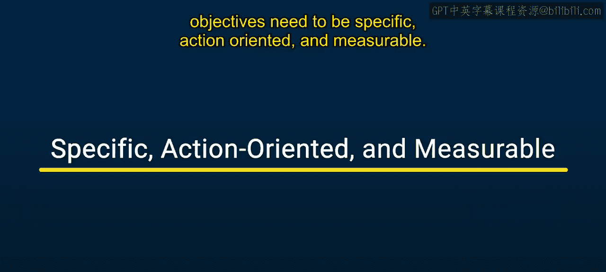
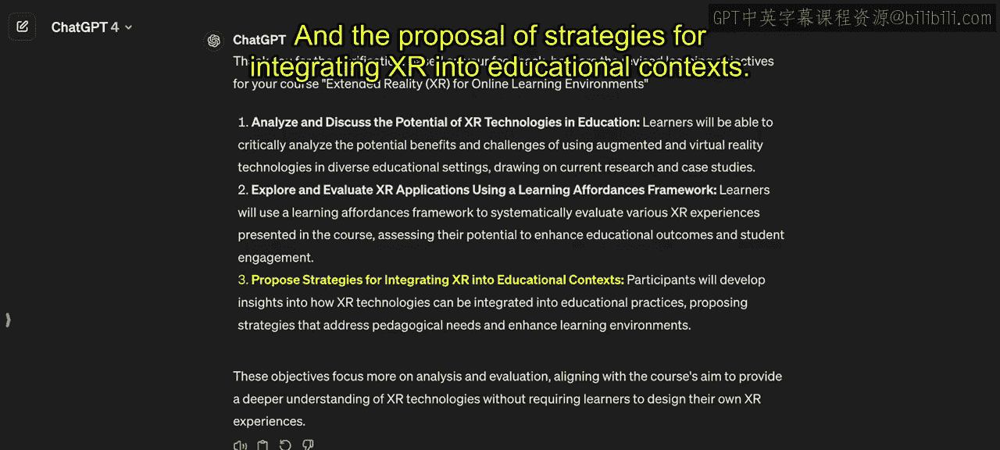

# 密歇根大学《生成式AI作为学习设计伙伴（3课全）｜Generative AI as a Learning Design Partner》中英字 - P11：2_起草学习目标.zh_en - GPT中英字幕课程资源 - BV147xgeaEGJ

The task of drafting learning objectives is a core part of a learning designer's role。

Learning objectives are usually one of the first tasks within a design process。

 and they set direction for all subsequent design decisions。

Let's recall the backward design framework The first stage of this framework is called identify desireded outcomescomes。

 which is in support of the following stages， determine acceptable evidence of learning。

 and plan activities and instruction。In the first stage， identify desired outcomes。

It's required that learning designers be able to articulate what learners should be able to know。

 do and feel as a result of participating in a course or learning experience These learning outcomes or objectives need to be specific。

 action oriented and measurable。😊。

Now let's consider how generative AI can serve as a partner in this learning design task。

 and while GenAI cannot replace the learning designer。

 it could potentially provide learning designers with a starting point。

 something to react to and improve upon。So let's take our course on extended reality for online learning environments and provide a prompt and information into chat GPT that will give us the results we are looking for。

In this case， we're not going to start from scratch。

 we're going to input the learning objectives from our original course and request that they be modified for use in an open online course。

😊，We are partnering with Chat EptT to create a new online short course。

 extended reality XR for online learning environments。

 inspired by our existing one credit residential course that focuses on educational applications of extended reality more broadly。

 the learning objectives from our original course are as follows。

Identify learning affordances related to augmented and virtual reality and educational contexts。

 connect concepts from educational research to personal experiences。

 using educational applications of augmented and virtual reality。

 explore emergent issues related to how people learn using augmented and virtual reality。

 develop new feelings， values and interests concerning augmented and virtual reality through active learning experiences。

 evaluate the suitability of new applications of augmented and virtual reality to be used within educational settings。

😊，Apply what you have learned about the efficacy of augmented and virtual reality environments for learning in a design focused individual project。

With the prompt of using these learning objectives for reference。

 please craft two to three learning objectives that would be suitable for use in an open online course this course will be offered to a global audience of learners using an available platform。

 thank you。The output is interesting。 First， it provides an overview of what learning designers should consider when developing learning objectives。

 We are reminded that global audiences of online learners may have varied backgrounds and different levels of access to technology。

 To that end， learning objectives should be clear， achievable and inclusive。

 yet detailed enough to ensure a deep understanding of the subject。😊。

For an open online course on an available platform。

 where the audience may have varied backgrounds and access levels to technology。

 learning objectives should be clear， achievable and broad enough to be inclusive。

 yet detailed enough to ensure a deep understanding of the subject here are two to three suggested learning objectives for your course extended reality XR for online learning environments。

So let's look at the first objective， analyze and discuss the potential of XR technologies and education。

Learners will be able to critically analyze the potential benefits and challenges of using augmented and virtual reality technologies in diverse educational settings drawing on the current research and case studies This objective is in line with our objectives for their course and will be well suited for learners in an open online course。

Now let's look at the second objective。Design XR based learning experiences。

Equip learners with the skills to design and critique immersive XR based educational experiences。

 ensuring that they are inclusive， pedagogically sound。

 and effectively integrate into various learning environments。

Now this objective may be beyond the scope of what we want to do in our online course because of the emphasis on design skills。

 so let's come back to this one。And now let's look at the third objective。

 evaluate and apply XR innovations in real world educational contexts。

 learners will develop the ability to evaluate the suitability and effectiveness of new XR applications for education and propose practical implementations in their own teaching or learning contexts。

This objective looks generally OK， but we want learners to use the Learning affordances framework that we'll be introducing in the course to analyze the XR experiences that we present in the course。

So let's work to modify the two learning objectives we just discussed and composed a prompt that asks chat GPT to modify them according to our specifications。

For learninging objective2， Design XR based learning experiences is out of scope for this course。

 we would like to focus on analysis instead。And for Learning objective three。

 we would like learners to use a Learning Afordances framework to analyze the extended reality experiences presented in the course。

So now let's look at the results， these are much closer to what we're looking for。

And when arranged in this order， we have a logical learning sequence。

 moving from discussion of the potential of XR technologies and education。

Exploration and evaluation of XR applications using a Learning Aances framework and the proposal of strategies for integrating XR into educational contexts。

In this particular example， we asked Chat GPT to use an existing set of objectives for a new context。

And with a little tweaking， we were able to develop three solid objectives to guide the development of our open online course。

We could have used generative AI to develop learning objectives from scratch。

 which likely would have required a little more effort for us to revise them until our objectives were more suitable to the learning design context that we were targeting。

So as we've shown in our demonstration， for generative AI to be helpful in drafting learning objectives。

 it's important for learning designers to have a clear sense of what learners should be able to accomplish as a result of completing the course。

 and it's also essential for learning designers to be conversant with Bloom's taxonomy or other taxonomies of learning to ensure that learning objectives are specific actionoriented and measurable。

