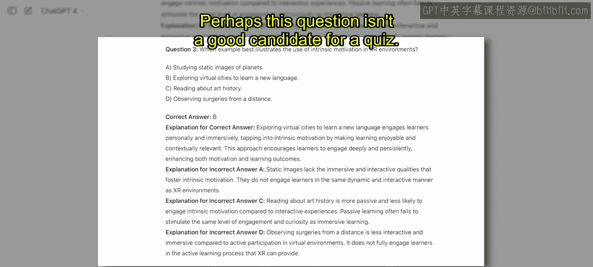
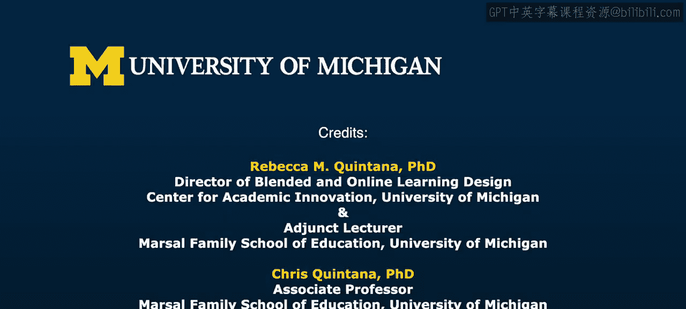

# 密歇根大学《生成式AI作为学习设计伙伴（3课全）｜Generative AI as a Learning Design Partner》中英字 - P12：3_制定评估和详细反馈.zh_en - GPT中英字幕课程资源 - BV147xgeaEGJ

Another design task where you can partner with generative AI involves developing different kinds of assessment instruments and collaborative feedback for learners。

This can include different types of exam questions or multiple choice quizzes。

 which is what we focus on today。We can use generative AI to not only help develop the assessments themselves。

 but also to provide elaborate feedback for the learner within the assessment that describes why different answers in the quiz are correct or incorrect。

This can help learners better understand the content they are being quizzed on。To illustrate this。

 let's move to an example where we create a multiple choice quiz for one of the video lessons that we have previously created。

In this example， we need to provide the generative AI with the prompt describing what we want。

And the video script that we're creating the quiz about to provide the content and the context for the quiz。

Let's see how we would do that in chat GPT， we would start by typing the following prompt。

 but before we submit that prompt we will also copy and paste the script， the quiz will be based on。

And submit all of that information to chat GT。So for this， we could use the following prompt。

Les write five multiple choice questions about the following script， identifying the correct answer。

 providing a 20 to 40 word explanation for the correct answer。

 and providing 20 to 40 word explanations for each incorrect answer。

We can then copy and paste the script right after the prompt。

 and then we will click on the sendend button to send all of this to Chat EPT and see the results。

As we review the quiz。We can see that the initial results aren't bad。

And we have a good start with some of these questions。

But one thing that sticks out immediately is the elaborate feedback。

ChatCptT did what we asked in terms of the size of the elaborate feedback。

 but we can now see that the feedback might be too minimal。

There is feedback for all the correct and incorrect answers。

 but that feedback might be too short to be useful to the learner。

So let's see if we can make that feedback a bit more detailed with the following prompt。Thank you。

 This is a great start。 could you please expand the explanations for each question by adding an additional one to two sentences。

If we look at the results， we can see that the elaborate feedback looks better。

 and there is more feedback to explain why the different answers are correct and incorrect。

The feedback in each question is still brief but informative。

And it gives more useful feedback than the previous version of our quiz。So from this perspective。

This latest version is an improvement。However， there are still things we might want to address。

We always want to review the resulting quiz questions to make sure that they make sense。

 that they are accurate， and that they fit the context for which we are designing。Here。

 if we review the generated questions， we see that one of the questions is weaker than the others。

Specifically， question three does not feel like it is well formed and a good fit for the quiz。

Even with the elaborate feedback， it does not feel like the options given in the quiz question。

Are inherent examples of intrinsic motivation。And the feedback provided。

Doesn't really help make the case that these options are or are not intrinsic motivation。

You could probably make a case either way。So perhaps this question isn't a good candidate for a quiz。

At this point， you could just delete it and write your own question。

Or have the AI generate a replacement or just modify the question yourself。

This again helps illustrate the point of treating generative AI as a design partner。

Here we saw how we can have the AI generate some potential quiz questions with feedback。

But it is still the responsibility of the designer to use this information to create substantive and accurate assessments。

You can have the system generate some questions， but you still need to evaluate these questions and modify them as you see fit。

And you can use all of this as material that can help you create your own assessment material。

 using the AI to help you brainstorm ideas and contribute to the larger assessment being created。

Think about how you might use a generative AI so you can explore the different ways it can help you develop assessments and feedback for your learners as a collaborative design partner。

