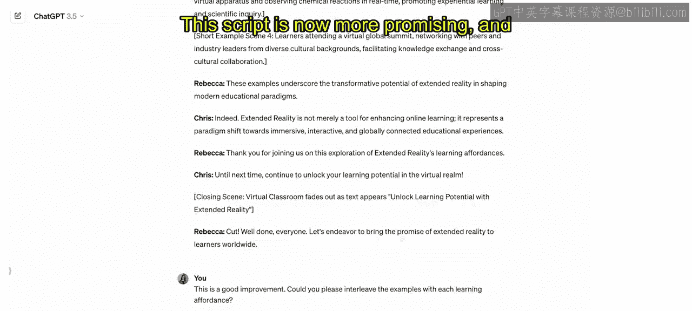

# 密歇根大学《生成式AI作为学习设计伙伴（3课全）｜Generative AI as a Learning Design Partner》中英字 - P13：4_开发脚本.zh_en - GPT中英字幕课程资源 - BV147xgeaEGJ

In online education， video presentations are quite common， like the video you're watching right now。

As we prepare for these videos， one of the design tasks that we have to engage in involves developing the script for the videos。

Scrips can play different roles for videos， they can serve as vehicles to help us organize our thoughts and develop talking points so we can improvise a video。

And sometimes we create a more detailed script that we read for the video presentation。Either way。

 creating scripts is one of the design tasks where we can partner with generative AI to help us get started developing some ideas and initial scripts that we can revise and tailor when we are at the stage that we need to develop presentations。

We can provide an example of this process by showing how we might develop a more detailed script for the example course that we've been discussing about extended reality and education。

In this example， we want to develop a script for the example course about learning affordances。

You will see some specific information that we included in the prompt。

 such as our working definition of learning affordances。

And the affordances we are interested in for our sample course。We also made some specific requests。

 the length of the script， the fact that we want some examples and that the script should be written for two presenters who will be appearing together in the video。

 Let's take a look at this first prompt we gave to chat GT as part of the script development task。

 we are partnering with chat GPT to create a new online short course extendedend reality XR for online learning environments。

Inspired by our existing one credit residential course that focuses on educational applications of extended reality more broadly。

We would like to create a short introductory video describing the learning affordances possible within extended reality environments。

The videos should be between four and six minutes with two speakers， Chris and Rebecca。

The outline of the video script should be as follows。Definition of learning affordances。

Learning affordances are the possibilities for action between the learner and the environment。

4 learning affordances identified for educational applications of extended reality。Spatial knowledge。

 intrinsic motivation， experiential learning， knowledge transfer。

An example of one extended reality learning environment that includes one or more of the learning affordances described。

 Thank you。When we look at the resulting script， we see that it's pretty good。

It gives us a good amount of information that we wanted to convey。

 and we can review the script for accuracy， which seems fine。

The script also touches on the four learning affordances that we mentioned。However。

 there is still room for improvement。First of all。We would like a few more examples here。

The script does provide an example at the end that incorporates a visit to the virtual art Gallery。

But we wanted more examples for each of the learning affordances。Second。

 the tone of the script is a bit informal。While we don't want to be overly formal or stiff in our presentation。

The tone here is a bit too folksy。And I can say that we don't tend to end any of our videos by yelling cut。

 that's a wrap。So we can continue working with ChatyPt to give it more directions using a follow up prompt where we can refine the script。

 Let's look at the follow up prompt。 Thanks。 This is a great start。😊。

Could you please modify the script to sound slightly more formal。Also。

Could you provide a short example of each learning affordance instead of one example at the end。

This is a little better。Note that you do still need to review the script because the resulting script is a bit different from the previous script。

The resulting script has a bit more formal tone， though Chat GT does still want us to say cut at the end of the script。

 and it does include some more examples。But it gave us a series of examples on learning affordances at the end of the script。

 where we would instead like to have examples described with each learning affordance。

Rather than a group of examples at the end of the script。

 we want this so that the script can flow better and be clear about each learning affordance。

 So let's see what it can do with a slightly revised prompt where we ask for this revision so that it can group each learning affordance with an example。

This is a good improvement。Could you please interweave the examples with each learning affordance？

This script is now more promising， and it does list the learning affordances with a short example for each。

This gives us a script that has better flow to help us give clear explanations of each learning affordance。

Now， does this mean you can just use the resulting script as is？Maybe。Maybe not。Again。

 when we see generative AI as a design partner， we can think of the output as a finished product or as a starting point to help us get started。

So we do still need to review the script and decide if we want to check for accuracy and see if we need to make any changes。

 clarifications， or other revisions to get a final script that we are happy with。

Those changes could be content oriented。Gramatical。Or stylistic。

Such is the fact that we still may need some edits because no matter what we say。

Chat EptT does seem to want us to end every script by yelling cut。

So we hope this example gives you a sense of how you can work with a generative AI for developing scripts。

How you need to use different specific prompts to convey what you want。And most importantly。

 how you need to review any results and use those results as a launchpa for your work。

