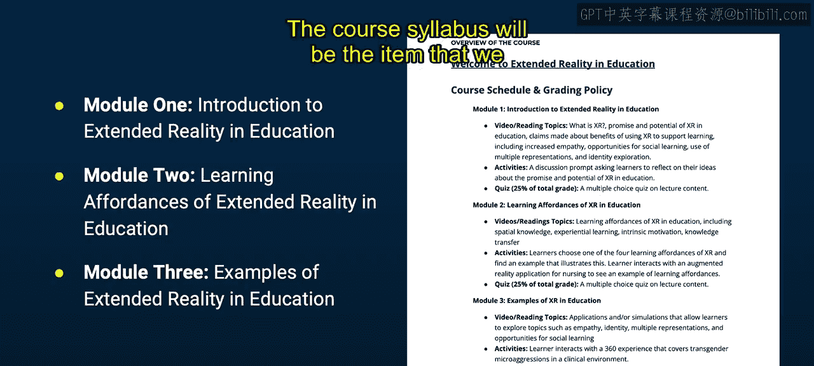
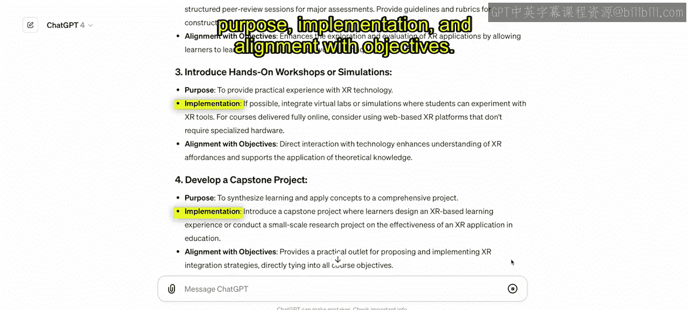
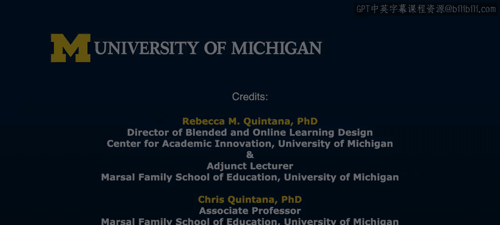

# 密歇根大学《生成式AI作为学习设计伙伴（3课全）｜Generative AI as a Learning Design Partner》中英字 - P15：6_将课程目标与设计成果对齐.zh_en - GPT中英字幕课程资源 - BV147xgeaEGJ

As learning designers， it is important to verify that our course designs are aligned with learning goals that have been established for a course or a learning experience。

Learning objectives should be specific， action oriented， and measurable。

Learning objectives are useful for learning designers to help guide the design of a course。

 ensuring that all proposed activities and assessments are developed in support of those objectives。

 with design processes taking weeks and months， it is important for learning objectives to be top of mind。

But even with the best of intentions， sometimes designs for learning can veer off course。

Learning designers can experience scope creep with content。

 activities and assessments extending beyond the original goals for the course。

 and the opposite can also happen， possibly due to time and resource pressures and constraints。

 sometimes our designs for learning fall short and don't quite live up to expectations In other words。

 the practice opportunities and learning resources do not adequately prepare learners to show what they know ins summative assessments。

So when we think about generative AI as a partner in learning design。

 specifically at the refinement stage of the learning design process。

 it seems reasonable to put generative AI to use for this purpose。

Let's return to the sample course we have been studying。

Now that our online course on Ex reality and education is developed。

 we want to make sure that the activities and assessments we have planned align with the learning objectives that we have defined for the course and just like our other examples。

 we'll be using chat GPT。We have set the following learning objectives for the course。

 analyze and discuss the potential of XR technologies in education。

Explore and evaluate XR applications using a Learning Aances framework。

And propose strategies for integrating XR into educational contexts。In our example。

 the course syllabus describes how the course is organized， so in module1。

 we have introduction to Ex reality in education。

In module 2， we see learning affordances of extended reality in education， and in module3。

 we have examples of extended reality in education。The course syllabus provides additional details。

 including the topics for each module， activities contained within each module。

 and the way that learners can show what they know。

The course syllabus will be the item that we input into Chat EBT along with our prompt。

Our prompt will also be very straightforward。Here is the syllabus for our online short course on extended reality and education。

 could you please take the learning objectives from the syllabus and ensure that our outline in the syllabus aligns with course goals？

And we'll also copy and paste the syllabus into chatGT。Let's have a look at the results。😊。

ChatCPT has organized the results by learning objectives Each objective is accompanied by a high level idea or theme。

Technologies and Education， Learning Afordances F and educational context。

For each of the learning objectives and corresponding themes。

 chat GPT provides examples of the ways in which the course design supports those goals。

 so it's looking pretty good。Notice that we use just the prompt and the syllabus。

 we didn't need to call out the learning objective specifically or the course outline chatt EptT was able to do that for us。

But in addition to responding to our question about alignment of learning objectives with the course outline and design。

ChatGPT went one step further。The output commented on the driving questions of the course and the ways in which they supported the stated learning objectives。

And in addition to commenting on the ways the course objectives and assessments are tied to each objectives。

ChatGPT's output provided a summative statement about course activities and assessments overall。

Chat GPT's assessment was pretty positive。Overall， the syllabus appears coherent and well structured。

 effectively mapping the learning objectives to the course content and activities。

And this alignment supports a cohesive learning experience that should be effective in meeting the educational goals of the course。

Still， it would be good to hear whether there might be ways we can strengthen alignment between learning objectives and course design elements。

Let's try this follow up prompt。What recommendations would you make to fill in the gaps？Wow。

 Cha GPT has provided a number of high level recommendations such as to incorporate case studies。

 expand peer collaboration， and develop a capstone project。

Each recommendation is structured as follows， purpose， implementation， and alignment with objectives。

As the learning designer， you can review the recommendations to see if they make sense in your design context。

 it could be that they spark some interesting ideas that would enhance your design。On the other hand。

 incorporating too many of them could result in the issue that we mentioned earlier， Scope creep。

So it is important that you use your best judgment as a learning designer to both verify that Chat GPT's assessment was well founded。

 not too generous。And to determine whether to make use of the additional recommendations provided by the generative AI。

