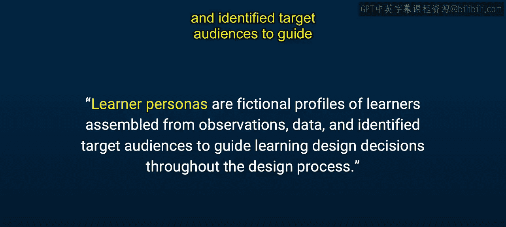
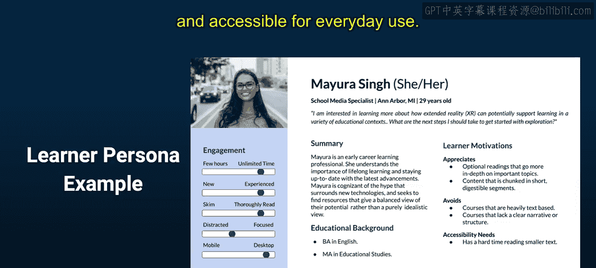
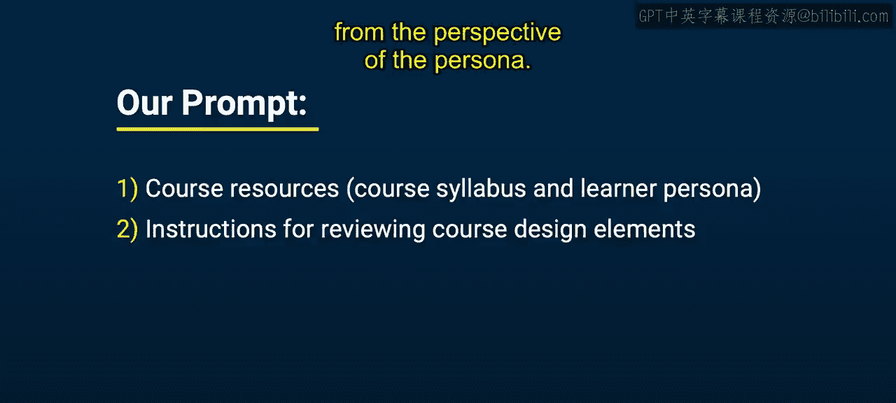
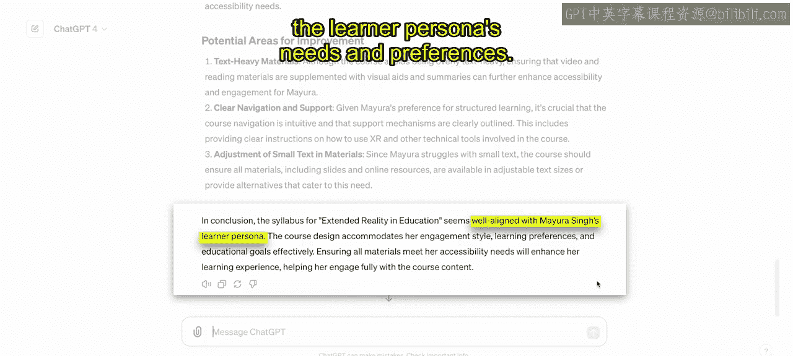

# 密歇根大学《生成式AI作为学习设计伙伴（3课全）｜Generative AI as a Learning Design Partner》中英字 - P16：7_扮演学习者角色.zh_en - GPT中英字幕课程资源 - BV147xgeaEGJ

Within the refinement stage of the learning design process。

 we can use chat GPT to check our work this could look like assessing the alignment between learning goals and course design elements。

But we can also go beyond more academic types of questions and tasks to prompt GPTs to take on a more specific role or perspective。

Learner personas are one tool within the Learning designers toolkit that could be used as the basis of a role playing prompt for chatGT。

In a nutshell， learner personas are fictional profiles of learners， assembled from observations。

 data， and identified target audiences to guide learning design decisions throughout the design process。

Learner personas can be represented in a variety of formats。

 with learning designers adopting a style and format that are best suited to their design needs and those of stakeholders。

Fortunately， some GPTs allow us to provide inputs in a variety of formats as well。

 including images that contain digitized text For example。

 this is a learner persona developed for our example course， extended reality and education。

The persona format includes a summary of the persona's background and motivation for taking the course。

Educational background and preferred modes of engagement。

One distinctive feature of this particular persona format is the way that modes of engagement are represented through sliders。

 each category is shown on a spectrum of low to high categories such as available time or level of experience and technology use。

 mobile or desktop。This allows learning designers to see these characteristics at a glance。

 making this format very useful and accessible for everyday use。

Our prompt will consist of two parts。One， course Res and two。

 instructions for reviewing course design elements from the perspective of the persona。

We can upload the persona in the format that we typically use。In other words。

 we don't need to provide a textual equivalent of the templated version。So as are prompt。

 we can say the following， I am attaching a learner persona that I developed for this short course。

 Please review our syllabus from that learner persona's perspective and provide us with feedback on whether it would meet the learner persona's goals。

 objectives and preferred modes of engagement。Here is the syllabus。

And now we attach the learning persona。So let's have a look at the results。😊，First。

 we can see that Cha GPT has organized the results in four categories， engagement and learning style。

 content and learning approach， course themes and objectives， and potential areas for improvement。

We didn't request that the feedback be organized in this way。

 but seeing it displayed as such provides us with a fresh perspective that addresses our question about whether the course design meets the learner persona's goals。

 objectives， and preferred modes of engagement。ChatGPT confirmed that the course design should be well suited to the learner persona's needs and preferences。

So that's a promising sign。At the same time， the ultimate responsibility for ensuring a strong design falls on the learning designer。

So it is still important to view the feedback with a critical eye and make the final judgment on whether a course design meets its intended goals。

