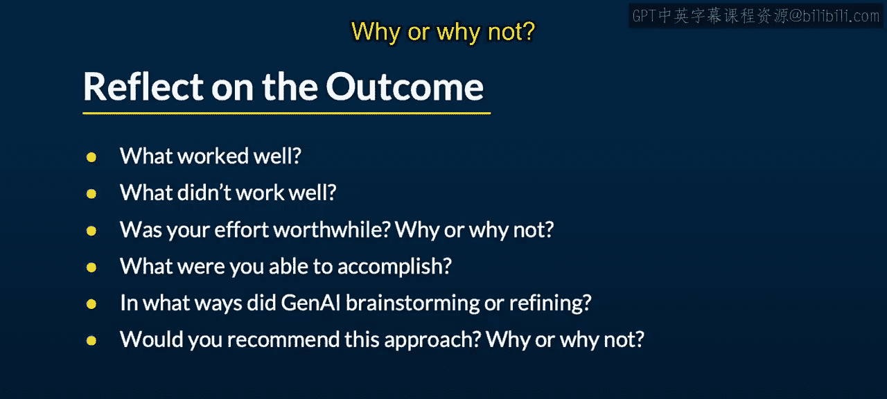
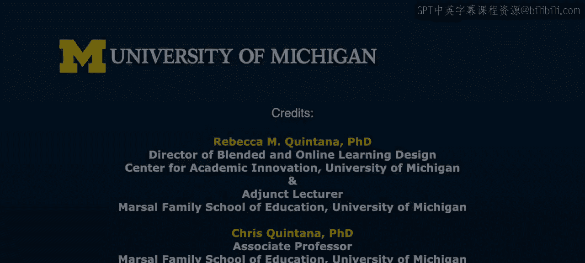

# 密歇根大学《生成式AI作为学习设计伙伴（3课全）｜Generative AI as a Learning Design Partner》中英字 - P17：8_实践尝试.zh_en - GPT中英字幕课程资源 - BV147xgeaEGJ

Throughout this course， we have considered how JenAI can support learning designers throughout two categories of work。

 brainstorming with GenAI and refining with generative AI。

We've demonstrated what these categories of work could look like using an example course that we called extended reality for online learning environments。

So in the brainstorming with generative AI category。

 we demonstrated how JenAI could be used to support learning designers in drafting。

 learning objectives， developing scripts， improving accessibility。

 and crafting assessments and feedback。In the refining with generative AI category。

 we looked at how JenAI could be used to support learning designers in aligning core goals to outcomes and role playing as a learner persona。

Now we want you to give it a try。First consider whether you want to focus on the brainstorming category or the refining category of tasks。

And this decision might depend on whether you are just at the beginning of a project idea or whether you have something more developed to experiment with。

And if you don't have an example project ready at hand， that's okay。

 we'll provide an example or a sample scenario for you to work from。In your courseworkbook。

 you'll begin by describing the context for your experimentation。

So if you are planning to use this opportunity to make progress on a current project that you are working on。

 you'll provide a brief description of what the learning experience is all about and your goals for the experimentation。

And if you are planning to use the sample scenario that we've provided as a starting point。

 you can just fill in some additional details and also state your goals for the experiment。Next。

 you'll scope your experiment further and identify a specific learning design task you'd like to work on in either the brain scstorming category or the refining category。

 you could decide that you want to replicate one of the tasks that we demonstrated earlier in the course。

 like drafting learning objectives or aligning course goals to outcomes。

 or you could articulate an entirely new use case It's totally up to you。Either way。

 we hope you'll find an opportunity to delve into a learning design task that will allow you to deepen your understanding of how learning designers can use generative AI to augment design practice。

As a next step， you'll use a generative AI tool like ChatGPT to give your ideas a try。

 now it may take a few attempts， but hopefully with some trial and error。

 you'll be able to achieve some interesting results。As you're working through the process。

 be sure to document the prompts you tried and the results that will be important for the next and final step。

So finally， you'll reflect on the outcome of your experiment。 what worked well。

 what didn't work so well。Was your overall effort worthwhile， why or why not？

What were you able to accomplish that you would not have been able to accomplish without JenAI？

And in what ways did generative AI support brainstorming or refining would you recommend this approach to other learning designers why or why not？

We are looking forward to hearing from you and seeing what you tried and your reflection on the outcomes。

