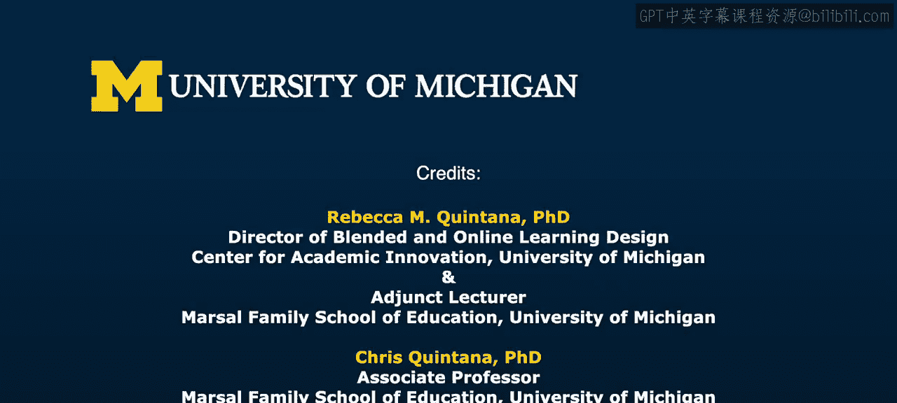

# 密歇根大学《生成式AI作为学习设计伙伴（3课全）｜Generative AI as a Learning Design Partner》中英字 - P18：0_课程欢迎.zh_en - GPT中英字幕课程资源 - BV147xgeaEGJ

Welcome to the third course in our series of courses on generative AI as a learning design partner。

We are so glad you have chosen to explore how generative AI could be used to complement and enhance learning design activities。

I'm Dr。 Chris Kana， associateiate Professor at the Marcel Family School of Education at the University of Michigan。

And I'm Dr。 Rebecca Kana， Director of Bded and online Learning Design at the Center for Academic Innovation。

 and adjunct lecturer at the Marcel Family School of Education。In this course。

 we'll continue our look at how learning designers can use generative AI to advance innovative forms of learning design practice。

In our first course， we took a high level view of our topic and thought about the strategic use of Gen AI within the learning design process In our second course。

 we looked at more specific examples of what this could look like throughout the course design process。

 and we did some hands on experimentation to get a sense of how it could work in practice。Here。

 we'll think strategically about the use of generative AI and consider the strengths and limitations of GenI for learning design。

We'll also contemplate how learning designers can communicate these strengths and limitations of the approach with various stakeholders。

Then we'll consider broader use cases and take a look at what it would be like to create our own generative pretrained transformer or GPT for use by learning designers。

 embarking on large projects， and for use by learners preparing for summative assessments。

We'll provide two worked examples in this course， one that demonstrates how learning designers could approach creating a living design repository for use by learning professionals who are engaged in the design and development of a complex project。

😊，And another， that could be used as a course element for learners to use within a course。

In the second example， the repository will consist of course elements that have already been developed and are available to learners to query and review。

Then later in the course， you'll have a chance to create your own design assistant。

You'll develop a plan to create a custom GPT that will serve as a support tool in a specific design or learning context。

You'll also have a chance to identify a learning design context where learners could use generative AI in an assignment or an assessment。

Using our course workbook tool， you'll offer a brief description of what that activity or assignment could look like。

 You'll explain why generative AI would be a useful tool in this context。

 and you'll prepare a list of guidelines for yourself as a learning designer or for learners who are using Gen AI for this particular assignment。

😊，As before， our behind the curtain feature will give you an inside look at how we designed and developed this course。

 showcasing how we use generative AI throughout our process。

 So now that you have an understanding of what this course is about and what you'll be doing throughout the course。

 Let's get started。

