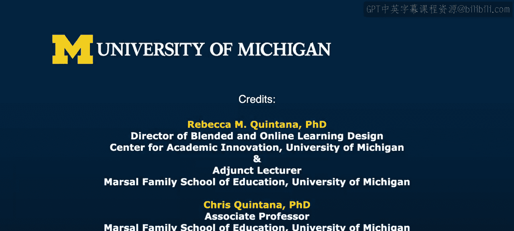

# 密歇根大学《生成式AI作为学习设计伙伴（3课全）｜Generative AI as a Learning Design Partner》中英字 - P1：0_课程简介.zh_en - GPT中英字幕课程资源 - BV147xgeaEGJ

Welcome to our series of courses on Genrative AI as a learning design partner。

We are thrilled that you're here to explore this topic together。I am Dr。 Chris Kana。

 Asociate Profess at the Marcel Family School of Education at the University of Michigan， and I'm Dr。

 Rebecca Canana， Director of Bded and online Learning Design at the Center for Academic Innovation。

 and adjunct lectureectr at the Marcel Family School of Education。

With the current focus on generative AI across many sectors。

 it is natural to wonder what its potential impact will be within various professional contexts。

 including contexts of teaching and learning。This series will focus on ways that learning professionals can consider the use of generative AI in learning design contexts。

Given that the widespread use of generative AI is a relatively new idea for most learning professionals。

 we wanted to give an overview of how we are approaching this opportunity from our experience in the field。

We also wanted to provide you with several examples along the way to help spark your thinking。

We hope that you will be inspired to try something new as you apply sound。

 design judgment in your professional practice。The series is structured across three short courses that focus on how you can leverage generative AI in your practice our goal is for you to consider its use as a potential partner in learning design。

We want to mention from the outset that we've designed each of the courses in our series to be completed in about three to five hours。

 each course will allow you to focus on one to two learning objectives and provide you with the opportunities for handson practice and application of concepts in real world context。

If you are brand new to the field of learning design。

 we encourage you to also explore our longer three course series on Learning experienceerience design。

 which is available on this platform。In the first course。

 you will develop a plan that considers how generative AI can be used as a partner in design。

In the second course， you will experiment with ways to use generative AI to support learning design tasks。

And in the third course， we take a broader view of how learning designers can engage in thought partnership about the use of this emerging technology with various stakeholders。

Whether you're an early career professional who is looking for a way to sharpen your skills or amplify the impact of your work or a more seasoned learning designer who is interested in exploring a new way of working。

 we think you'll find value in this course， We also think that learning professionals and leaders who are responsible for setting direction for their teams and departments will find a series like this useful as you look for opportunities to understand how the design landscape is evolving。

😊，Now you might be wondering whether we， as instructors in the course have used generative AI to design the experience you are about to embark on。

It's a very meta question and one that will be worth exploring as we move through the course together。

We can let you know that throughout the design and development of this series。

 we have been trying out various tools and techniques with our colleagues and design partners。

And so you'll see how some of our experiments have worked out。

And you might even find some surprises along the way。

We've structured our course so that at the completion of each section。

 you will be able to unlock our notes on how we embrace generative AI as a learning design partner throughout our process。

We hope you'll find this approach to be motivating and engaging。

 and we also hope that you'll freely share your experiences using generative AI with your peers in the course throughout the discussion forums and the course activities Now that we've provided our introductory remarks It's time to get started Let's see how we might embrace generative AI as a learning design partner。

