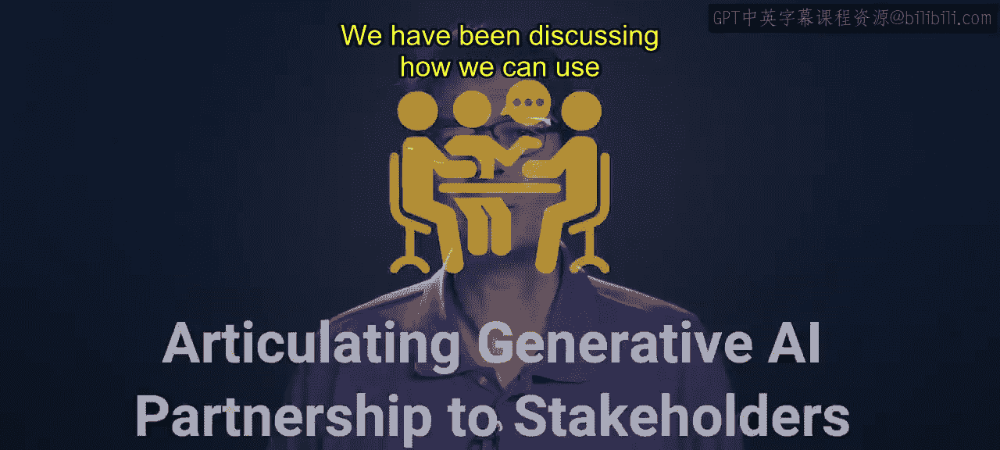
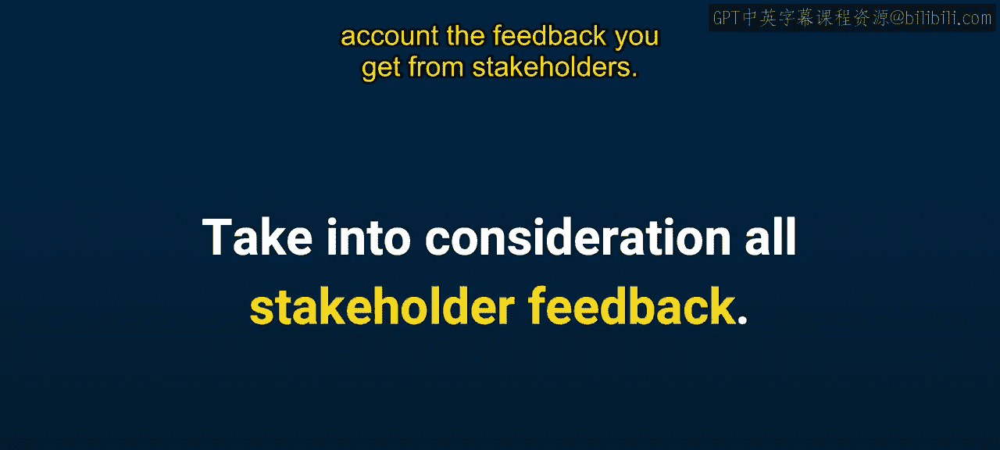
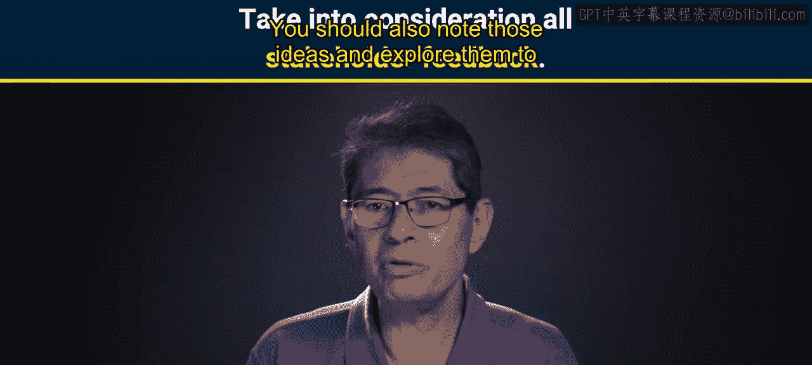
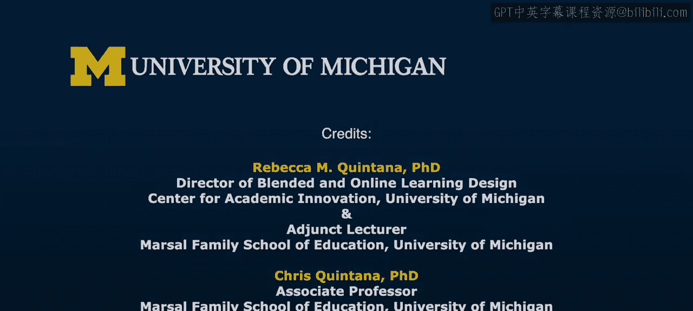

# 密歇根大学《生成式AI作为学习设计伙伴（3课全）｜Generative AI as a Learning Design Partner》中英字 - P21：3_向利益相关者阐述生成式人工智能合作.zh_en - GPT中英字幕课程资源 - BV147xgeaEGJ

We have been discussing how we can use generative AI as a tool and partner for learning design。

These discussions have been mainly from the perspective of the designer。

 as we have focused on how a designer can make Gen AI tools part of their toolkit。

But designers do not work in a vacuum。On any learning design project。

 there are many different collaborators and stakeholders involved in the project that can impact different aspects of the work。

For example， a project team might include multiple designers that you would be collaborating with。

Other stakeholders can include project managers who are overseeing the project。

 media designers who are developing the media assets or software developers who may do some programming or other technology development for the project。

 other stakeholders are the clients that you are designing the project for and educators or others who may serve as consultants that you work with and update throughout the design process。

All of these stakeholders will participate to different degrees in a project。

But when exciting new technologies emerge like generative AI。

You might have to deal with different opinions about a technology which can impact your work as a designer when it comes to tools like generative AI。

 some stakeholders may get really excited about such tools and push for you to use those tools in the project solely because that's the hot。

 trendy technology on the flip side some may have concerns or fears about generative AI。For example。

 a faculty member might not want their lecture material used within a Gen AI tool。

Or there may be other concerns about copyright issues within generative AI tools。And as a result。

 some stakeholders may be reluctant to incorporate the technology for you as a designer。

 you may have to navigate these different perspectives and requests while ultimately aiming to make progress and move forward with the learning experience you are designing。

So part of your role as a designer isn't just a design。

 but also to articulate the approaches you are taking in your design with the other stakeholders on your project。

So as you discuss generative AI use to stakeholders。

 there are some general approaches that you can think about using。First of all。

 while it seems to counter to our topic about articulating aspects of generative AI。

 one approach to describing the utility and use of generative AI。

Is to actually focus on and spotlight the design tasks that you are performing。

And not focus so much on the tools that you are using like Gen AI。

It's always interesting to talk about technology。But I always tell our learning technology students that when we are talking about learning。

 it's not as important to put the focus on the particular tools you're using。Rather。

 what is important are the tasks and the learning activity that you are developing to support learning。

 and this should be the focus of your discussions。You can then discuss what kind of tools and approaches you are using to do these design tasks。

 and this can include mention of generative AI as part of that toolkit。In other words。

 you shouldn't necessarily put the spotlight on generative AI in your design project。But instead。

 spotlight what you are doing and working on and then you can talk about how you're doing these design tasks。

 which can include your use of generative AI。And other tools to help you complete those tasks and achieve your learning design goals。

The learning design goals should get the spotlight。And you can cast tools like GenAI as a partner。

 the means to achieve those goals。Now， this focus on tasks over tools can also help you emphasize the partnership aspect of generative AI。

 which we have been discussing throughout this series when there is a new trendy technology like generative AI。

 some people might have the impression that simply using Gen AI will be enough to do all your tasks。

On the other hand， others have we have said。Might have a fear that we are turning over too much of the design work to GenAI and taking humans out of the equation。

In each of these cases， you want to discuss that you are using JenAI as a design partner。

You're not turning over all of your design tasks to GenAI。You， the designer。

 are still taking the lead in the design process， but you are using tools like JenAI as needed when it can be helpful for you and the process。

So when we talk about this design partnership。We are reinforcing that the designer is in charge and they decide when and how to bring in different tools like generative AI。

Finally， while these ideas can help you position how you are using generative AI in your learning design projects。

That doesn't mean that you shouldn't take into account the feedback you get from stakeholders。

What is key for you as the designer is to fully understand the different tools you're using。

 like generative AI。So that you can clearly describe the strengths and limitations of the tools。

And so you can also describe where the hype might be unrealistic in talking about what a tool can do。

If other stakeholders have big concerns about some aspects of generative AI。

 you need to be prepared so you can address those fears rather than simply dismissing the feedback。

Or if some stakeholders are overhyping or painting an unrealistic picture of what generative AI can do。

You need to be able to address that with a more even handed assessment of Gen AI。

And when some stakeholders offer up some interesting ideas about other ways you might think about using GenAI。

 ideas you might not have thought of yet。You should also note those ideas and explore them to see how you can expand your use of Gen AI。

Just as we have talked about generative AI is part of a design partnership。

The different stakeholders on a project also make up a partnership that will result in many discussions。

 ideas， and observations about technology。The excitement。

And trepidation about different technologies will make its way to different stakeholders。

 and you need to be prepared to talk about how you want to use these technologies。

How they can be useful to your work to advance the project。

And also note the occasions when you don't think you need or want to use the technologies。

Giving measured feedback and being clear about how you are using different tools for your work can be an important part of any design process。

Especially as new tools like generative AI appear on the learning design scene。

