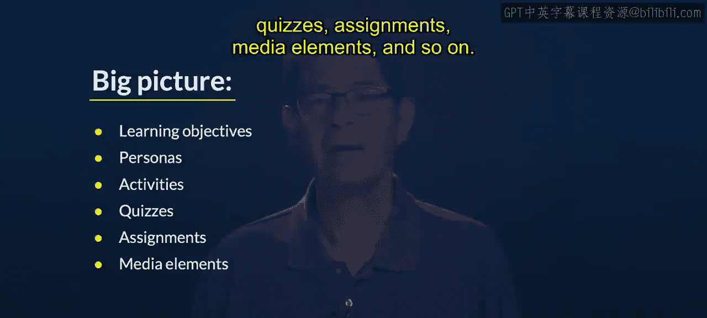
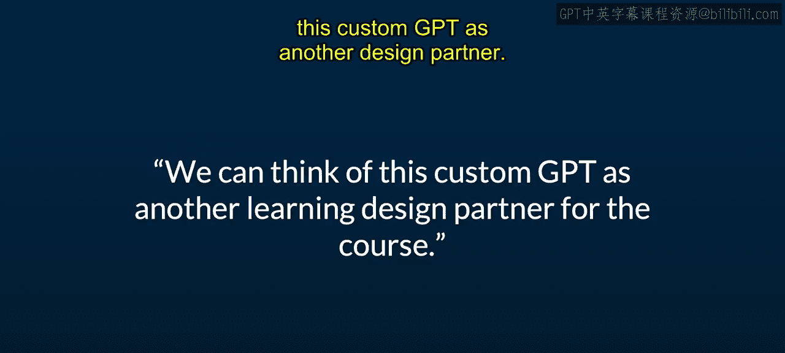
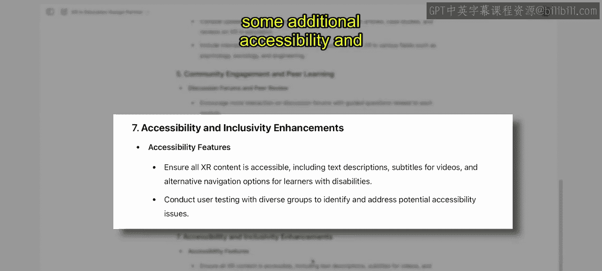
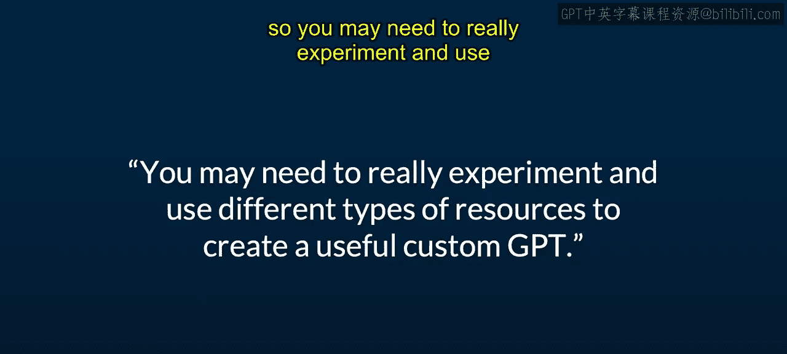
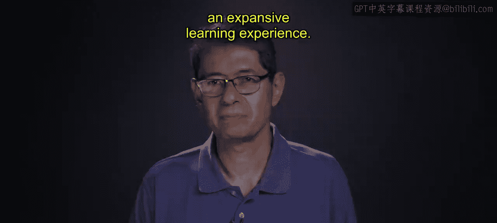

# 密歇根大学《生成式AI作为学习设计伙伴（3课全）｜Generative AI as a Learning Design Partner》中英字 - P22：4_面向学习设计师的定制GPT.zh_en - GPT中英字幕课程资源 - BV147xgeaEGJ

We have been looking at how learning designers can use generative AI tools as a partner for their learning design activity。

So far， we have looked at examples where we created different requests and prompts for tools like ChaGPT to help us with different learning design tasks。

But we can also look at generative AI tools to help us track and gauge all the different elements of a learning experience that we are designing。

Our design process will result in a large number of items to keep track of learning objectives。

 personas， activities， quizzes， assignments， media elements， and so on。

After a while， as the learning experience gets bigger。

 it will become more challenging to see both the big picture。

And the small details about the experience。So we can turn to generative AI tools to help with all of this too。

Aside from querying the normal generative of AI tools like ChatGT。

We can also create custom GPT tools to support learning designers with tracking and assessing the different elements of their project Let's look at an example of how we can create such a custom GPT and some ways we might use it。

For this example， let's look at how we can create a custom GPT for a class that I have taught with Dr。

 Rebecca Kinana here at the university。The course is XR in Education。

 a course about how we can use technologies like virtual and augmented reality to support learning。

While we've taught the course in person at the university， in this example。

 we are creating a fully online version of this course and the custom GPT we are creating will help us with that learning design task。

So let's look at how we can create a custom GPT for this course that we can then use to answer different design questions we might have about the course。

This GPT is intended solely for the learning designers of the course and not students。

 so we can think of this custom GPT as another design partner。

 we can go into chat GPT to create a new custom GPT， and then we can start configuring it。

First。We can give it a name that reminds us this custom GPT is a design partner for our XR and education class。

 so we'll call the GPT we are creating XR and Education Design partner。Next。

 we describe the GPT by saying that it serves as a repository of completed design artifacts to assist in the development of additional course materials。

We can then provide instructions for how we would like the GPT to operate。By saying that。

This GPT provides up to date information about the current design status of various artifacts and course elements。

Design team members are encouraged to upload finalized artifacts to the GPT to ensure that it remains up to date。

Design team members could query this GPT to develop new materials and ensure that the content is coherent。

 consistent， and aligned。We can then set up some conversation starters。

You can think of these as shortcuts to tasks you might frequently want the GPT to do for you。

And so these links will be displayed on the front of the GPT page。Here。

 we create the following conversation starters。One for course elements that need to be developed。

Another four course elements that are aligned with objectives。

A third one called Cose elements that are aligned with our personas。And finally。

 coherence and inconsistency in the course design。As we create these conversation starters。

 you'll see them displayed as buttons on the front of the GPT。This way。

 we can quickly have the GPT work on these tasks when we press the corresponding buttons。Finally。

 we need to give the custom GPT some information or knowledge about our XR and education course。

This information is found in different course files we have for the course。

 so we can upload documents like the course syllabus， a sample reading， a quiz， some personas。

 some initial scripts that we created about learning and affordances， etc。

We can do this initial upload of information about the class。

 but as we move forward with the design of the course。

 we will be adding new information that we create， such as new quizzes and scripts or perhaps new personas and learning objectives。

Once we have all of this information uploaded， we can create the custom GPT for our course and share the GPT with other members of our design team。

Remember that our GPT currently only has some initial information about our course。

But that's enough to let us see how we might use our custom G with some small examples。

 Let's use some of our conversation starters。 First。

 to ask our GT about what course elements are aligned with our learning objectives。 Here。

 the G returns with quite a bit of information。 It does start out by giving an assessment of how it sees the course aligning elements of the course with the learning objectives。

It notes that the course structure incorporates theoretical concepts， practical applications。

 and immersive technologies to enhance learner engagement and understanding；

 it then goes on to list some of the main course elements and how those elements align with learning objectives。

Now， as always， you as the designer should review this feedback for accuracy and to see that it all makes sense。

But as you can see， as you start adding more course elements to the GPT over time。

 you can continue to use the GPT to provide you with useful summaries and overviews to help you gauge different aspects of the course。

Let's look at another example， we can start again at the front page of the GPT with a new chat。

This time we are asking the GPT to tell us what course elements still need to be developed。

 given what we've noted in the syllabus here， the GPT gives us a summary of what it thinks we still need to do。

 For example， it tells us that we still need to develop certain course modules。

And it describes elements of those modules。It reminds us that。

 especially for a course on extended reality， we should develop some more interactive elements and simulations。

 it describes some quizzes and materials that we should create。

 and it reminds us that we need to think about some additional accessibility and inclusivity features for the course。

There's more that we could do， but this should give you an idea about how learning designers can create custom GPTs to support the learning design process。

Creating a GPT is still a somewhat new activity， so you may need to really experiment and use different types of resources to create a useful GPT。

But hopefully you can see how developing a custom GPT can really serve as a design partner in different ways to help you keep track of all the elements that go into creating an expansive learning experience。

