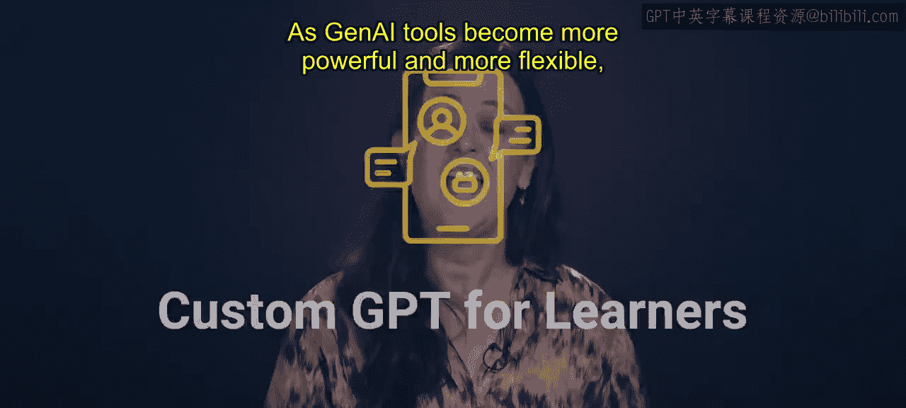
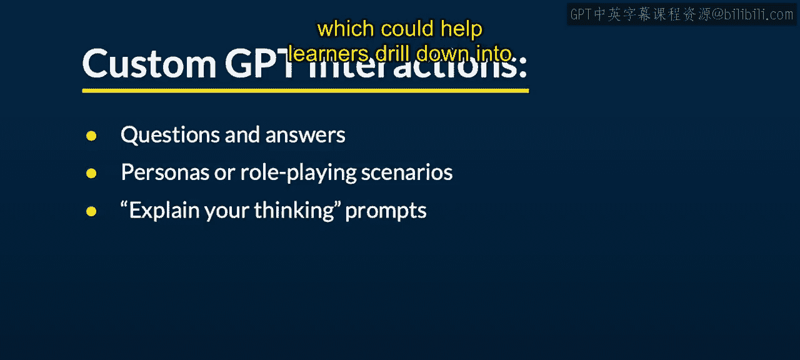
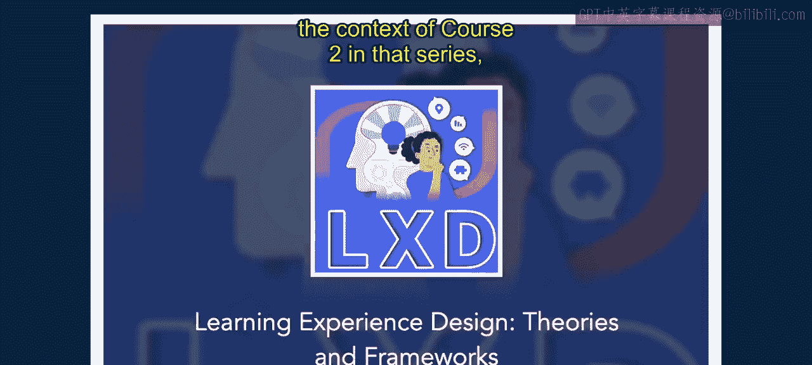
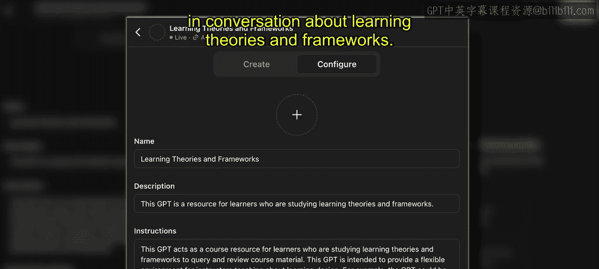
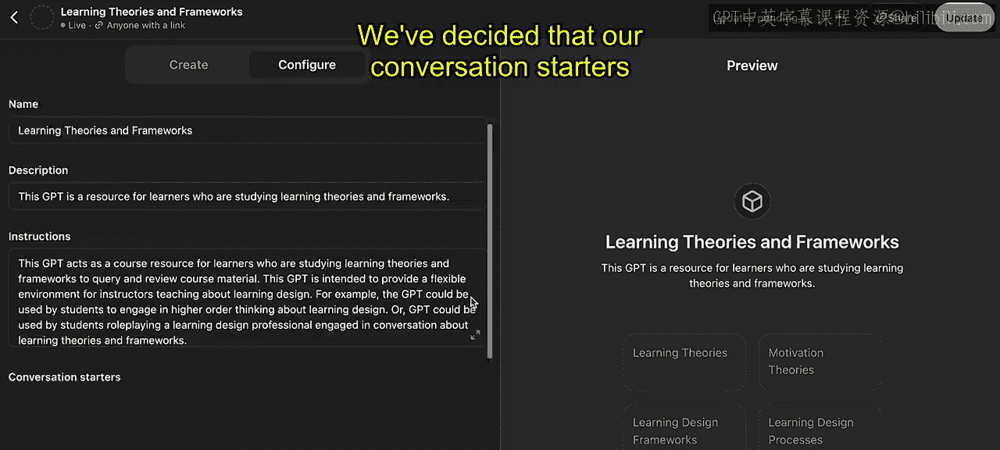
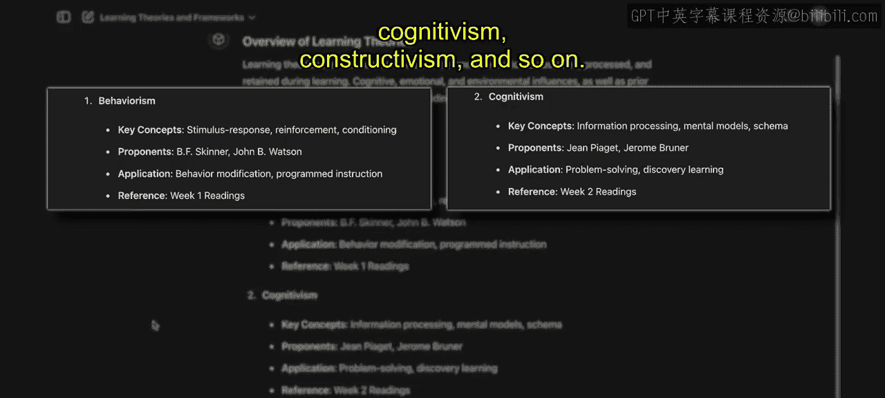
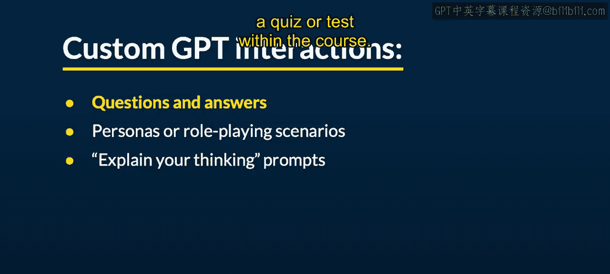
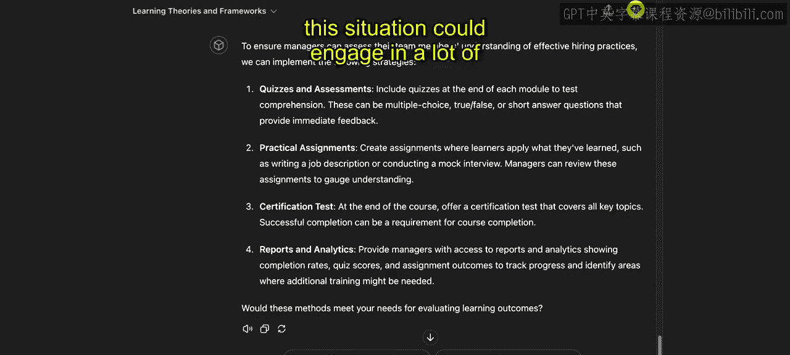

# 密歇根大学《生成式AI作为学习设计伙伴（3课全）｜Generative AI as a Learning Design Partner》中英字 - P23：5_面向学习者的定制GPT.zh_en - GPT中英字幕课程资源 - BV147xgeaEGJ

As Jen AI tools become more powerful and more flexible。

We will continue to see opportunities for learning professionals to create highly specialized and customized environments in the form of custom GPTs。

This will allow us to create environments where learning professionals can perform specific tasks。

And environments where learners can engage in knowledge building within a customized environment。

We'll be looking at this second category of use in this video。

There are a variety of ways that learning designers could use custom GPTs as a resource for learning activities if we think about the types of interactions that GPT environments can support we can get some inspiration for the types of learning activities that could leverage a custom GPT for example。

 GPTs do well with basic questions and answers， learners could ask a question in their own words and receive a response。

😊，GPTs also excel at embodying a persona or engaging in roleplaying scenarios， and finally。

 when prompted， GPTs can also explain their reasoning which could help learners drill down into specific concepts that they are studying。

 so let's create a custom GPT environment that could be used by learners within the context of a learning experience design course Now we've taught our learning experience design graduate course in face to face settings and we've also taught it online。

So we'll use the materials that we developed for the context of course two in that series。

 learning theories and Fs。

This topic is broad enough that it gives us the opportunity to develop a knowledge bank that could be used for a variety of educational activities related to this course topic。

So let's see how we set up this custom GPT for our example。We've given it a title。

 Learning Theories and Frameworks。And we've kept our description pretty generic this GPT is a resource for learners who are studying learning theories and frameworks。

We've developed instructions for how we'd like the GPT to operate。They are as follows。

 the GPT acts as a course resource for learners who are studying learning theories and frameworks to query and review course material。

This GPT is intended to provide a flexible environment for instructors teaching about learning design。

 for example， the GPT could be used by students to engage in higher order thinking skills about learning design。

 or the GPT could be used by students in role playing activities such as having a learning design professional。

 engage in conversation about learning theories and frameworks。

We've decided that our conversation starters will be the topic areas from the course。

This provides a light scaffold or support for learners to help guide their thinking about our course as a whole。

 so these topics are learning theories， motivation theories， learning design frameworks。

 and learning design processes。We've uploaded course content to the custom GPT to provide it with relevant information about our course。

Items such as the course syllabus， scripts for videos， slides that accompany those videos。

 and readings that we've authored to elaborate on course concepts。Okay。

 let's give our custom GPT a whirl， let's start by seeing what happens when a learner selects one of the conversation starters we provided。

If a learner selects learning theories， for example。

 they receive a synthesis of information from our course about learning theories。

Theories such as behaviorism， Civism， constructivism， and so on。

Learning designers and educators could design a followup activity for learners to engage in questions and answers in order to compare。

 contrast， and synthesize ideas across the learning theories in this course。

 this type of activity could be useful to learners as they review material and preparation for a quiz or test within the course。

So now let's try something a little more complicated， a roleplay scenario， and in this scenario。

 the learner will play the client who is working with a learning designer who is played by Cha GT to design an engaging and compelling HR training on best hiring practices。

The client doesn't have foundational knowledge of learning design theories and frameworks。

 so the objective of this activity could be for learners within the course to evaluate how effectively the GPT responds to clients questions in a research informed way。

Ultimately， the learning outcome for this activity is for learners to recognize effective learning design strategies for engaging with project stakeholders as the client。

 the learner could ask something like。😊，What kind of course design would learners find motivating we want our course on best hiring practices to have a high completion rate In our scenario。

 the learning designer played by the GPT provides five ideas and the client drills down into one of them interactive content they could say something like I'm interested in learning more about what quizzes and polls could look like in our course。

The learning designer played by the GPT provides examples of what sample questions could look like and then offers two implementation tips。

Immediate feedback is good and you could think about incorporating discussions。

The client responds with a question about what does a course look like where learners are motivated to continue？

And the GPT responds with more detail about how the use of quizzes and polls can keep learners engaged in the course。

Finally， the client could ask something about how will managers know if team members have learned about effective hiring practices the learning designer again played by the GPT provides a number of options。

So you can see that a learner in this situation could engage in a lot of back and forth discussion as the scenario unfolds in a natural way。

So this example is intended to give you a glimpse into the type of learning activity that could be designed using a custom GPT。

As a learning designer， it is important to think carefully about the structure of the activity。

Educators could provide learners with a starter prompt to set the parameters of the interaction。

Another thing they could do is require learners to explicitly introduce at least three concepts from the course in the roleplaying activity。

 so in this case， the client， the learner asked about motivation， assessment strategies。

 and evidence of learning， all things found within the course。

And to extend the activity even further， learners could be asked to download the transcript of the chat。

 highlight， or annotate areas where the GPT modeled research informed learning design practices and where it did not。

So to sum up， the creation of a custom GPT creates new kinds of opportunities for learning designers and educators to explore。

The key is to provide structure and specific requirements so that the activity aligns with learning outcomes designed and defined for the course。

