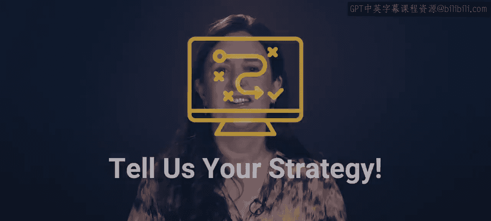
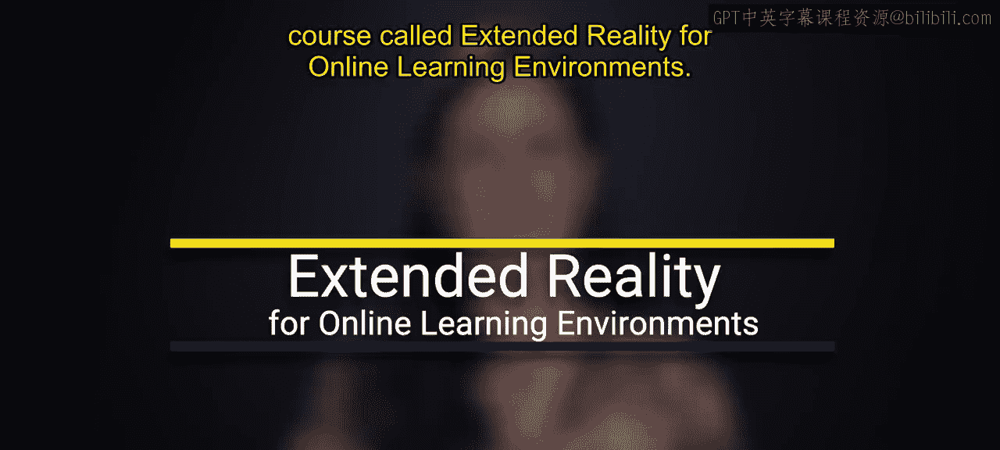
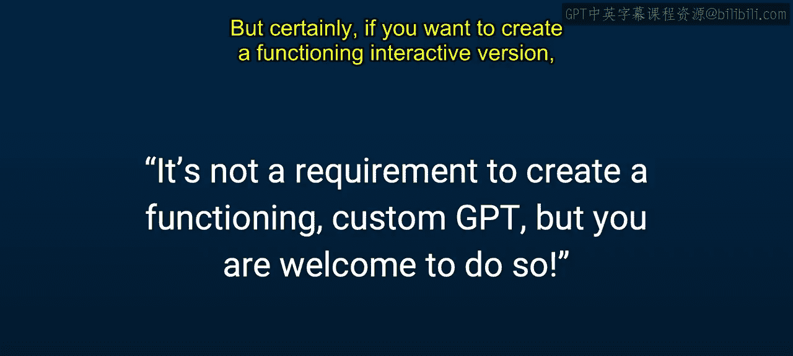
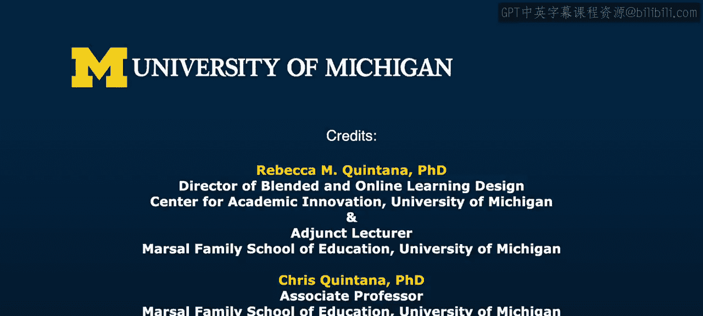

# 密歇根大学《生成式AI作为学习设计伙伴（3课全）｜Generative AI as a Learning Design Partner》中英字 - P24：6_分享你的策略.zh_en - GPT中英字幕课程资源 - BV147xgeaEGJ

Throughout this course， we have considered how generative AI can support learning designers throughout two categories of work。

Rrainstorming with generative AI and refining with generative AI。

We've demonstrated what these categories of work could look like using an example course called Extended reality for onlineline Learning Enviments。

Throughout this series， we've considered how learning professionals can think about generative AI as a learning design partner。

We started by considering the learning design process as a whole to be able to identify promising areas for experimentation and integration。

We then looked at how GenAI could be used to augment specific learning design tasks related to drafting and refining。

 and then in this course we've looked at ways generative AI can be used as a resource to support design processes and activities within learning situations。

And along the way， you've had the opportunity to reflect on the potential of JenAI to augment learning design processes。

 and to give the examples we have showcased to try。Now。

 we'd like you to think about how you would use generative AI to create a repository or a resource bank for learning designers or learners to support their work or understanding of a topic。

We've demonstrated two use cases for developing a custom GPT。

 which allowed us to define the content and parameters for the GenI to use as the basis of queries and responses。

 for this course activity， you will create a strategy to build a custom GPT to support learning designers within the context of a project or a custom GPT to support learners in the context of a learning situation。

In our first example， we wanted to create a resource for learning designers to use throughout the lifecycle of the course design and development process。

 the intent here was to develop a current and customized environment for learning designers to use when they are looking for results that are tailored to their specific project。

Think of it as being able to ask questions and advice of an experienced learning designer who has full and complete knowledge of your project。

As the course design process unfolds， the custom GPT can be updated with new and relevant material if you decide to focus on this use case first。

 you'll need to identify a particular learning design task or set of tasks and a specific design context for its use。

Then you'll need to think about the resources and materials that you would need to provide to develop a custom GPT that would add value to the project。

 you'll need to indicate the type of information that would be available and useful to include within the set of comprehensive resources。

In our second example， we wanted to develop a resource for learners to search and also ask for clarification or elaboration about ideas presented within the course。

We aim to include as many resources from the course as possible to inform responses to questions that learners might have about the course or the content。

 think of it as being able to provide learners with their own teaching assistant。

 sort of like a personal tutor。In a learning situation。

 this customized GPT could be used within a test or quiz preparation activity， for example。

So if you decide to focus on this use case， you'll need to start by identifying the activity in the learning situation that you want to support。

 consider how you'd like the custom GPT to work and identify the resources and materials that will be needed to make this a functioning GPT。

For this activity， you will develop a strategy for one of the two directions that I've just described。

If you want to take it a step further， you could work to develop your own working custom GPT following the plan and strategy that you outline。

 but this isn't a requirement that you have to do for this course。

 but certainly if you want to create a functioning interactive version， you are welcome to do that。

We are looking forward to seeing the strategies you develop for creating a custom GPT for either learning designers or learners who are operating in their specific context of work or learning。

Thank you for sharing your strategies with your peers within the course。

