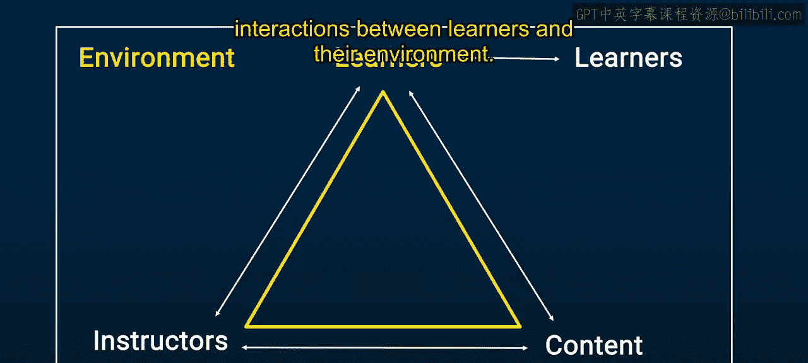
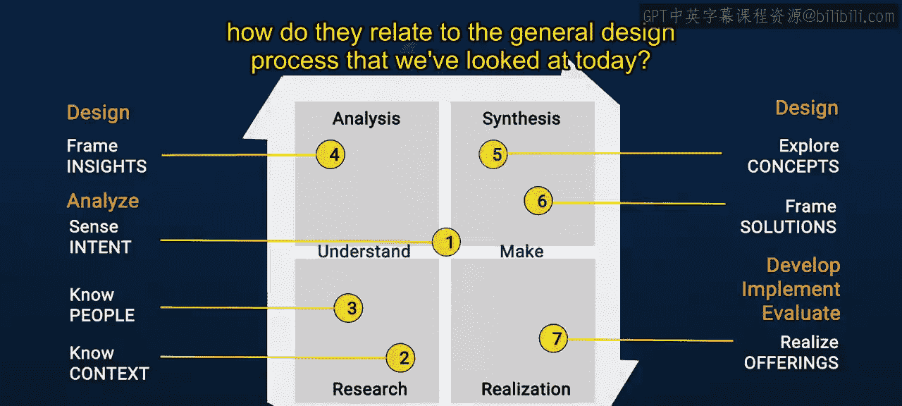
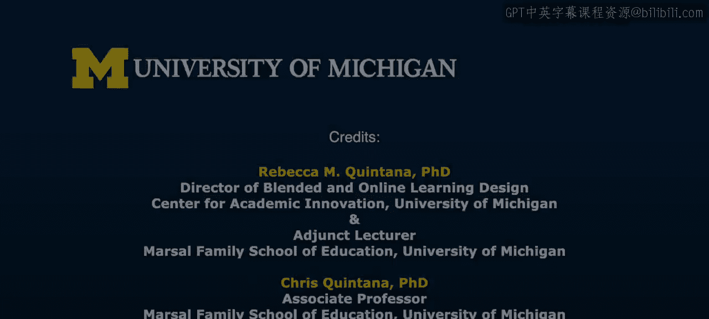

# 密歇根大学《生成式AI作为学习设计伙伴（3课全）｜Generative AI as a Learning Design Partner》中英字 - P2：1_设计流程概述.zh_en - GPT中英字幕课程资源 - BV147xgeaEGJ

Today we're going to take a high level look at the learning design process。

This is meant to be a really quick refresher， so if this is an entirely new topic for you。

 we encourage you to have a look at the resources that we have provided in the introduction to this lesson。

This topic will help prime our thinking for ways that generative AI can work as a learning design partner throughout the design process。

We want to emphasize that we don't adhere to one specific learning design model or framework。

A quick internet search will show you that there are many ways to approach the design of a learning experience。

 and often learning designers will draw on multiple frameworks since each one brings a different area of focus to our designs for learning。

 such as technology integration， or thinking about issues of diversity， equity and inclusion。

One of the better known models is Addie， which stands for analyze， design，Develop。

Implement and evaluate。Other well known learning design frameworks include the7 Cs model。

 the conversational framework， backward design。And universalal Design for learning。

All of these frameworks will help us think about the kinds of interactions we want to foster within the designs for learning that we create。

We have found the instructional triangle to be helpful as we conceptualize how these interactions work together within a learning situation。

Interactions between learners and content interactions between learners and instructors。

Interactions between instructors and content。Interactions between learners and other learners。

And interactions between learners and their environment。

As we'll see， these frameworks touch on the same basic elements of the learning design process。

 even if they do look different from one another。So to illustrate this idea。

 I am going to refer to a representation of a general design process first。

 and then I'll show how the components of the AddI framework map onto it。

This design process diagram originated with Professor Vijy Kumar from the Illinois Institute of Technology。

 who characterized design in seven modes arranged around four quadrants。

Starting with sense intent in the center of the quadrants。

 designers focus on the overarching problem or issue that they're trying to address。

This involves seeing the big picture to be able to articulate how the project or design challenge fits within a broader landscape in which it's situated。

Next， the research quadrant in the bottom left。Allows designers to focus on knowing people and knowing contexts。

Designers can identify audiences and contextual characteristics through a variety of user experience research methods。

Moving to the analysis quadrant， designers take ideas gathered in the research quadrant and translate them into an overall direction for design。

Designers need to be able to assess the resources and constraints present within their design context and to define the parameters that they will operate within。

Next in the synthesisynth quadrant， designers are focused on exploring concepts and framing solutions。

This is where they begin to plan and sketch out personas， scenarios， and plans for their design。

This is where the design comes into sharper focus。And finally， in the realization quadrant。

 designers develop， implement， test， and evaluate the designs that they outlined and planned in the earlier phases of the process。

And just as the representation conveys， the design process is fluid and dynamic。

 Designers could move back and forth between the different tasks within each quadrant。

So let's overlay the AddI learning design framework on this general design process diagram to show how they can interrelate。

And as a thought exercise， you could try this out with a different learning design framework on your own。

So starting with sense intent， learning designers also need to consider what problem or issue they are trying to solve or address。

What are the learning problems or instructional challenges that are being addressed through the design？

The answer to these questions can be described in learning goals or objectives。

An activity that is core to the design process。This relates to the analyzed part of Addie。

Also part of the analyze in AddI is understanding people and understanding context。

 this relates to the research quadrant， where learning designers seek out information about learning characteristics of their learners and contextual factors related to the course。

Once learning outcomes， audience and context have been identified。

 learning designers will turn their attention to what Addie calls design。

 This includes thinking about the core elements of a learning experience。

 such as how learners will be assessed and what the main content and activities will be。😊。

These activities are captured in the analysis quadrant of the design process representation。

Also included in design is sketching， outlining and prototyping。

 these tasks map nicely onto the synthesis quadrant。

 and although the Addie model calls this phase design。

 we can think of the entire activity or enterprise as design。

It's also worth noting that the design tasks associated with AddI span two quadrants。

 so they don't necessarily fit neatly into one quadrant or the other。

The fourth quadrant of the design model realization can encompass the last three phases of the AddI model。

 develop， implement and evaluate。Assessments， activities and content are developed and implemented in a learning environment。

 allowing designers to test， evaluate， and ensure that their designs for learning are functioning as intended。

What learning design frameworks do you draw on in your own work and how do they relate to the general design process that we've looked at today？

I hope you'll give this thought exercise a try。This will help you sharpen your focus on the learning design process。

 which is essential as we consider bringing in AI tools and methods。

