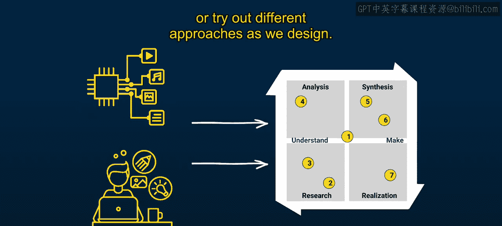
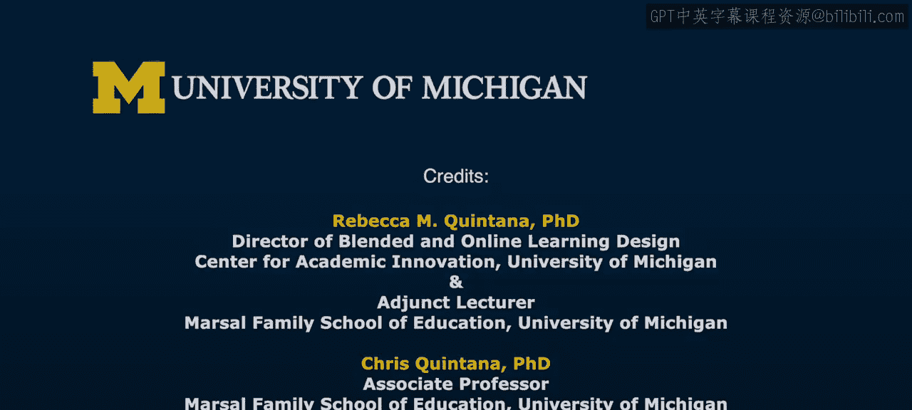

# 密歇根大学《生成式AI作为学习设计伙伴（3课全）｜Generative AI as a Learning Design Partner》中英字 - P3：2_与生成式人工智能的伙伴关系.zh_en - GPT中英字幕课程资源 - BV147xgeaEGJ

As we explore how and why we might use generative AI tools for learning design。

Now is a good time to discuss the mindset we want to adopt for how we use these technologies。

While we've been hearing a lot about JenAI tools and their abilities。

We do need to remember that they are just that。Tools。When we think about tools and how we use them。

 it may seem pretty straightforward。 We use tools to do a task for us and ideally， in a fast。

 efficient manner where we don't always dwell on the results As a simple example。

 if we need some holes in the wall， we just use a drill。 We make the holes and we're done。

Even in the technology space， we can use different kinds of tools to do tasks for us。

 we can use word processors to write text， or we can use calculators or spreadsheets to add up numbers。

We just use these tools to complete the tasks we have in mind and use the results from those tools in some fashion。

But generative AI is an interesting tool category that stems from the idea of it being generative。

Which can help us work and think in different ways。

We can certainly use Gen AI like we did in the examples I just described。

 where we give the tool some input， it could be a question or some other prompt。

 and we just take the information it gives us and we apply that information somewhere。Task complete。

But。😡，As we move into our discussion about using GenAI for learning design。

 we want to think in terms of a different mindset where we use GenAI as a design partner or an intellectual partner。

Using it consistently during the learning design process to help us generate ideas。

Iterate through different design possibilities or try out different approaches as we design。

We do not necessarily just want to ask JenAI to generate complete answers for us that we use as is。

This isn't what we mean by a partnership。Rather， we can think about the specific design task that we are working on and then work with the GenAI to generate initial ideas that we can review like we would a rough draft。

 seeing what we can use， what we can expand on， and what we can delete。

We can see if the GenAI generates new ideas that we hadn't thought of。

And we can see how and if we want to continue expanding on these new ideas。

 even doing so with the tool。We can use additional and revised approaches and prompts to the GenAI to try new design directions and continually expand on ideas through different iterations of the design process。

This idea of consistently working with a tool throughout the activities in the design process and through different iterations of those activities are what we mean by using the technology as a partner。

We're not just taking the results of a GenAI and simply copying and pasting that output as is。Rather。

 we're working with the tool consistently over time to discover new paths， to refine our work。

 and to ensure the quality of the content that we are generating。

This is the mindset we take in our own work and throughout our discussions here。

It is the mindset that we want you to adopt， or we think of output from Gen AI。

 not as the final answers。But as ideas and possibilities that we can revise and reshape throughout our design work。

